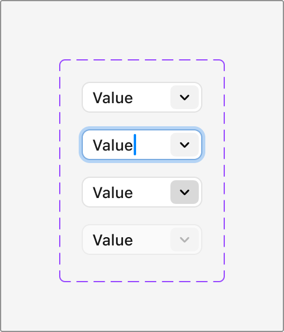
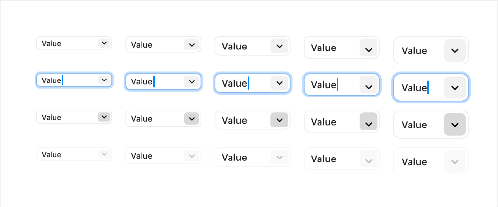

# Apple HIG Combo Boxes System — macOS Admin Specification

> *"A combo box combines a text field with a pull-down button in a single control."*  
> — **Apple Human Interface Guidelines (Combo Boxes)** ([developer.apple.com/design/human-interface-guidelines/combo-boxes](https://developer.apple.com/design/human-interface-guidelines/combo-boxes))

Dokumen ini mendefinisikan standar kontrol **Combo Box** (`NSComboBox` di AppKit macOS), anatomi integrasi teks input bebas (*free-form text input*) dengan tombol menu tarik-turun (*pull-down button*), matriks 4 status interaktif, 5 skala ukuran, serta implementasi komponen CSS/React untuk antarmuka backend/admin MobiCare.

---

## 1. Karakteristik & Filosofi Apple HIG untuk Combo Boxes

Berbeda dengan **Pop-Up Button** (yang hanya mengizinkan pemilihan dari daftar tetap) atau **Text Field** murni (yang menuntut pengetikan manual tanpa bantuan opsi), Combo Box adalah kontrol hibrida khusus desktop macOS:

1. **Fleksibilitas Ganda (*Dual Flexibility*)**:
   - Pengguna dapat mengetikkan nilai kustom secara manual ke dalam bidang teks (*editable text field*).
   - ATAU pengguna dapat mengeklik tombol panah bawah (*pull-down button*) di sisi kanan untuk memilih salah satu opsi nilai yang telah ditentukan sebelumnya (*predefined values*).
2. **Kustom Tidak Merusak Opsi Default**:
   - *"When people enter a custom value, it’s not added to the list of choices."*  
   - Nilai baru yang diketikkan pengguna berlaku untuk input tersebut, namun tidak secara otomatis merusak atau mengubah daftar opsi standar sistem.
3. **Eksklusif macOS Native**:
   - *"Not supported in iOS, iPadOS, tvOS, visionOS, or watchOS."*  
   - Merupakan kontrol khas macOS desktop untuk efisiensi produktivitas profesional dan entri data padat (*high-density administrative workflows*).

---

## 2. Praktik Terbaik Apple HIG (*Best Practices*)

1. **Isi Default yang Bermakna (*Meaningful Default Value*)**:
   - Jangan biarkan kotak kombo kosong secara default jika ada nilai rekomendasi yang relevan.
   - Pilih opsi yang paling sering digunakan sebagai default awal (tidak harus opsi pertama dalam daftar).
2. **Gunakan Label Pengantar (*Introductory Label*)**:
   - Berikan label deskriptif menggunakan gaya kapitalisasi judul (*Title-style Capitalization*) diakhiri dengan titik dua (`:`), misalnya: `Model Perangkat:`, `Masa Garansi:`, `Vendor Suku Cadang:`.
3. **Panjang Karakter Opsi (*Option Truncation Prevention*)**:
   - Pastikan lebar bidang teks cukup untuk menampung teks opsi terpanjang. Hindari pemotongan teks (*truncation*) di dalam kontrol saat opsi dipilih.
4. **Sediakan Opsi yang Paling Relevan (*Relevant Choices*)**:
   - Berikan daftar opsi yang paling mungkin dipilih pengguna untuk mempercepat alur kerja harian tanpa harus mengetik.

---

## 3. Anatomi Visual & 4 Status Interaktif (Ref 24 & 25)



Setiap kontrol Combo Box terdiri dari:
- **Container Luar**: Kotak bersudut melengkung halus (*squircle radius*), background putih elevasi, dan border halus dengan drop shadow lembut.
- **Text Field (Kiri)**: Area teks input editable dengan padding teks yang nyaman.
- **Pull-Down Button (Kanan)**: Kapsul tombol mini dengan ikon panah bawah (*chevron down* `⌄`).

### Matriks 4 Status Interaksi:

| Status | Tampilan Kontainer Luar | Tampilan Tombol Pull-Down (Kanan) | Indikator Teks / Kursor |
| :--- | :--- | :--- | :--- |
| **1. Default (Resting)** | Background putih `#FFFFFF`, border halus `rgba(0,0,0,0.12)`, shadow lembut `0 1px 2px rgba(0,0,0,0.06)`. | Kapsul abu-abu ultra-halus `rgba(0,0,0,0.04)`. Ikon chevron `#1D1D1F`. | Teks nilai standar warna primer (`labelColor`). |
| **2. Focused (Editing)** | Dikelilingi **Apple Focus Ring** biru sistem: `box-shadow: 0 0 0 3px rgba(0, 122, 255, 0.38)`. Border berubah menjadi `#007AFF`. | Kapsul abu-abu halus tetap netral. | Garis kursor vertikal berkedip warna biru solid `#007AFF` (`caret-color: #007AFF`). |
| **3. Pressed (Menu Open)** | Border tetap tenang atau semi-aktif. | Kapsul tombol berubah lebih gelap: solid `rgba(0,0,0,0.16)` atau `#D1D1D6` menandakan menu sedang terbuka. | Menu popover dropdown opsi muncul tepat di bawah kontainer. |
| **4. Disabled** | Opasitas keseluruhan `0.45` s.d. `0.50`, border sangat redup `rgba(0,0,0,0.06)`, `cursor: not-allowed`. | Kapsul tombol dan ikon chevron memudar ke warna `tertiaryLabel` (`rgba(0,0,0,0.20)`). | Teks memudar ke abu-abu redup, input terkunci `readonly`. |

---

## 4. Matriks 5 Skala Ukuran (Ref 25)



| Ukuran | Tinggi (*Height*) | Font Size | Radius Sudut | Padding Teks | Lebar Tombol Chevron | Rekomendasi Penggunaan di MobiCare |
| :--- | :--- | :--- | :--- | :--- | :--- | :--- |
| **Mini** | `20px` | `11px` | `4px` | `0 6px` | `16px` | Inline table cell filter, compact toolbar pagination. |
| **Small** | `24px` | `12px` | `5px` | `0 8px` | `20px` | Secondary inspector sidebar, modal utility toolbar. |
| **Regular (Default)** | **`28px`** | **`13px`** | **`6px`** | **`0 10px`** | **`24px`** | **Standar utama formulir admin MobiCare (macOS standard body).** |
| **Large** | `34px` | `14px` | `8px` | `0 12px` | `28px` | Modal dialog formulir utama (Work Order entry, Price Editor). |
| **Extra Large** | `40px` | `15px` | `10px` | `0 14px` | `32px` | Header search filter global, standalone hero search. |

---

## 5. Penerapan Nyata di Backend Admin MobiCare

| Lokasi Halaman | Kebutuhan Entri Data | Mengapa Menggunakan Combo Box? |
| :--- | :--- | :--- |
| **`/admin/pricelist`** (Katalog Servis) | **Model Perangkat** | Admin dapat memilih seri populer dari daftar (*iPhone 15 Pro, Samsung S24, MacBook Air M3*) ATAU mengetikkan tipe langka/lama yang belum ada di database (*misal: iPad Air 2 2014*). |
| **`/admin/garansi`** (Klaim Garansi) | **Durasi Garansi Servis** | Pilihan standar cepat (*30 Hari, 90 Hari, 180 Hari*) ATAU input custom garansi khusus negosiasi (*misal: 45 Hari*). |
| **`/admin/teknisi`** (Work Order) | **Vendor / Sub-kontraktor** | Memilih teknisi in-house utama dari pull-down ATAU mengetikkan nama teknisi pihak ketiga / vendor rekanan spesialis chip. |
| **`AdminDataTable` Filter Toolbar** | **Filter Kolom Cepat** | Mengetik kata kunci pencarian ATAU mengeklik chevron untuk memilih status filter populer (*Semua Status, Sedang Dikerjakan, Menunggu Part, Siap Diambil*). |

---

## 6. Implementasi CSS Utility (`.mac-combobox`)

```css
/* ==========================================================================
   Apple HIG macOS Native Combo Box Component
   ========================================================================== */

.mac-combobox-wrapper {
  position: relative;
  display: inline-flex;
  align-items: center;
  width: 100%;
}

.mac-combobox {
  position: relative;
  display: flex;
  align-items: center;
  width: 100%;
  height: 28px; /* Standar Regular macOS */
  padding: 0 4px 0 10px;
  background: #ffffff;
  border: 1px solid rgba(0, 0, 0, 0.12);
  border-radius: 6px;
  box-shadow: 0 1px 2px rgba(0, 0, 0, 0.05);
  font-family: -apple-system, BlinkMacSystemFont, "SF Pro Text", "Helvetica Neue", sans-serif;
  font-size: 13px;
  color: #1d1d1f;
  transition: border-color 0.15s ease, box-shadow 0.15s ease;
}

/* Skala Ukuran */
.mac-combobox-mini {
  height: 20px;
  padding: 0 3px 0 6px;
  font-size: 11px;
  border-radius: 4px;
}
.mac-combobox-small {
  height: 24px;
  padding: 0 3px 0 8px;
  font-size: 12px;
  border-radius: 5px;
}
.mac-combobox-large {
  height: 34px;
  padding: 0 5px 0 12px;
  font-size: 14px;
  border-radius: 8px;
}
.mac-combobox-xlarge {
  height: 40px;
  padding: 0 6px 0 14px;
  font-size: 15px;
  border-radius: 10px;
}

/* Input Teks Editable */
.mac-combobox input.mac-combobox-input {
  flex: 1;
  min-width: 0;
  border: none;
  background: transparent;
  outline: none;
  font-family: inherit;
  font-size: inherit;
  color: inherit;
  caret-color: #007aff;
  padding: 0;
}

.mac-combobox input.mac-combobox-input::placeholder {
  color: rgba(0, 0, 0, 0.35);
}

/* Pull-Down Button Kanan */
.mac-combobox-btn {
  display: flex;
  align-items: center;
  justify-content: center;
  width: 20px;
  height: 20px;
  margin-left: 4px;
  background: rgba(0, 0, 0, 0.04);
  border: none;
  border-radius: 4px;
  color: #1d1d1f;
  cursor: pointer;
  transition: background-color 0.12s ease;
  user-select: none;
}

.mac-combobox-mini .mac-combobox-btn { width: 14px; height: 14px; border-radius: 3px; }
.mac-combobox-small .mac-combobox-btn { width: 18px; height: 18px; border-radius: 3px; }
.mac-combobox-large .mac-combobox-btn { width: 24px; height: 24px; border-radius: 5px; }
.mac-combobox-xlarge .mac-combobox-btn { width: 28px; height: 28px; border-radius: 6px; }

.mac-combobox-btn:hover {
  background: rgba(0, 0, 0, 0.08);
}

.mac-combobox-btn:active,
.mac-combobox.is-menu-open .mac-combobox-btn {
  background: rgba(0, 0, 0, 0.16);
}

/* Focus State dengan Apple Blue Focus Ring */
.mac-combobox:focus-within {
  border-color: #007aff;
  box-shadow: 0 0 0 3px rgba(0, 122, 255, 0.38);
}

/* Disabled State */
.mac-combobox.is-disabled {
  opacity: 0.48;
  cursor: not-allowed;
  background: rgba(0, 0, 0, 0.03);
  box-shadow: none;
}
.mac-combobox.is-disabled input,
.mac-combobox.is-disabled button {
  pointer-events: none;
}

/* Dark Mode Adaptation */
@media (prefers-color-scheme: dark) {
  .mac-combobox {
    background: rgba(255, 255, 255, 0.08);
    border-color: rgba(255, 255, 255, 0.14);
    color: #f5f5f7;
    box-shadow: 0 1px 2px rgba(0, 0, 0, 0.4);
  }
  .mac-combobox input.mac-combobox-input::placeholder {
    color: rgba(255, 255, 255, 0.3);
  }
  .mac-combobox-btn {
    background: rgba(255, 255, 255, 0.1);
    color: #f5f5f7;
  }
  .mac-combobox-btn:hover {
    background: rgba(255, 255, 255, 0.16);
  }
  .mac-combobox-btn:active,
  .mac-combobox.is-menu-open .mac-combobox-btn {
    background: rgba(255, 255, 255, 0.24);
  }
  .mac-combobox:focus-within {
    border-color: #0a84ff;
    box-shadow: 0 0 0 3px rgba(10, 132, 255, 0.4);
  }
  .mac-combobox.is-disabled {
    background: rgba(255, 255, 255, 0.03);
    border-color: rgba(255, 255, 255, 0.06);
  }
}
```
