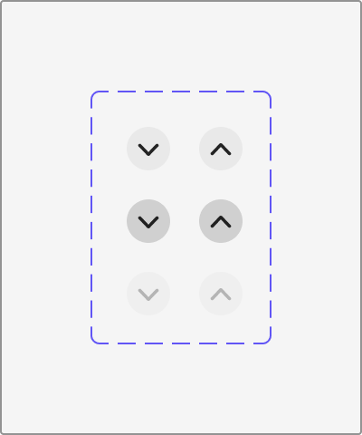
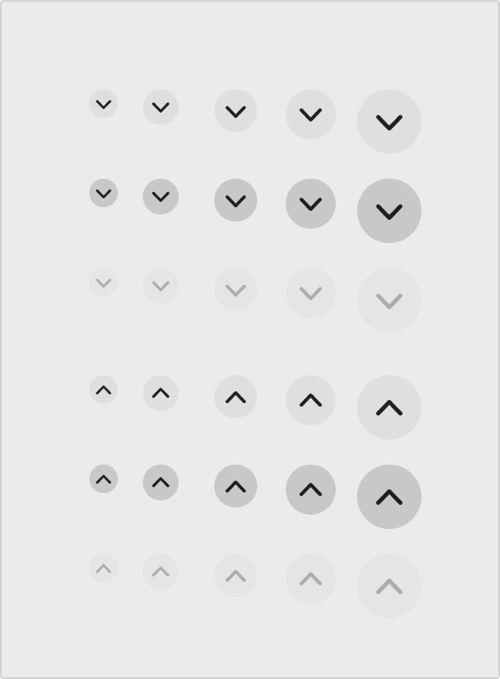

# Apple HIG Disclosure Controls System — macOS Admin Specification

> *"Disclosure controls reveal and hide information and functionality related to specific controls or views."*  
> — **Apple Human Interface Guidelines (Disclosure Controls)** ([developer.apple.com/design/human-interface-guidelines/disclosure-controls](https://developer.apple.com/design/human-interface-guidelines/disclosure-controls))

Dokumen ini mendefinisikan standar kontrol pengungkapan bertahap (*Progressive Disclosure Controls*), perbedaan mendasar antara **Disclosure Triangles** vs **Disclosure Buttons**, orientasi panah chevron (bawah untuk membuka vs atas untuk menutup), aturan ketat *"Maksimal Satu Tombol per View"*, serta penerapannya pada backend/admin MobiCare.

---

## 1. Karakteristik & Filosofi Apple HIG untuk Disclosure Controls

Prinsip utama Apple dalam mengelola informasi padat adalah **Progressive Disclosure**:
1. **Sembunyikan Detail Hingga Dibutuhkan (*Hide Details Until Relevant*)**:
   - *"Place controls that people are most likely to use at the top of the disclosure hierarchy so they’re always visible, with more advanced functionality hidden by default."*
   - Letakkan opsi utama yang paling sering dipakai di level teratas agar selalu terlihat. Opsi tingkat lanjut (*advanced options*) disembunyikan secara default agar tidak membebani pengguna dengan kelebihan kognitif (*cognitive overload*).
2. **Dua Jenis Kontrol Pengungkapan di macOS**:
   - **Disclosure Triangles (`NSButton.BezelStyle.disclosure`)**:
     - Berbentuk segitiga kecil tanpa latar tombol (polos).
     - Digunakan untuk hierarki pohon, navigasi folder peramban (Finder list view), atau daftar berjenjang.
     - Mengarah ke kanan/ke dalam (`▶`) saat tertutup (*collapsed*), dan mengarah ke bawah (`▼`) saat terbuka (*expanded*).
   - **Disclosure Buttons (`NSButton.BezelStyle.pushDisclosure`) (Ref 27 & 28)**:
     - Berbentuk tombol lingkaran (*circular push button*) dengan ikon panah chevron di dalamnya.
     - Terikat langsung dengan suatu kontrol atau formulir tertentu (misal: tombol ekspansi di samping field lokasi pada Save Dialog).
     - Mengarah ke **Bawah (`⌄`)** saat konten tersembunyi (klik untuk membuka ke bawah).
     - Mengarah ke **Atas (`⌃`)** saat konten terbuka (klik untuk menutup kembali ke atas).
3. **Aturan Emas Apple: Maksimal 1 Disclosure Button per View**:
   - *"Use no more than one disclosure button in a single view. Multiple disclosure buttons add complexity and can be confusing."*
   - Dilarang menempatkan banyak Disclosure Button dalam satu formulir/dialog karena membingungkan arah ekspansi layout.

---

## 2. Anatomi Status & Matriks Skala Ukuran (Ref 27 & 28)



### Matriks 3 Status Interaksi:

| Status | Tampilan Lingkaran Latar Belakang | Ikon Chevron (`⌄` / `⌃`) | Perilaku Interaktif |
| :--- | :--- | :--- | :--- |
| **1. Default (Resting)** | Abu-abu ultra-halus `rgba(0, 0, 0, 0.05)` (Light) / `rgba(255, 255, 255, 0.08)` (Dark). | Hitam solid `#1D1D1F` (Light) / `#F5F5F7` (Dark), tebal garis proporsional. | Kursor pointer, siap diklik. |
| **2. Pressed (Active)** | Abu-abu solid lebih gelap `rgba(0, 0, 0, 0.16)` atau `#D1D1D6` (Light) / `rgba(255, 255, 255, 0.20)` (Dark). | Bergeser mikro saat ditekan (`transform: scale(0.96)`). | Umpan balik klik langsung pada `pointer-down`. |
| **3. Disabled** | Sangat pudar `rgba(0, 0, 0, 0.02)` atau transparan. | Abu-abu redup `rgba(0, 0, 0, 0.20)` (*tertiary label*). | Non-interaktif, `cursor: not-allowed; opacity: 0.45;`. |

---

### Matriks 5 Skala Ukuran (Ref 28)



| Ukuran | Diameter Lingkaran | Ukuran Ikon Chevron | Ketebalan Garis (*Stroke*) | Rekomendasi Penggunaan di MobiCare |
| :--- | :--- | :--- | :--- | :--- |
| **Mini** | `18px` | `10px` | `1.5px` | Baris tabel data padat, sub-item tree list view. |
| **Small** | `22px` | `12px` | `1.75px` | Field formulir sekunder, compact save dialog. |
| **Regular (Default)** | **`26px`** | **`14px`** | **`2.0px`** | **Standar Save Dialog & Formulir Utama Admin MobiCare.** |
| **Large** | `32px` | `16px` | `2.25px` | Header accordion section, setting card utama. |
| **Extra Large** | `40px` | `20px` | `2.5px` | Hero collapsible panel, full-page onboarding guide. |

---

## 3. Penerapan Nyata di Backend Admin MobiCare

| Lokasi Halaman | Komponen | Jenis Kontrol | Fungsi Pengungkapan Bertahap |
| :--- | :--- | :--- | :--- |
| **`/admin/pricelist`** | **Pohon Kategori Servis** | **Disclosure Triangle (`▶` / `▼`)** | Menampilkan atau menyembunyikan varian tipe HP (*Apple > iPhone 15 > LCD / Baterai*) secara berjenjang tanpa memuat seluruh baris sekaligus. |
| **`/admin/pricelist`** | **Breakdown Harga Suku Cadang** | **Disclosure Button (`⌄` / `⌃`)** | Tombol lingkaran 26px di sebelah harga jual total untuk membuka rincian kalkulasi: Modal Part + Ongkos Teknisi + Profit Margin + PPN. |
| **`ExportModal.tsx`** | **Save As Location Expander** | **Disclosure Button (`⌄` / `⌃`)** | Mengubah Compact Save Sheet menjadi Full Finder Browser Sheet (Ref 26) saat admin ingin memilih folder penyimpanan khusus. |
| **`/admin/promo`** | **Opsi Penjadwalan Lanjutan** | **Disclosure Button (`⌄` / `⌃`)** | Menyembunyikan pengaturan kompleks (kuota harian per user, jam aktif promo) agar formulir promo tetap ringkas bagi admin toko. |
| **`AdminDataTable`** | **Detail Baris Cepat (*Row Drawer*)** | **Disclosure Triangle (`▶` / `▼`)** | Membuka riwayat perbaikan & catatan IMEI perangkat langsung di bawah baris tabel transaksi servis. |

---

## 4. Implementasi CSS Utility (`.mac-disclosure-btn` & `.mac-disclosure-triangle`)

```css
/* ==========================================================================
   Apple HIG macOS Native Disclosure Controls
   ========================================================================== */

/* 1. DISCLOSURE BUTTON (Tombol Lingkaran Push Disclosure) */
.mac-disclosure-btn {
  display: inline-flex;
  align-items: center;
  justify-content: center;
  width: 26px; /* Standar Regular macOS */
  height: 26px;
  border-radius: 50%;
  background: rgba(0, 0, 0, 0.05);
  border: none;
  color: #1d1d1f;
  cursor: pointer;
  padding: 0;
  transition: background-color 0.12s ease, transform 0.08s ease, color 0.12s ease;
  user-select: none;
}

/* Skala Ukuran Tombol Lingkaran */
.mac-disclosure-btn-mini   { width: 18px; height: 18px; font-size: 10px; }
.mac-disclosure-btn-small  { width: 22px; height: 22px; font-size: 12px; }
.mac-disclosure-btn-large  { width: 32px; height: 32px; font-size: 16px; }
.mac-disclosure-btn-xlarge { width: 40px; height: 40px; font-size: 20px; }

/* Status Hover & Pressed */
.mac-disclosure-btn:hover {
  background: rgba(0, 0, 0, 0.09);
}

.mac-disclosure-btn:active {
  background: rgba(0, 0, 0, 0.18);
  transform: scale(0.96);
}

/* Status Disabled */
.mac-disclosure-btn:disabled,
.mac-disclosure-btn.is-disabled {
  opacity: 0.45;
  cursor: not-allowed;
  pointer-events: none;
  background: rgba(0, 0, 0, 0.02);
  color: rgba(0, 0, 0, 0.20);
}

/* Ikon Chevron dengan Rotasi Fluid */
.mac-disclosure-btn svg {
  transition: transform 0.2s cubic-bezier(0.16, 1, 0.3, 1);
}

/* Ketika status Terbuka (Expanded), chevron berotasi ke atas */
.mac-disclosure-btn.is-expanded svg {
  transform: rotate(180deg);
}

/* 2. DISCLOSURE TRIANGLE (Segitiga Hirarki Pohon / Tabel Data) */
.mac-disclosure-triangle {
  display: inline-flex;
  align-items: center;
  justify-content: center;
  width: 14px;
  height: 14px;
  background: transparent;
  border: none;
  color: rgba(0, 0, 0, 0.55);
  cursor: pointer;
  padding: 0;
  transition: color 0.12s ease, transform 0.18s cubic-bezier(0.16, 1, 0.3, 1);
}

.mac-disclosure-triangle:hover {
  color: #1d1d1f;
}

.mac-disclosure-triangle.is-expanded {
  transform: rotate(90deg);
  color: #007aff; /* Aksen biru aktif saat cabang terbuka */
}

/* Dark Mode Adaptation */
@media (prefers-color-scheme: dark) {
  .mac-disclosure-btn {
    background: rgba(255, 255, 255, 0.08);
    color: #f5f5f7;
  }
  .mac-disclosure-btn:hover {
    background: rgba(255, 255, 255, 0.14);
  }
  .mac-disclosure-btn:active {
    background: rgba(255, 255, 255, 0.22);
  }
  .mac-disclosure-btn:disabled,
  .mac-disclosure-btn.is-disabled {
    background: rgba(255, 255, 255, 0.02);
    color: rgba(255, 255, 255, 0.20);
  }
  .mac-disclosure-triangle {
    color: rgba(255, 255, 255, 0.55);
  }
  .mac-disclosure-triangle:hover {
    color: #f5f5f7;
  }
  .mac-disclosure-triangle.is-expanded {
    color: #0a84ff;
  }
}
```
