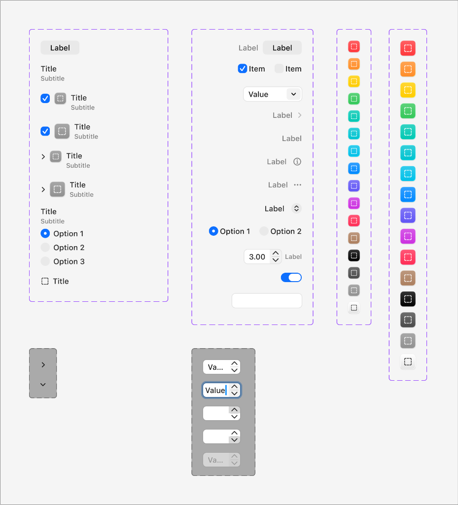

# Apple HIG Forms & Settings Controls System — macOS Admin Specification

> *"In macOS, forms and settings create visually distinct groups of logically related information and interactive controls, allowing people to efficiently view, configure, and modify system and application parameters."*  
> — **Apple Human Interface Guidelines & macOS Tahoe Design Resources (Forms & Settings Controls)**

Dokumen ini mendefinisikan arsitektur formulir macOS (*Form Layout & Control Ecosystem*), anatomi kartu grup (*grouped settings cards*), sistem badge ikon warna sistem Apple (*system palette leading icon squircles*), serta integrasi lengkap kontrol formulir: Checkboxes, Radio Groups, Stepper Numbers, Pop-Up Buttons, Toggle Switches, dan Text Fields untuk backend/admin MobiCare.

---

## 1. Prinsip Utama Apple HIG untuk Formulir & Pengaturan (*Forms & Settings*)

1. **Pengelompokan Logis & Hirarki Visual (Ref 29 - Kolom 1 & 2)**:
   - Formulir di macOS tidak dibuat sebagai rentetan input vertikal tanpa batas. Seluruh kontrol dikelompokkan ke dalam kartu grup beradius 12px (`.mac-box`) dengan latar belakang ultra-halus (*subtle background wash*).
   - Setiap grup memiliki judul bagian (*Section Title*, tebal 13pt) dan sub-judul (*Subtitle*, reguler 11pt–12pt) jika memerlukan penjelasan konteks.
2. **Kesesuaian Tipe Kontrol dengan Peruntukan**:
   - **Checkboxes (`☑` / `☐`)**: Untuk pilihan independen di mana satu atau beberapa opsi dapat diaktifkan secara bersamaan (misal: fitur garansi tambahan, notifikasi WhatsApp).
   - **Radio Buttons (`◉` / `○`)**: Khusus untuk pilihan timbal-balik eksklusif (*mutually exclusive*) di mana hanya satu opsi yang dapat dipilih dari 2–4 opsi (misal: Metode Pembayaran: Tunai, QRIS, Transfer Bank).
   - **Toggle Switches**: Untuk mengaktifkan atau menonaktifkan status fitur sistem seketika (*instant state toggle*, misal: Status Aktif Promo, Mode Maintenance).
   - **Numeric Stepper Field (`[ 3.00 ] ⇅`)**: Menggabungkan input angka langsung dengan tombol panah naik/turun presisi (misal: persentase diskon promo, durasi estimasi pengerjaan servis dalam jam).
   - **Pop-Up Buttons (`Value ⇅` / `Value ⌄`)**: Menampilkan menu pull-down pilihan dari daftar tetap (misal: Kategori Servis: LCD, Baterai, Mesin).
   - **Navigational Rows (`Label ›`)**: Baris formulir yang membuka dialog lembar sheet lanjutan atau modal detail.
3. **Sistem Badge Ikon Warna Sistem (*Leading Icon Squircles*) (Ref 29 - Kolom 3 & 4)**:
   - Di sisi kiri setiap baris pengaturan utama terdapat ikon squircle 28px–32px berlatar belakang warna sistem Apple terkalibrasi (*systemRed, systemOrange, systemGreen, systemBlue, systemPurple, dll.*) dengan ikon putih di dalamnya.
   - Memberikan penanda visual instan (*glanceability*) agar admin dapat mengenali jenis pengaturan dalam sekejap tanpa harus membaca teks terlebih dahulu.

---

## 2. Anatomi Komponen Formulir Lengkap (Ref 29)



### Matriks Kontrol Formulir macOS:

| Jenis Kontrol | Visual Default (Light) | Visual Aktif / Focused / Checked | Penggunaan di Admin MobiCare |
| :--- | :--- | :--- | :--- |
| **Checkbox** | Kotak 14px rounded (radius 3.5px), border `rgba(0,0,0,0.2)`. | Isian biru solid `#007AFF` dengan tanda centang putih murni (`☑`). | Pilihan checklist inspeksi QC servis, suku cadang tambahan. |
| **Radio Button** | Lingkaran 14px, border `rgba(0,0,0,0.25)`. | Isian biru solid `#007AFF` dengan titik putih di pusat (`◉`). | Pilihan metode perbaikan (Reguler, Express, Sameday). |
| **Toggle Switch** | Kapsul 38px x 22px abu-abu netral, knob putih di kiri. | Kapsul hijau/biru solid `#34C759` atau `#007AFF`, knob putih meluncur ke kanan. | Status tayang promo di website, status ketersediaan suku cadang. |
| **Numeric Stepper** | Field 26px dengan tombol ⇅ di sisi kanan input. | Focus ring biru di kontainer, angka tabular (`tnum`). | Input nominal diskon %, estimasi waktu servis (jam), kuota promo. |
| **Pop-Up Menu** | Kotak field 28px dengan panah ganda ⇅ di kanan. | Menu dropdown muncul tepat di bawah field. | Pilihan kategori perangkat (iPhone, iPad, MacBook, Android). |
| **Row Disclosure (`›`)** | Teks label di kiri + chevron kanan abu-abu halus di kanan. | Baris merespons klik dengan membuka lembar sheet/modal. | Menuju pengaturan garansi lanjutan, detail log riwayat servis. |
| **Info / Help (`ⓘ`)** | Ikon lingkaran `i` halus di ujung kanan label. | Menampilkan tooltip popover penjelasan kebijakan. | Penjelasan syarat & ketentuan diskon promo. |
| **Action More (`⋯`)** | Ikon tiga titik elipsis di ujung kanan baris. | Menampilkan context menu opsi cepat (Duplikasi, Hapus, Nonaktifkan). | Aksi cepat baris tabel data tanpa membuka form edit. |

---

## 3. Matriks 13 Warna Sistem Badge Ikon Formulir (*Settings Icon Squircles*)

Sesuai Ref 29 (Kolom 3 & 4), badge ikon di sisi kiri baris formulir menggunakan squircle radius 6px–7px dengan palet resmi Apple:

| Nama Warna Sistem | Nilai Hex (Light) | Nilai Hex (Dark) | Rekomendasi Pemetaan di Admin MobiCare |
| :--- | :--- | :--- | :--- |
| **systemRed** | `#FF3B30` | `#FF453A` | Pengaturan Hapus Akun, Peringatan Kritis, Klaim Garansi Batal. |
| **systemOrange**| `#FF9500` | `#FF9F0A` | Perbaikan Tertunda, Menunggu Sparepart, Servis Prioritas Express. |
| **systemYellow**| `#FFCC00` | `#FFD60A` | Peringatan Stok Minimum, Promo Segera Berakhir. |
| **systemGreen** | `#34C759` | `#30D158` | Servis Selesai, Promo Aktif, Pembayaran Berhasil. |
| **systemMint**  | `#00C7BE` | `#63E6E2` | Uji Coba Fungsi Perangkat, Checklist QC Masuk. |
| **systemTeal**  | `#30B0C7` | `#40C8E0` | Modul Diagnosis Hardware, Pemindaian IMEI. |
| **systemCyan**  | `#32ADE6` | `#64D2FF` | Konfigurasi Jaringan & Konektivitas, WiFi/Bluetooth Test. |
| **systemBlue**  | `#007AFF` | `#0A84FF` | Profil Toko, Katalog Harga Utama (`/admin/pricelist`), Pengaturan Global. |
| **systemIndigo**| `#5856D6` | `#5E5CE6` | Laporan Keuangan, Rekapitulasi Pendapatan, Statistik Kasir. |
| **systemPurple**| `#AF52DE` | `#BF5AF2` | Manajemen Penawaran Promo Spesial (`/admin/promo`), Voucher. |
| **systemPink**  | `#FF2D55` | `#FF375F` | Ulasan Pelanggan, Rating Layanan Kepuasan. |
| **systemBrown** | `#A2845E` | `#AC8E68` | Log Akses Teknisi, Arsip Lama, Dokumen Riwayat Servis. |
| **systemGray**  | `#8E8E93` | `#98989D` | Pengaturan Umum, Info Versi Sistem, Panduan Bantuan. |

---

## 4. Penerapan Nyata di Backend Admin MobiCare

### A. Formulir Editor Katalog Layanan (`ServiceEditor.tsx` / `/admin/pricelist`)
- **Group 1: Informasi Dasar**:
  - Badge Ikon: `systemBlue` (ikon obeng/kunci pas).
  - Field: Teks Model Perangkat (`Combo Box`), Kategori Servis (`Pop-Up Menu ⇅`), Status Ketersediaan (`Toggle Switch`).
- **Group 2: Kalkulasi Harga & Estimasi**:
  - Badge Ikon: `systemIndigo` (ikon tag harga).
  - Field: Harga Jual (`Input Teks`), Biaya Modal (`Input Teks`), Estimasi Waktu Pengerjaan (`Numeric Stepper [ 2.00 ] ⇅ Jam`).
- **Group 3: Garansi & Kebijakan**:
  - Badge Ikon: `systemGreen` (ikon perisai garansi).
  - Field: Durasi Garansi (`Combo Box: 90 Hari`), Syarat Garansi (`Row Disclosure ›` membuka modal rincian).

### B. Formulir Editor Promo Spesial (`PromoEditor.tsx` / `/admin/promo`)
- **Group 1: Status & Masa Berlaku**:
  - Badge Ikon: `systemPurple` (ikon diskon/bintang).
  - Field: Judul Promo, Status Aktif (`Toggle Switch`), Masa Berlaku Mulai & Selesai.
- **Group 2: Tampilan Badge & Visual**:
  - Badge Ikon: `systemTeal` (ikon palet kuas).
  - Field: Warna Badge Promo (`Color Well` cakram spektrum pelangi), Label Promo.

---

## 5. Implementasi CSS Utility Formulir macOS (`.mac-form-*`)

```css
/* ==========================================================================
   Apple HIG macOS Native Form & Settings Controls
   ========================================================================== */

/* 1. Baris Formulir Standar macOS */
.mac-form-row {
  display: flex;
  align-items: center;
  justify-content: space-between;
  min-height: 38px;
  padding: 6px 12px;
  border-bottom: 1px solid rgba(0, 0, 0, 0.05);
}

.mac-form-row:last-child {
  border-bottom: none;
}

/* 2. Badge Ikon Kiri (28px Squircle) */
.mac-icon-badge {
  display: inline-flex;
  align-items: center;
  justify-content: center;
  width: 28px;
  height: 28px;
  border-radius: 7px;
  color: #ffffff;
  margin-right: 12px;
  flex-shrink: 0;
  box-shadow: 0 1px 2px rgba(0, 0, 0, 0.1);
}

.mac-icon-badge-red    { background: #ff3b30; }
.mac-icon-badge-orange { background: #ff9500; }
.mac-icon-badge-yellow { background: #ffcc00; color: #000000; }
.mac-icon-badge-green  { background: #34c759; }
.mac-icon-badge-mint   { background: #00c7be; }
.mac-icon-badge-teal   { background: #30b0c7; }
.mac-icon-badge-cyan   { background: #32ade6; }
.mac-icon-badge-blue   { background: #007aff; }
.mac-icon-badge-indigo { background: #5856d6; }
.mac-icon-badge-purple { background: #af52de; }
.mac-icon-badge-pink   { background: #ff2d55; }
.mac-icon-badge-brown  { background: #a2845e; }
.mac-icon-badge-gray   { background: #8e8e93; }

/* 3. Checkbox macOS Native */
.mac-checkbox {
  appearance: none;
  width: 14px;
  height: 14px;
  border: 1px solid rgba(0, 0, 0, 0.25);
  border-radius: 3.5px;
  background: #ffffff;
  cursor: pointer;
  display: inline-grid;
  place-content: center;
  transition: background-color 0.12s ease, border-color 0.12s ease;
}

.mac-checkbox:checked {
  background: #007aff;
  border-color: #007aff;
}

.mac-checkbox:checked::before {
  content: "";
  width: 8px;
  height: 4px;
  border-left: 1.75px solid #ffffff;
  border-bottom: 1.75px solid #ffffff;
  transform: rotate(-45deg) translate(0.5px, -0.5px);
}

/* 4. Radio Button macOS Native */
.mac-radio {
  appearance: none;
  width: 14px;
  height: 14px;
  border: 1px solid rgba(0, 0, 0, 0.3);
  border-radius: 50%;
  background: #ffffff;
  cursor: pointer;
  display: inline-grid;
  place-content: center;
  transition: background-color 0.12s ease, border-color 0.12s ease;
}

.mac-radio:checked {
  border-color: #007aff;
  background: #007aff;
}

.mac-radio:checked::before {
  content: "";
  width: 5px;
  height: 5px;
  border-radius: 50%;
  background: #ffffff;
}

/* 5. Numeric Stepper macOS Native */
.mac-stepper-field {
  display: inline-flex;
  align-items: center;
  height: 26px;
  background: #ffffff;
  border: 1px solid rgba(0, 0, 0, 0.15);
  border-radius: 6px;
  padding: 0 4px;
  box-shadow: 0 1px 2px rgba(0, 0, 0, 0.05);
}

.mac-stepper-input {
  width: 56px;
  border: none;
  outline: none;
  text-align: right;
  font-family: inherit;
  font-size: 13px;
  font-variant-numeric: tabular-nums;
  color: #1d1d1f;
  padding-right: 4px;
}

.mac-stepper-controls {
  display: flex;
  flex-direction: column;
  margin-left: 2px;
}

.mac-stepper-btn {
  display: flex;
  align-items: center;
  justify-content: center;
  width: 14px;
  height: 10px;
  background: transparent;
  border: none;
  cursor: pointer;
  color: rgba(0, 0, 0, 0.6);
  padding: 0;
}

.mac-stepper-btn:hover {
  color: #007aff;
}

/* 6. Toggle Switch macOS Native */
.mac-switch {
  position: relative;
  display: inline-block;
  width: 38px;
  height: 22px;
  flex-shrink: 0;
}

.mac-switch input {
  opacity: 0;
  width: 0;
  height: 0;
}

.mac-switch-slider {
  position: absolute;
  cursor: pointer;
  inset: 0;
  background-color: rgba(0, 0, 0, 0.16);
  transition: 0.2s cubic-bezier(0.16, 1, 0.3, 1);
  border-radius: 9999px;
}

.mac-switch-slider::before {
  position: absolute;
  content: "";
  height: 18px;
  width: 18px;
  left: 2px;
  bottom: 2px;
  background-color: #ffffff;
  border-radius: 50%;
  box-shadow: 0 1px 3px rgba(0, 0, 0, 0.25);
  transition: 0.2s cubic-bezier(0.16, 1, 0.3, 1);
}

.mac-switch input:checked + .mac-switch-slider {
  background-color: #34c759; /* Apple System Green */
}

.mac-switch input:checked + .mac-switch-slider::before {
  transform: translateX(16px);
}

/* Dark Mode Adaptation */
@media (prefers-color-scheme: dark) {
  .mac-form-row {
    border-bottom-color: rgba(255, 255, 255, 0.06);
  }
  .mac-checkbox {
    background: rgba(255, 255, 255, 0.1);
    border-color: rgba(255, 255, 255, 0.25);
  }
  .mac-checkbox:checked {
    background: #0a84ff;
    border-color: #0a84ff;
  }
  .mac-radio {
    background: rgba(255, 255, 255, 0.1);
    border-color: rgba(255, 255, 255, 0.3);
  }
  .mac-radio:checked {
    background: #0a84ff;
    border-color: #0a84ff;
  }
  .mac-stepper-field {
    background: rgba(255, 255, 255, 0.08);
    border-color: rgba(255, 255, 255, 0.15);
  }
  .mac-stepper-input {
    color: #f5f5f7;
    background: transparent;
  }
  .mac-stepper-btn {
    color: rgba(255, 255, 255, 0.6);
  }
  .mac-switch-slider {
    background-color: rgba(255, 255, 255, 0.18);
  }
  .mac-switch input:checked + .mac-switch-slider {
    background-color: #30d158;
  }
}
```
