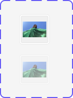

# Apple HIG Image Wells System — macOS Admin Specification

> *"An image well is an editable version of an image view. After selecting an image well, people can copy and paste its image or delete it. People can also drag a new image into an image well without selecting it first."*  
> — **Apple Human Interface Guidelines (Image Wells)** ([developer.apple.com/design/human-interface-guidelines/image-wells](https://developer.apple.com/design/human-interface-guidelines/image-wells))

Dokumen ini mendefinisikan standar kontrol **Image Well** (`NSImageView` berstatus editable di AppKit macOS), mekanisme seret-dan-lepas (*drag-and-drop*), dukungan clipboard (`⌘C`, `⌘V`, `⌫`), status normal vs non-aktif (*disabled*), serta penerapannya untuk upload foto suku cadang, poster promo, dan galeri pengerjaan servis di backend/admin MobiCare.

---

## 1. Karakteristik & Filosofi Apple HIG untuk Image Wells

Berbeda dengan elemen `` pasif (*Image View* biasa), Image Well adalah kontrol interaktif dua arah khusus desktop macOS:

1. **Interaksi Langsung Tanpa Tombol File Picker Tambahan**:
   - Pengguna dapat langsung menyeret (*drag-and-drop*) file gambar dari Finder ke dalam Image Well tanpa perlu mengeklik tombol *"Pilih File"* terlebih dahulu.
2. **Dukungan Clipboard Penuh**:
   - Ketika Image Well terpilih (*focused*), pengguna dapat:
     - Menyalin gambar: `⌘C` (*Copy*).
     - Menempel gambar dari screenshot/clipboard: `⌘V` (*Paste*).
     - Menghapus gambar: tombol `Delete` / `Backspace` (`⌫`).
3. **Eksklusif Native Desktop macOS**:
   - *"Not supported in iOS, iPadOS, tvOS, visionOS, or watchOS."*  
   - Merupakan kontrol desktop khas macOS yang mempercepat alur kerja kreatif dan administratif berdensitas tinggi.
4. **Praktik Terbaik Desain**:
   - **Kembali ke Gambar Default (*Revert to Default*)**: Jika field mewajibkan gambar, tampilkan kembali gambar placeholder default ketika pengguna menghapus gambar yang ada.
   - **Umpan Balik Visual Saat Drag Over**: Tampilkan garis batas aksen biru sistem (*Apple Blue highlight border*) ketika file gambar diseret di atas kontrol.

---

## 2. Anatomi Visual & Dua Status Resmi (Ref 30)



Setiap Image Well terdiri dari:
- **Bezel Bingkai Luar**: Kontainer squircle dengan batas halus inset (`box-shadow: inset 0 1px 2px rgba(0,0,0,0.1)` atau border halus `rgba(0,0,0,0.12)`).
- **Kanvas Gambar (Pusat)**: Area preview gambar dengan `object-fit: cover` atau `contain`, proporsi rasio aspek stabil.
- **Dua Status Visual Utama**:
  1. **Active / Editable (Atas)**: Gambar tampil tajam, opasitas `1.0`, border tegas, siap menerima interaksi seret-lepas atau klik.
  2. **Disabled / Non-Editable (Bawah)**: Gambar meredup ke opasitas `~0.45`, filter desaturasi halus, dan kursor `not-allowed`.

---

## 3. Penerapan Nyata di Backend Admin MobiCare

| Halaman Admin | Kebutuhan Media | Perilaku Image Well macOS |
| :--- | :--- | :--- |
| **`/admin/gallery`** (`GalleryEditor.tsx`) | **Dokumentasi Hasil Servis (Before & After)** | Admin dapat menempelkan screenshot hasil servis langsung dari clipboard (`⌘V`) atau menyeret foto kamera teknisi dari folder Finder tanpa membuka dialog file picker. |
| **`/admin/promo`** (`PromoEditor.tsx`) | **Poster & Banner Penawaran Spesial** | Memasukkan aset poster promosi (rasio 16:9 atau 1:1) dengan drag-and-drop instan. |
| **`/admin/pricelist`** (`ServiceEditor.tsx`) | **Foto Referensi Suku Cadang** | Preview visual part (LCD Original, Baterai, Fleksibel Kamera) dengan kemampuan hapus cepat (`⌫`) dan kembali ke ikon placeholder default. |
| **Profil Teknisi** | **Foto Avatar Teknisi** | Image Well lingkaran/squircle 48px untuk foto profil staf service center. |

---

## 4. Implementasi CSS Utility (`.mac-image-well`)

```css
/* ==========================================================================
   Apple HIG macOS Native Image Well Component
   ========================================================================== */

.mac-image-well {
  position: relative;
  display: inline-flex;
  flex-direction: column;
  align-items: center;
  justify-content: center;
  width: 120px;
  height: 120px;
  background: rgba(0, 0, 0, 0.03);
  border: 1px solid rgba(0, 0, 0, 0.14);
  border-radius: 10px;
  box-shadow: inset 0 1px 2px rgba(0, 0, 0, 0.06);
  overflow: hidden;
  cursor: pointer;
  outline: none;
  transition: border-color 0.15s ease, box-shadow 0.15s ease, background-color 0.15s ease;
}

/* Skala Ukuran Standar */
.mac-image-well-sm { width: 64px; height: 64px; border-radius: 8px; }
.mac-image-well-md { width: 120px; height: 120px; border-radius: 10px; }
.mac-image-well-lg { width: 180px; height: 180px; border-radius: 12px; }

/* Gambar di Dalam Well */
.mac-image-well img {
  width: 100%;
  height: 100%;
  object-fit: cover;
  display: block;
  user-select: none;
  -webkit-user-drag: none;
  transition: opacity 0.15s ease;
}

/* Placeholder Default (Saat Kosong) */
.mac-image-well-placeholder {
  display: flex;
  flex-direction: column;
  align-items: center;
  justify-content: center;
  color: rgba(0, 0, 0, 0.35);
  font-size: 11px;
  gap: 6px;
  padding: 8px;
  text-align: center;
}

/* Status Drag-Over (Saat File Diseret di Atas Well) */
.mac-image-well.is-drag-over {
  border-color: #007aff;
  background: rgba(0, 122, 255, 0.06);
  box-shadow: 0 0 0 3px rgba(0, 122, 255, 0.35);
}

/* Status Focus Keyboard */
.mac-image-well:focus {
  border-color: #007aff;
  box-shadow: 0 0 0 3px rgba(0, 122, 255, 0.38);
}

/* Status Disabled (Ref 30 - Bawah) */
.mac-image-well.is-disabled {
  opacity: 0.45;
  cursor: not-allowed;
  pointer-events: none;
  box-shadow: none;
  background: rgba(0, 0, 0, 0.02);
  border-color: rgba(0, 0, 0, 0.08);
}

.mac-image-well.is-disabled img {
  filter: grayscale(20%);
}

/* Dark Mode Adaptation */
@media (prefers-color-scheme: dark) {
  .mac-image-well {
    background: rgba(255, 255, 255, 0.04);
    border-color: rgba(255, 255, 255, 0.14);
    box-shadow: inset 0 1px 2px rgba(0, 0, 0, 0.3);
  }
  .mac-image-well-placeholder {
    color: rgba(255, 255, 255, 0.35);
  }
  .mac-image-well.is-drag-over {
    border-color: #0a84ff;
    background: rgba(10, 132, 255, 0.1);
    box-shadow: 0 0 0 3px rgba(10, 132, 255, 0.4);
  }
  .mac-image-well:focus {
    border-color: #0a84ff;
    box-shadow: 0 0 0 3px rgba(10, 132, 255, 0.4);
  }
  .mac-image-well.is-disabled {
    background: rgba(255, 255, 255, 0.02);
    border-color: rgba(255, 255, 255, 0.06);
  }
}
```
