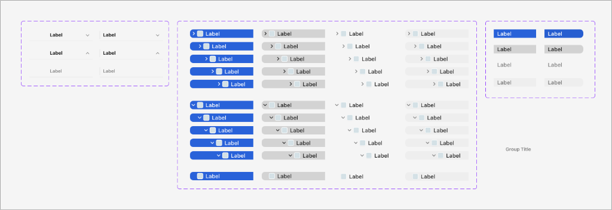

# Apple HIG Lists & Tables System — macOS Admin Specification

> *"Lists and tables present data in one or more columns of rows. A table or list can represent data that’s organized in groups or hierarchies, and it can support user interactions like selecting, adding, deleting, and reordering."*  
> — **Apple Human Interface Guidelines (Lists and tables)** ([developer.apple.com/design/human-interface-guidelines/lists-and-tables](https://developer.apple.com/design/human-interface-guidelines/lists-and-tables))

Dokumen ini mendefinisikan standar tabel data multi-kolom (*Multicolumn Tables*), tampilan pohon berjenjang (*Hierarchical Outline Views*), status seleksi aktif vs tidak aktif (*Active Blue vs Inactive Gray Selection*), gaya seleksi persegi vs kapsul (*Rectangular vs Pill Selection*), serta implementasi komponen untuk backend/admin MobiCare.

---

## 1. Karakteristik & Filosofi Apple HIG untuk Lists & Tables

Tabel dan daftar adalah tulang punggung antarmuka profesional macOS untuk memproses data berdensitas tinggi:

1. **Umpan Balik Seleksi (*Selection Feedback & Window State Awareness*) (Ref 31)**:
   - **Active Window Selection**: Saat jendela atau tabel dalam keadaan fokus, baris yang dipilih disorot dengan warna **Solid Apple Blue (`#007AFF`)** dan teks berubah menjadi putih murni (`#FFFFFF`).
   - **Inactive Window Selection**: Ketika jendela kehilangan fokus (misal admin sedang membuka aplikasi lain di sampingnya), baris seleksi otomatis berubah dari biru sistem menjadi **Abu-abu Netral (`rgba(0, 0, 0, 0.12)` atau `#D1D1D6`)** dengan teks gelap. Ini adalah aturan emas macOS untuk menjaga status fokus jendela tetap jelas.
   - **Hover Feedback**: Baris yang disorot kursor (*hover*) mendapatkan lapisan transparan ultra-halus (`rgba(0, 0, 0, 0.04)`) tanpa mengubah warna teks.
2. **Dua Gaya Seleksi Baris (Ref 31 - Panel Kanan)**:
   - **Rectangular Rounded (`radius: 5px–6px`)**: Standar untuk tabel data multi-kolom administratif (`NSTableView`, seperti Finder List View dan tabel katalog servis MobiCare).
   - **Pill Capsule (`radius: 9999px`)**: Standar untuk navigasi sidebar atau daftar pilihan tab vertikal (`AdminNav.tsx`).
3. **Hirarki Pohon & Indentasi Bertingkat (*Outline Views — `NSOutlineView`*)**:
   - Untuk data yang memiliki hubungan induk-anak (*parent-child*), gunakan segitiga pengungkapan (*disclosure triangle* `▶` / `▼`) di sisi kiri baris.
   - Indentasi bertingkat proporsional: setiap level kedalaman (*depth*) menjorok `12px`–`16px` ke kanan.
4. **Header Kolom Interaktif (*Sortable Headers*)**:
   - Judul kolom menggunakan kata benda ringkas (*Title-style Capitalization*) tanpa tanda baca akhir.
   - Dapat diklik untuk mengurutkan data (*sort asc/desc*), menampilkan ikon chevron panah penunjuk arah urutan.
   - Mendukung penyesuaian lebar kolom (*resizable columns*).
5. **Kewajiban Tabular Figures (`tnum`)**:
   - Seluruh kolom angka (Harga Servis `Rp 1.450.000`, Stok Part, Durasi Garansi) wajib menggunakan `font-variant-numeric: tabular-nums` agar angka sejajar secara vertikal.

---

## 2. Anatomi Status Seleksi & Matriks Hirarki (Ref 31)



### Matriks Status Seleksi Baris:

| Status Seleksi | Background Baris (Light) | Background Baris (Dark) | Warna Teks | Warna Ikon / Badge |
| :--- | :--- | :--- | :--- | :--- |
| **1. Active Selection (Jendela Fokus)** | Solid `#007AFF` (Apple Blue) | Solid `#0A84FF` | Putih murni `#FFFFFF` (tebal 500) | Putih murni atau transparan terang |
| **2. Inactive Selection (Jendela Latar Belakang)**| Abu-abu solid `rgba(0, 0, 0, 0.12)` / `#D1D1D6` | Abu-abu `rgba(255, 255, 255, 0.15)` | Hitam `#1D1D1F` | Abu-abu gelap / netral |
| **3. Hover State** | Transparan halus `rgba(0, 0, 0, 0.04)` | Transparan `rgba(255, 255, 255, 0.06)` | Sesuai level teks primer | Sesuai level ikon primer |
| **4. Unselected / Normal** | Transparan (atau alternating zebra `rgba(0,0,0,0.015)`) | Transparan (atau zebra `rgba(255,255,255,0.02)`) | Hitam `#1D1D1F` | Warna sistem default |

---

## 3. Penerapan Nyata di Backend Admin MobiCare

| Komponen Halaman | Tipe Tampilan | Penerapan Aturan Apple HIG |
| :--- | :--- | :--- |
| **`PriceGrid.tsx`** (`/admin/pricelist`) | **Tabel Multi-kolom Data (`NSTableView`)** | Header dapat diurutkan (Model, Jenis Kerusakan, Biaya Modal, Harga Jual). Baris terpilih mendapat sorotan solid Apple Blue `#007AFF`. Angka harga wajib `tabular-nums`. |
| **`AdminNav.tsx`** (Sidebar Navigasi) | **Daftar Kapsul (*Pill List Selection*)** | Item menu aktif (Dashboard, Pricelist, Promo, Galeri) menggunakan bentuk kapsul pill rounded (`radius: 9999px`) warna Apple Blue `#007AFF`. |
| **Kategori Suku Cadang** | **Tampilan Pohon (*Outline View*)** | Menampilkan struktur folder hierarkis: `Apple > iPhone > iPhone 15 > LCD` dengan disclosure triangle dan indentasi dinamis. |
| **`PromoViewer.tsx`** (`/admin/promo`) | **Tabel Daftar Promo** | Menampilkan daftar kupon promo dengan indikator status aktif toggle di dalam baris dan aksi hapus cepat. |

---

## 4. Implementasi CSS Utility (`.mac-table` & `.mac-list-row`)

```css
/* ==========================================================================
   Apple HIG macOS Native Tables & List Views
   ========================================================================== */

/* 1. KONTEN TABEL DATA MULTI-KOLOM (NSTableView) */
.mac-table-container {
  width: 100%;
  background: #ffffff;
  border: 1px solid rgba(0, 0, 0, 0.12);
  border-radius: 8px;
  overflow: hidden;
  box-shadow: 0 1px 3px rgba(0, 0, 0, 0.04);
  font-family: -apple-system, BlinkMacSystemFont, "SF Pro Text", "Helvetica Neue", sans-serif;
  font-size: 13px; /* Standar macOS Body */
}

.mac-table {
  width: 100%;
  border-collapse: separate;
  border-spacing: 0;
  text-align: left;
}

/* Header Kolom yang Dapat Diurutkan */
.mac-table-th {
  height: 28px;
  padding: 0 12px;
  font-size: 11px;
  font-weight: 600;
  color: rgba(0, 0, 0, 0.55);
  background: rgba(0, 0, 0, 0.03);
  border-bottom: 1px solid rgba(0, 0, 0, 0.1);
  border-right: 1px solid rgba(0, 0, 0, 0.06);
  user-select: none;
  cursor: pointer;
  white-space: nowrap;
}

.mac-table-th:hover {
  background: rgba(0, 0, 0, 0.06);
  color: #1d1d1f;
}

.mac-table-th:last-child {
  border-right: none;
}

/* Baris Data Tabel */
.mac-table-tr {
  height: 32px;
  transition: background-color 0.08s ease;
  cursor: default;
}

.mac-table-td {
  padding: 0 12px;
  color: #1d1d1f;
  border-bottom: 1px solid rgba(0, 0, 0, 0.04);
}

/* Angka Tabular Selaras Vertikal */
.mac-table-td.is-numeric {
  text-align: right;
  font-variant-numeric: tabular-nums;
  font-feature-settings: "tnum";
}

/* Alternating Rows (Zebra Striping) */
.mac-table-tr:nth-child(even):not(.is-selected) {
  background-color: rgba(0, 0, 0, 0.015);
}

/* Hover Row */
.mac-table-tr:hover:not(.is-selected) {
  background-color: rgba(0, 0, 0, 0.04);
}

/* 2. STATUS SELEKSI BARIS RESMI APPLE */

/* Seleksi Aktif (Jendela Fokus): Solid Apple Blue */
.mac-table-tr.is-selected,
.mac-list-row.is-selected {
  background-color: #007aff !important;
  color: #ffffff !important;
}

.mac-table-tr.is-selected .mac-table-td,
.mac-list-row.is-selected .mac-list-label {
  color: #ffffff !important;
}

/* Seleksi Inaktif (Jendela Latar Belakang): Solid Abu-abu Netral */
.mac-table.is-window-inactive .mac-table-tr.is-selected,
.mac-list-row.is-window-inactive.is-selected {
  background-color: rgba(0, 0, 0, 0.12) !important;
  color: #1d1d1f !important;
}

.mac-table.is-window-inactive .mac-table-tr.is-selected .mac-table-td,
.mac-list-row.is-window-inactive.is-selected .mac-list-label {
  color: #1d1d1f !important;
}

/* 3. LIST ROW VARIATIONS (Pill vs Rectangular) */
.mac-list-row {
  display: flex;
  align-items: center;
  height: 28px;
  padding: 0 10px;
  border-radius: 6px; /* Rectangular Rounded */
  margin: 1px 4px;
  cursor: pointer;
  user-select: none;
  transition: background-color 0.1s ease;
}

/* Gaya Kapsul Pill (Untuk Sidebar Navigasi) */
.mac-list-row.is-pill {
  border-radius: 9999px;
  padding: 0 14px;
}

.mac-list-row:hover:not(.is-selected) {
  background-color: rgba(0, 0, 0, 0.05);
}

/* Indentasi Hirarki Pohon (Outline View) */
.mac-list-row[data-depth="1"] { padding-left: 24px; }
.mac-list-row[data-depth="2"] { padding-left: 38px; }
.mac-list-row[data-depth="3"] { padding-left: 52px; }
.mac-list-row[data-depth="4"] { padding-left: 66px; }

/* Dark Mode Adaptation */
@media (prefers-color-scheme: dark) {
  .mac-table-container {
    background: #1e1e20;
    border-color: rgba(255, 255, 255, 0.12);
  }
  .mac-table-th {
    background: rgba(255, 255, 255, 0.04);
    border-bottom-color: rgba(255, 255, 255, 0.1);
    border-right-color: rgba(255, 255, 255, 0.06);
    color: rgba(255, 255, 255, 0.55);
  }
  .mac-table-td {
    color: #f5f5f7;
    border-bottom-color: rgba(255, 255, 255, 0.04);
  }
  .mac-table-tr:nth-child(even):not(.is-selected) {
    background-color: rgba(255, 255, 255, 0.02);
  }
  .mac-table-tr:hover:not(.is-selected) {
    background-color: rgba(255, 255, 255, 0.06);
  }
  .mac-table-tr.is-selected,
  .mac-list-row.is-selected {
    background-color: #0a84ff !important;
  }
  .mac-table.is-window-inactive .mac-table-tr.is-selected,
  .mac-list-row.is-window-inactive.is-selected {
    background-color: rgba(255, 255, 255, 0.15) !important;
    color: #f5f5f7 !important;
  }
  .mac-table.is-window-inactive .mac-table-tr.is-selected .mac-table-td,
  .mac-list-row.is-window-inactive.is-selected .mac-list-label {
    color: #f5f5f7 !important;
  }
}
```
