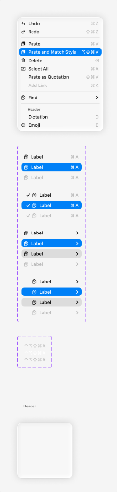
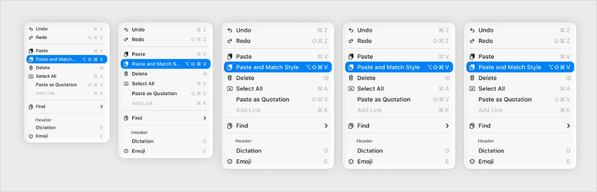

# Apple HIG Menus System — macOS Admin Specification

> *"A menu reveals its options when people interact with it, making it a space-efficient way to present commands in your app or game. Whether you use system-provided components or custom ones, people expect menus to behave in familiar ways."*  
> — **Apple Human Interface Guidelines (Menus)** ([developer.apple.com/design/human-interface-guidelines/menus](https://developer.apple.com/design/human-interface-guidelines/menus))

Dokumen ini mendefinisikan standar **Menu Flyout / Context Menus** (`NSMenu` di AppKit macOS), pengelompokan perintah dengan garis pemisah (*separators*), anatomi badge pintasan keyboard (`⌃`, `⌥`, `⇧`, `⌘`), status seleksi biru solid Apple (`#007AFF`), sub-menu bertingkat (*submenus*), serta manajemen lebar menu dan pencegahan pemotongan teks (*truncation*) pada backend/admin MobiCare.

---

## 1. Karakteristik & Filosofi Apple HIG untuk Menus

1. **Pengorganisasian Berbasis Prioritas (*Priority-Based Organization*)**:
   - *"Prefer listing important or frequently used menu items first."*  
   - Pengguna memindai menu dari atas ke bawah. Tempatkan perintah berprioritas tinggi dan paling sering digunakan di urutan teratas grup agar mudah diakses tanpa harus membaca seluruh menu.
2. **Pengelompokan Logis dengan Separator (*Logical Grouping with Separators*)**:
   - Kelompokkan perintah yang berhubungan erat (misal: Perintah Manipulasi Data: *Undo, Redo*; Perintah Clipboard: *Cut, Copy, Paste, Delete*).
   - Pisahkan setiap grup menggunakan garis pemisah horizontal tipis 1px (`rgba(0, 0, 0, 0.08)` Light / `rgba(255, 255, 255, 0.1)` Dark).
   - Simpan semua perintah terkait dalam satu grup meskipun frekuensi penggunaannya berbeda (misal: *Paste and Match Style* diletakkan bersama *Paste*).
3. **Larangan Menyembunyikan Menu yang Tidak Aktif (*Never Hide Inactive Items*)**:
   - *"Always show the same set of menu items... If a menu bar item isn’t actionable, disable the action instead of hiding it from the menu."*  
   - Menghilangkan item menu saat tidak tersedia membingungkan memori spasial pengguna. Item yang sedang tidak dapat dijalankan wajib ditampilkan dalam status **Disabled** (abu-abu pudar `opacity: 0.4`), bukan dihapus.
4. **Submenus Hanya Bila Sangat Diperlukan (*Use Submenus Sparingly*)**:
   - Submenu menyembunyikan opsi dan menambah kompleksitas interaksi kursor.
   - Gunakan submenu (`›`) hanya jika terdapat lebih dari dua variasi untuk satu kata kerja yang sama (misal: *Cari > Cari Teks... / Temukan Berikutnya / Ganti...*).

---

## 2. Anatomi Item Menu & Simbol Pintasan Keyboard (Ref 37)



Setiap baris menu dapat memuat 4 zona elemen:
1. **Leading Zone (Kiri)**:
   - Ikon Simbol (misal: Ikon Panah Putar Balik Undo, Ikon Tempat Sampah Delete).
   - Tanda Centang (*Toggle Checkmark* `✓`) untuk opsi yang sedang aktif (misal: `✓ Tampilkan Kolom Margin`).
2. **Label Zone (Tengah)**: Teks aksi berbasis kata kerja (*Verb Phrase*), Title-style capitalization (misal: *Salin Data Servis*, *Hapus Transaksi*).
3. **Trailing Zone (Kanan)**:
   - **Keyboard Shortcut**: Simbol tombol pengubah standar macOS disusul huruf:
     - `⌃` : Control
     - `⌥` : Option / Alt
     - `⇧` : Shift
     - `⌘` : Command
   - **Submenu Indicator**: Ikon chevron kanan halus (`›`) jika item membuka submenu flyout ke samping.

### Matriks Status Baris Menu:

| Status Baris | Background Baris | Warna Teks Label | Warna Shortcut / Chevron |
| :--- | :--- | :--- | :--- |
| **Normal (Resting)** | Transparan | Hitam solid `#1D1D1F` (Light) / `#F5F5F7` (Dark) | Abu-abu redup `rgba(0, 0, 0, 0.45)` |
| **Hover / Selected** | **Solid Apple Blue (`#007AFF`)**, radius `5px` | **Putih murni `#FFFFFF`** (tebal 500) | **Putih murni `#FFFFFF`** |
| **Disabled** | Transparan | Abu-abu pudar `rgba(0, 0, 0, 0.28)`, `cursor: not-allowed` | Sangat redup `rgba(0, 0, 0, 0.18)` |

---

## 3. Manajemen Skala Lebar Menu & Truncation (Ref 38)



Apple HIG mengilustrasikan adaptasi 5 skala lebar kartu menu popover:
- **Minimum Width (`200px`)**: Menjamin label dan pintasan keyboard (`⌥⇧⌘V`) memiliki jarak spasial yang cukup tanpa saling bertabrakan (*overlapping*).
- **Default Recommended Width (`240px – 280px`)**: Menampung teks aksi deskriptif lengkap tanpa pemotongan.
- **Perilaku Truncation**: Jika teks melebihi lebar maksimum container, gunakan elipsis di tengah teks (*middle truncation*, misal: `Paste and Match...`) agar kata kunci awal dan konteks akhir tetap dapat dibaca.

---

## 4. Penerapan Nyata di Backend Admin MobiCare

| Komponen / Halaman | Konteks Menu | Perintah yang Disediakan |
| :--- | :--- | :--- |
| **`PriceGrid.tsx`** (`/admin/pricelist`) | **Context Menu Klik Kanan Baris Servis** | - *Edit Harga Suku Cadang* (`⌘E`)<br>- *Duplikasi Baris Layanan* (`⌘D`)<br>- *Separator*<br>- *Salin ID Suku Cadang* (`⌘C`)<br>- *Separator*<br>- *Hapus Layanan...* (`⌫`, merah/disabled jika berelasi) |
| **`AdminNav.tsx`** (`Menu Bar File`) | **Menu Dropdown File** | - *Tambah Suku Cadang Baru...* (`⌘N`)<br>- *Impor Katalog CSV...* (`⇧⌘I`)<br>- *Ekspor Pricelist Excel...* (`⇧⌘E`)<br>- *Separator*<br>- *Cetak Katalog Resmi...* (`⌘P`) |
| **`GalleryEditor.tsx`** (`/admin/gallery`) | **Context Menu Foto Galeri** | - *Lihat Ukuran Penuh (Quick Look)* (`Space`)<br>- *Ganti Foto Utama*<br>- *Separator*<br>- *Hapus dari Galeri* (`⌫`) |

---

## 5. Implementasi CSS Utility (`.mac-menu-popover`)

```css
/* ==========================================================================
   Apple HIG macOS Native Menu Popover Component
   ========================================================================== */

.mac-menu-popover {
  position: absolute;
  min-width: 220px;
  max-width: 320px;
  padding: 4px;
  background: rgba(255, 255, 255, 0.85);
  backdrop-filter: blur(25px) saturate(180%);
  -webkit-backdrop-filter: blur(25px) saturate(180%);
  border: 1px solid rgba(0, 0, 0, 0.12);
  border-radius: 8px;
  box-shadow: 
    0 10px 25px rgba(0, 0, 0, 0.15),
    0 0 1px rgba(0, 0, 0, 0.1);
  font-family: -apple-system, BlinkMacSystemFont, "SF Pro Text", "Helvetica Neue", sans-serif;
  font-size: 13px;
  color: #1d1d1f;
  z-index: 1050;
  user-select: none;
}

/* Baris Item Menu */
.mac-menu-item {
  display: flex;
  align-items: center;
  justify-content: space-between;
  height: 24px;
  padding: 0 8px;
  border-radius: 5px;
  cursor: default;
  transition: background-color 0.08s ease, color 0.08s ease;
}

/* Sisi Kiri Baris: Checkmark / Ikon + Label */
.mac-menu-item-leading {
  display: flex;
  align-items: center;
  gap: 8px;
  min-width: 0;
  flex: 1;
}

.mac-menu-icon {
  width: 14px;
  height: 14px;
  display: inline-flex;
  align-items: center;
  justify-content: center;
  color: rgba(0, 0, 0, 0.65);
  flex-shrink: 0;
}

.mac-menu-label {
  white-space: nowrap;
  overflow: hidden;
  text-overflow: ellipsis;
  font-size: 13px;
  color: inherit;
}

/* Sisi Kanan Baris: Shortcut Keyboard & Chevron */
.mac-menu-item-trailing {
  display: flex;
  align-items: center;
  gap: 4px;
  margin-left: 16px;
  flex-shrink: 0;
}

.mac-menu-shortcut {
  font-size: 12px;
  color: rgba(0, 0, 0, 0.45);
  font-variant-numeric: tabular-nums;
  letter-spacing: 0.02em;
}

/* Status Hover / Seleksi: Solid Apple Blue */
.mac-menu-item:hover,
.mac-menu-item.is-selected {
  background-color: #007aff !important;
  color: #ffffff !important;
}

.mac-menu-item:hover .mac-menu-icon,
.mac-menu-item:hover .mac-menu-shortcut,
.mac-menu-item.is-selected .mac-menu-icon,
.mac-menu-item.is-selected .mac-menu-shortcut {
  color: #ffffff !important;
}

/* Status Disabled */
.mac-menu-item.is-disabled {
  opacity: 0.38;
  cursor: not-allowed;
  pointer-events: none;
}

/* Garis Pemisah (Separator) */
.mac-menu-separator {
  height: 1px;
  margin: 4px -2px;
  background-color: rgba(0, 0, 0, 0.08);
}

/* Section Header (Opsional) */
.mac-menu-header {
  padding: 4px 8px 2px 8px;
  font-size: 11px;
  font-weight: 600;
  color: rgba(0, 0, 0, 0.45);
  text-transform: capitalize;
}

/* Dark Mode Adaptation */
@media (prefers-color-scheme: dark) {
  .mac-menu-popover {
    background: rgba(36, 36, 38, 0.85);
    border-color: rgba(255, 255, 255, 0.14);
    box-shadow: 
      0 12px 30px rgba(0, 0, 0, 0.5),
      0 0 1px rgba(255, 255, 255, 0.1);
    color: #f5f5f7;
  }
  .mac-menu-icon {
    color: rgba(255, 255, 255, 0.65);
  }
  .mac-menu-shortcut {
    color: rgba(255, 255, 255, 0.45);
  }
  .mac-menu-item:hover,
  .mac-menu-item.is-selected {
    background-color: #0a84ff !important;
  }
  .mac-menu-separator {
    background-color: rgba(255, 255, 255, 0.1);
  }
  .mac-menu-header {
    color: rgba(255, 255, 255, 0.45);
  }
}
```
