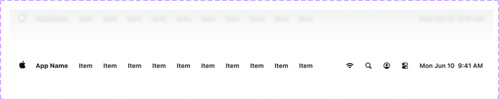

# Apple HIG The Menu Bar System — macOS Admin Specification

> *"On a Mac or an iPad, the menu bar at the top of the screen displays the top-level menus in your app or game. Mac users are very familiar with the macOS menu bar, and they rely on it to help them learn what an app does and find the commands they need."*  
> — **Apple Human Interface Guidelines (The menu bar)** ([developer.apple.com/design/human-interface-guidelines/the-menu-bar](https://developer.apple.com/design/human-interface-guidelines/the-menu-bar))

Dokumen ini mendefinisikan standar **Menu Bar macOS** (`NSMenu` & `MenuBarExtra`), anatomi bilah menu 28px terpadu, urutan hierarki menu standar sistem, status interaksi kapsul pill (*Apple Logo & App Name pill states*), indikator status sistem di sisi kanan (*Menu Bar Extras*), serta implementasi komponen bilah menu desktop untuk shell backend/admin MobiCare.

---

## 1. Karakteristik & Filosofi Apple HIG untuk The Menu Bar

1. **Jangkar Navigasi Global Teratas (*Top-level Navigation Anchor*)**:
   - Menu Bar membentang penuh di sepanjang bagian paling atas layar desktop macOS (`height: 24pt / 28px`).
   - Menggunakan material kaca buram ultra-halus (*frosted glass backdrop-filter: blur(20px)*) yang menyatu anggun dengan wallpaper desktop atau bingkai atas window.
2. **Urutan Anatomi Menu Standar Sistem Apple (Ref 33)**:
   - Sesuai panduan resmi Apple, menu harus disajikan dalam urutan konsisten dari kiri ke kanan:
     1. **Apple Menu (``)**: Selalu berada di posisi terdepan (*leading side*), berisi info sistem dan pengaturan global.
     2. **Nama Aplikasi (*App Name*, Tebal 700)**: Menu utama aplikasi (misal: **MobiCare**, berisi *About MobiCare, Settings... ⌘,, Log Out*).
     3. **File**: Perintah dokumen dan data (*Katalog Baru ⌘N, Ekspor Data... ⌘E, Simpan ⌘S*).
     4. **Edit**: Perintah manipulasi data (*Undo ⌘Z, Redo ⇧⌘Z, Cut ⌘X, Copy ⌘C, Paste ⌘V, Select All ⌘A*).
     5. **View / Tampilan**: Perintah tata letak (*Toggle Sidebar ⌃⌘S, Reload Data ⌘R, Zoom, Full Screen ⌃⌘F*).
     6. **Menu Spesifik Aplikasi (*App-specific menus*)**: Menu khusus bisnis (misal: **Katalog**, **Promo**, **Teknisi**, **Garansi**).
     7. **Window**: Perintah kontrol jendela (*Minimize ⌘M, Zoom, Bring All to Front*).
     8. **Help**: Dokumentasi panduan operasional admin dan bantuan cepat.
3. **Menu Bar Extras (Sisi Kanan / Trailing Side) (Ref 33)**:
   - Menampilkan status utilitas sistem:
     - Indikator Jaringan / Wi-Fi (`status online/offline database`).
     - Pencarian Global Spotlight (`⌘K / 🔍`).
     - Profil Akun Admin (`👤`).
     - Pusat Kontrol / Control Center (`🎛`).
     - Waktu & Tanggal Digital Real-Time (`Mon Jun 10 9:41 AM`).
4. **Status Interaksi Kapsul Pill (*Interactive Pill Hover States*) (Ref 34, 35, 36)**:
   - Ketika item menu diklik atau dibuka, latar belakang teks menu berubah menjadi **Kapsul Pill Abu-abu Halus (`rgba(0, 0, 0, 0.08)` Light / `rgba(255, 255, 255, 0.12)` Dark)** dengan sudut melengkung sempurna (`border-radius: 9999px` atau `6px`).
   - Memberikan konfirmasi visual langsung bahwa menu sedang aktif membuka flyout dropdown.

---

## 2. Anatomi Visual Aset Referensi (Ref 32 s.d. 36)



### Matriks Komponen & Status Bilah Menu:

| Komponen | Status Default | Status Aktif / Terbuka | Referensi |
| :--- | :--- | :--- | :--- |
| **Apple Logo (``)** | Logo hitam solid (Light) atau putih lembut (Dark) tanpa latar. | Terbungkus kapsul oval abu-abu halus (`rgba(0,0,0,0.08)` / `rgba(255,255,255,0.14)`). | Ref 34 (Light) & Ref 35 (Dark) |
| **App Name Menu** | Teks tebal 700 (`font-weight: 700`), warna `#1D1D1F` (Light) / `#F5F5F7` (Dark). | Teks tebal di dalam kapsul pill abu-abu halus (`padding: 2px 10px`, `border-radius: 6px`). | Ref 36 |
| **Standard Menu Items** | Teks reguler 13px (`File, Edit, View, ...`), opasitas label primer. | Kapsul pill abu-abu halus, membuka flyout dropdown menu dengan shortcut badge. | Ref 33 & Ref 08 |
| **Menu Bar Extras (Kanan)**| Ikon minimalis monokrom (Wi-Fi, Spotlight, Profil, Jam). | Ikon berlatar kapsul pill saat popover / modal status aktif dibuka. | Ref 33 |
| **App Icons Ecosystem** | Squircle radius proporsional di Dock/Launchpad. | Mode Light dan Mode Dark dengan pencahayaan rim-light khas Apple. | Ref 32 |

---

## 3. Penerapan Nyata di Backend Admin MobiCare

### A. Bilah Menu Desktop Global (`AdminChrome.tsx` / `AdminNav.tsx`)
Bilah menu 28px membentang di bagian paling atas viewport admin desktop:
- **Leading Edge**:
  - ``: Menu sistem cepat (Info Versi Sistem MobiCare, Kunci Layar, Log Out Admin).
  - **MobiCare**: Menu aplikasi utama (Tentang MobiCare Service Center, Pengaturan Toko `⌘,`, Sembunyikan Panel).
  - **Katalog**: Opsi cepat tambah sparepart (`⌘N`), impor CSV, ekspor harga.
  - **Promo**: Buat penawaran diskon baru, kelola voucher aktif.
  - **Tampilan**: Toggle Sidebar (`[ |]`), mode gelap/terang, perbesar tabel.
  - **Bantuan**: Panduan SOP teknisi servis, panduan klaim garansi.
- **Trailing Edge**:
  - Indikator Status Database Cloud (Online Hijau / Sync).
  - Tombol Pencarian Cepat Spotlight Admin (`⌘K`).
  - Indikator Admin Aktif (`admin@mobicare.id`).
  - Jam Digital Real-time (`WITA`).

---

## 4. Implementasi CSS Utility (`.mac-menubar`)

```css
/* ==========================================================================
   Apple HIG macOS Native Top Menu Bar Component
   ========================================================================== */

.mac-menubar {
  position: fixed;
  top: 0;
  left: 0;
  right: 0;
  height: 28px; /* Standar macOS Tahoe 28px (24pt) */
  display: flex;
  align-items: center;
  justify-content: space-between;
  padding: 0 12px;
  background: rgba(255, 255, 255, 0.75);
  backdrop-filter: blur(20px) saturate(180%);
  -webkit-backdrop-filter: blur(20px) saturate(180%);
  border-bottom: 1px solid rgba(0, 0, 0, 0.08);
  font-family: -apple-system, BlinkMacSystemFont, "SF Pro Text", "Helvetica Neue", sans-serif;
  font-size: 13px;
  color: #1d1d1f;
  z-index: 1000;
  user-select: none;
}

/* Sisi Kiri (Leading): Logo, App Name, dan Menu Items */
.mac-menubar-leading {
  display: flex;
  align-items: center;
  gap: 2px;
}

/* Item Menu Interaktif */
.mac-menubar-item {
  display: inline-flex;
  align-items: center;
  justify-content: center;
  height: 22px;
  padding: 0 8px;
  border-radius: 5px;
  color: #1d1d1f;
  text-decoration: none;
  cursor: default;
  transition: background-color 0.1s ease;
  font-size: 13px;
}

.mac-menubar-item:hover,
.mac-menubar-item.is-active {
  background: rgba(0, 0, 0, 0.08);
}

/* Logo Apple Menu */
.mac-menubar-apple {
  font-size: 14px;
  padding: 0 6px;
  border-radius: 9999px;
}

/* Nama Aplikasi (Tebal Bold) */
.mac-menubar-appname {
  font-weight: 700;
  padding: 0 8px;
}

/* Sisi Kanan (Trailing): Menu Bar Extras & Jam */
.mac-menubar-trailing {
  display: flex;
  align-items: center;
  gap: 8px;
  font-size: 12px;
  color: rgba(0, 0, 0, 0.75);
}

.mac-menubar-extra-btn {
  display: inline-flex;
  align-items: center;
  justify-content: center;
  height: 22px;
  padding: 0 6px;
  border-radius: 5px;
  background: transparent;
  border: none;
  color: inherit;
  cursor: pointer;
  transition: background-color 0.1s ease;
}

.mac-menubar-extra-btn:hover {
  background: rgba(0, 0, 0, 0.08);
  color: #1d1d1f;
}

.mac-menubar-clock {
  font-variant-numeric: tabular-nums;
  font-weight: 500;
  padding-left: 4px;
}

/* Dark Mode Adaptation */
@media (prefers-color-scheme: dark) {
  .mac-menubar {
    background: rgba(30, 30, 32, 0.75);
    border-bottom-color: rgba(255, 255, 255, 0.1);
    color: #f5f5f7;
  }
  .mac-menubar-item {
    color: #f5f5f7;
  }
  .mac-menubar-item:hover,
  .mac-menubar-item.is-active {
    background: rgba(255, 255, 255, 0.12);
  }
  .mac-menubar-trailing {
    color: rgba(255, 255, 255, 0.75);
  }
  .mac-menubar-extra-btn:hover {
    background: rgba(255, 255, 255, 0.12);
    color: #f5f5f7;
  }
}
```
