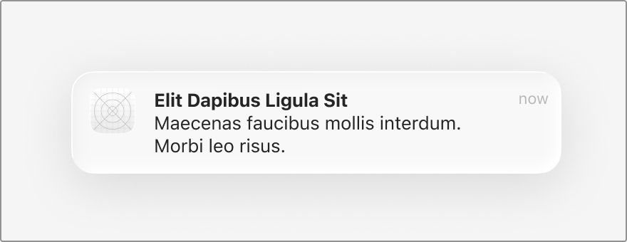

# Apple HIG Notifications & Toast Banners System — macOS Admin Specification

> *"A notification gives people timely, high-value information they can understand at a glance. Provide concise, informative notifications. People turn on notifications to get quick updates, so you want to provide valuable information succinctly."*  
> — **Apple Human Interface Guidelines (Notifications & Managing notifications)** ([developer.apple.com/design/human-interface-guidelines/notifications](https://developer.apple.com/design/human-interface-guidelines/notifications))

Dokumen ini mendefinisikan standar **Desktop Push Notifications & Toast Banners** (`UNNotification` / `NSUserNotificationCenter` di macOS), anatomi banner kapsul frosted glass beradius 18px, penempatan di pojok kanan atas desktop, perbedaannya dengan dialog Alert modal, serta implementasi sistem feedback (Sonner / custom toast) untuk backend/admin MobiCare.

---

## 1. Karakteristik & Filosofi Apple HIG untuk Notifications

Di lingkungan macOS desktop, notifikasi (banner toast) adalah sistem komunikasi asinkron yang tidak menginterupsi (*non-blocking asynchronous feedback*):

1. **Perbedaan Mendasar: Notification (Toast) vs Alert Modal**:
   - **Alert Modal (Ref 03, 04, 18)**: Hanya untuk situasi **kritis** yang memerlukan keputusan pengguna saat itu juga (konfirmasi penghapusan permanen, pencegah kehilangan data saat menutup form belum tersimpan). Dialog modal memblokir interaksi antarmuka lainnya.
   - **Notification Banner / Toast (Ref 15 & 39)**: Untuk umpan balik status operasional **pasif & informatif** (misal: *"Perubahan harga berhasil disimpan"*, *"Katalog diekspor ke Excel"*, *"Koneksi database sinkron"*). Banner meluncur dari pojok kanan atas, bertahan beberapa detik, lalu menghilang secara otomatis (*auto-dismiss*) tanpa menghentikan pekerjaan admin.
2. **Ringkas & Langsung Dipahami dalam Sekejap (*Glanceable & Concise*)**:
   - *"Provide concise, informative notifications... they can understand at a glance."*  
   - Judul singkat berupa aksi yang telah tuntas (tebal 13pt/14px).
   - Deskripsi pelengkap 1 baris (reguler 12pt).
   - Timestamp waktu relatif di pojok kanan atas (`now`, `2m ago`).
3. **Anatomi Visual Banner Kapsul Frosted Glass (Ref 39)**:
   - **Corner Radius**: `18px – 20px` squircle.
   - **Material Latar**: Frosted liquid glass transparan dengan efek blur tinggi (`backdrop-filter: blur(40px) saturate(190%)`).
   - **Ikon Aplikasi**: Squircle 36px x 36px di sisi paling kiri (*leading side*) berisikan logo MobiCare atau ikon penanda status modul.
   - **Bayangan Mengambang**: Deep atmospheric shadow (`0 12px 32px rgba(0, 0, 0, 0.12), 0 0 0 1px rgba(0, 0, 0, 0.08)`).

---

## 2. Anatomi Banner Notifikasi Tunggal (Ref 39)



### Elemen-Elemen Komponen:

| Posisi | Elemen | Tipografi / Styling | Deskripsi Fungsi |
| :--- | :--- | :--- | :--- |
| **Leading (Kiri)** | **App Icon Squircle** | `36px x 36px`, `border-radius: 8px` | Menampilkan logo MobiCare atau badge modul (Katalog, Promo, Garansi). |
| **Center (Atas)** | **Judul Notifikasi** | `font-size: 13.5px`, `font-weight: 700`, `#1D1D1F` | Ringkasan kejadian utama (misal: *"Katalog Selesai Diperbarui"*). |
| **Center (Bawah)**| **Isi Pesan Deskriptif** | `font-size: 12px`, `color: rgba(0,0,0,0.65)`, line-height 1.4 | Penjelasan detail ringkas (misal: *"Harga 12 tipe LCD iPhone 15 Pro telah sinkron"*). |
| **Trailing (Kanan)**| **Timestamp Relatif** | `font-size: 11px`, `color: rgba(0,0,0,0.40)`, tabular | Waktu relatif (`now`, `baru saja`). |

---

## 3. Penerapan Nyata di Backend Admin MobiCare (Sonner / Admin Toast)

| Peristiwa Operasional | Judul Notifikasi Toast | Deskripsi / Subtitle | Tipe Umpan Balik |
| :--- | :--- | :--- | :--- |
| **Simpan Katalog (`/admin/pricelist`)** | **Katalog Berhasil Diperbarui** | Perubahan harga suku cadang telah tersimpan ke database. | Sukses (Ikon Hijau / MobiCare) |
| **Ekspor Data (`ExportModal.tsx`)** | **Unduhan Selesai** | File `Pricelist-MobiCare-2026-10-22.xlsx` siap digunakan. | Sukses (Ikon Dokumen) |
| **Aktivasi Promo (`/admin/promo`)** | **Promo Berhasil Diterbitkan** | Promo "Diskon Merdeka 15%" kini aktif di situs publik. | Sukses (Ikon Bintang) |
| **Upload Foto Gagal (`/admin/gallery`)**| **Gagal Mengunggah Foto** | Ukuran file melebihi batas maksimum 5MB. Silakan pilih foto lain. | Error / Warning (Ikon Kuning/Merah) |
| **Koneksi Terputus** | **Koneksi Database Offline** | Menghubungkan ulang ke server MobiCare... | Status Jaringan (Ikon Wi-Fi) |

---

## 4. Implementasi CSS Utility (`.mac-notification-banner`)

```css
/* ==========================================================================
   Apple HIG macOS Native Notification Banner (Toast) Component
   ========================================================================== */

/* Kontainer Wadah Notifikasi di Pojok Kanan Atas Desktop */
.mac-notification-container {
  position: fixed;
  top: 36px; /* Tepat di bawah Menu Bar 28px */
  right: 16px;
  display: flex;
  flex-direction: column;
  gap: 10px;
  z-index: 9999;
  pointer-events: none;
}

/* Banner Notifikasi Kapsul Frosted Glass */
.mac-notification-banner {
  position: relative;
  display: flex;
  align-items: flex-start;
  width: 360px;
  padding: 12px 16px;
  background: rgba(255, 255, 255, 0.85);
  backdrop-filter: blur(40px) saturate(190%);
  -webkit-backdrop-filter: blur(40px) saturate(190%);
  border-radius: 18px; /* Squircle Apple Radius */
  box-shadow: 
    0 12px 32px rgba(0, 0, 0, 0.12),
    0 2px 6px rgba(0, 0, 0, 0.04),
    0 0 0 1px rgba(0, 0, 0, 0.08);
  font-family: -apple-system, BlinkMacSystemFont, "SF Pro Text", "Helvetica Neue", sans-serif;
  pointer-events: auto;
  cursor: pointer;
  user-select: none;
  animation: macNotificationSlideIn 0.32s cubic-bezier(0.16, 1, 0.3, 1);
  transition: transform 0.18s cubic-bezier(0.16, 1, 0.3, 1), box-shadow 0.18s ease;
}

.mac-notification-banner:hover {
  transform: translateY(-1px) scale(1.01);
  box-shadow: 
    0 16px 36px rgba(0, 0, 0, 0.16),
    0 0 0 1px rgba(0, 0, 0, 0.1);
}

@keyframes macNotificationSlideIn {
  from {
    transform: translateX(110%) scale(0.95);
    opacity: 0;
  }
  to {
    transform: translateX(0) scale(1);
    opacity: 1;
  }
}

/* Ikon Aplikasi Squircle di Sisi Kiri */
.mac-notification-icon {
  width: 36px;
  height: 36px;
  border-radius: 8px;
  margin-right: 12px;
  flex-shrink: 0;
  box-shadow: 0 1px 3px rgba(0, 0, 0, 0.15);
  overflow: hidden;
  background: #ffffff;
}

.mac-notification-icon img,
.mac-notification-icon svg {
  width: 100%;
  height: 100%;
  object-fit: cover;
}

/* Konten Teks Tengah */
.mac-notification-content {
  flex: 1;
  min-width: 0;
  padding-right: 8px;
}

.mac-notification-title {
  font-size: 13.5px;
  font-weight: 700;
  color: #1d1d1f;
  margin: 0 0 2px 0;
  line-height: 1.3;
}

.mac-notification-message {
  font-size: 12px;
  color: rgba(0, 0, 0, 0.65);
  margin: 0;
  line-height: 1.4;
  word-break: break-word;
}

/* Timestamp Kanan Atas */
.mac-notification-time {
  font-size: 11px;
  color: rgba(0, 0, 0, 0.40);
  font-variant-numeric: tabular-nums;
  flex-shrink: 0;
  margin-top: 1px;
}

/* Dark Mode Adaptation */
@media (prefers-color-scheme: dark) {
  .mac-notification-banner {
    background: rgba(36, 36, 38, 0.85);
    border-color: rgba(255, 255, 255, 0.12);
    box-shadow: 
      0 16px 36px rgba(0, 0, 0, 0.5),
      0 0 0 1px rgba(255, 255, 255, 0.1);
  }
  .mac-notification-title {
    color: #f5f5f7;
  }
  .mac-notification-message {
    color: rgba(255, 255, 255, 0.65);
  }
  .mac-notification-time {
    color: rgba(255, 255, 255, 0.40);
  }
}
```
