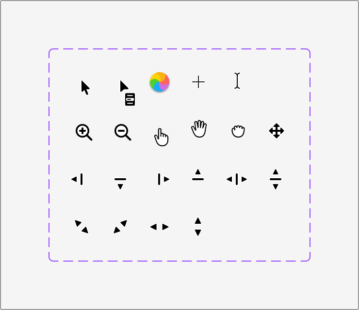

# Apple HIG Pointing Devices & Cursors System — macOS Admin Specification

> *"People can use a pointing device like a trackpad or mouse to navigate the interface and initiate actions. People appreciate the precision and flexibility that pointing devices offer. On a Mac, people typically expect to combine a pointing device with a keyboard as they navigate apps and the system."*  
> — **Apple Human Interface Guidelines (Pointing devices)** ([developer.apple.com/design/human-interface-guidelines/pointing-devices](https://developer.apple.com/design/human-interface-guidelines/pointing-devices))

Dokumen ini mendefinisikan standar interaksi peranti penunjuk (*Pointing Devices — Mouse & Trackpad*), katalog lengkap kursor sistem macOS (`NSCursor`), status kursor dinamis (tangan telunjuk, I-Beam, zoom, resize kolom, grab kanvas, beachball spinner), serta penerapannya untuk efisiensi manipulasi data pada backend/admin MobiCare.

---

## 1. Karakteristik & Filosofi Apple HIG untuk Pointing Devices

Di lingkungan desktop macOS, mouse dan trackpad memberikan presisi tingkat piksel (*pixel-level precision*) dan umpan balik kontekstual langsung melalui bentuk kursor:

1. **Konsistensi Semantik Kursor (*Cursor Semantic Consistency*) (Ref 40)**:
   - Bentuk kursor harus selalu mencerminkan secara akurat aksi apa yang dapat dilakukan pada elemen yang sedang berada di bawah penunjuk (*hover state*).
   - Jangan pernah mempertahankan kursor panah default jika elemen dapat digeser (*draggable*), diubah ukurannya (*resizable*), atau diedit teksnya (*editable*).
2. **Kombinasi Pointing Device + Keyboard Modifiers**:
   - Pengguna Mac terbiasa memadukan klik kursor dengan tombol pengubah keyboard:
     - `Shift + Click`: Seleksi rentang baris majemuk (*range selection*) pada tabel data.
     - `Command (⌘) + Click`: Menambah/mengurangi baris individual ke dalam seleksi aktif (*toggle multi-selection*).
     - `Option (⌥) + Drag`: Menduplikasi baris/item layanan seketika.
3. **Interaksi Gestur Trackpad Native**:
   - **Scroll Dua Jari (*Two-finger Scroll*)**: Menggulirkan tabel data horizontal/vertikal secara luwes tanpa bilah scrollbar invasif.
   - **Klik Sekunder / Dua Jari (*Secondary Click*)**: Membuka context menu tepat di posisi ujung kursor.
   - **Pinch-to-Zoom**: Memperbesar foto inspeksi perangkat di modul galeri servis.

---

## 2. Katalog Lengkap Kursor Sistem macOS (Ref 40)



### Matriks Kursor & CSS Cursor Equivalents:

| Kategori Kursor | Bentuk Visual macOS | Properti CSS Standar | Penggunaan Nyata di Admin MobiCare |
| :--- | :--- | :--- | :--- |
| **Default Arrow** | Panah hitam solid miring ke kiri | `cursor: default;` | Menavigasi kanvas jendela, area kosong tabel. |
| **Pointing Hand** | Tangan putih dengan telunjuk ke atas | `cursor: pointer;` | Menekan tombol aksi (*Primary Button*), tab menu sidebar, toggle switch, checkbox. |
| **I-Beam Text** | Garis vertikal berlekuk atas-bawah | `cursor: text;` | Mengetik dan menyeleksi teks pada form input, deskripsi promo, pencarian. |
| **Column Resize** | Garis vertikal dengan dua panah `◀|▶` | `cursor: col-resize;` | Menyesuaikan lebar kolom tabel harga (`PriceGrid.tsx`) atau batas lebar panel sidebar. |
| **Row Resize** | Garis horizontal dengan dua panah `▲/▼` | `cursor: row-resize;` | Mengubah tinggi baris textarea atau laci detail servis. |
| **Corner Resize** | Panah diagonal dua arah | `cursor: nwse-resize;` / `nesw-resize;` | Mengubah ukuran popover dialog atau jendela modal yang dapat di-resize. |
| **Open Hand** | Telapak tangan terbuka | `cursor: grab;` | Kanvas peta Our Store, viewer foto galeri beresolusi tinggi sebelum digeser. |
| **Closed Hand** | Tangan menggenggam | `cursor: grabbing;` | Saat admin sedang menyeret foto galeri untuk mengubah urutan (*drag reorder*). |
| **Crosshair** | Garis silang tipis presisi (`+`) | `cursor: crosshair;` | Alat crop gambar thumbnail sparepart atau seleksi koordinat foto. |
| **Zoom In / Out** | Kaca pembesar (`+` / `–`) | `cursor: zoom-in;` / `zoom-out;` | Memperbesar foto bukti kerusakan LCD/motherboard pelanggan di modal Quick Look. |
| **Spinning Wait** | Roda putar pelangi ("Beach ball") | *Animasi SVG loading* | Indikator sinkronisasi background saat ekspor laporan ribuan transaksi berlangsung. |

---

## 3. Penerapan Nyata di Backend Admin MobiCare

### A. Tabel Katalog Suku Cadang (`PriceGrid.tsx` / `/admin/pricelist`)
- **Resize Kolom**: Garis batas pemisah antar-header (`.mac-table-th`) memiliki zona interaksi 4px dengan `cursor: col-resize`, memungkinkan admin melebarkan kolom "Nama Layanan" atau menyempitkan kolom "Garansi".
- **Multi-Selection Keyboard**:
  - Klik biasa: Memilih 1 baris (Solid Apple Blue `#007AFF`).
  - `⌘ + Click`: Memilih baris kedua tanpa menghilangkan baris pertama untuk aksi massal (*bulk delete/update*).
  - `⇧ + Click`: Memilih seluruh baris dari titik awal ke titik akhir.

### B. Galeri Servis & Urutan Promo (`GalleryEditor.tsx` & `PromoEditor.tsx`)
- **Drag Reorder**:
  - Saat kursor berada di atas kartu foto: `cursor: grab;`.
  - Saat tombol mouse/trackpad ditekan dan foto mulai melayang: `cursor: grabbing;`.

### C. Inspector Gambar & Detail Modal (`QuickLookModal`)
- Saat hover foto motherboard: `cursor: zoom-in;`.
- Setelah di-zoom penuh: `cursor: grab;` untuk menggeser (*pan*) area mikrosoldering.

---

## 4. Implementasi Utility CSS Kursor macOS (`.mac-cursor-*`)

```css
/* ==========================================================================
   Apple HIG macOS Native Cursor & Pointer Utilities
   ========================================================================== */

/* 1. Seleksi dan Tindakan */
.mac-clickable,
.mac-btn,
.mac-checkbox,
.mac-radio,
.mac-switch {
  cursor: pointer;
}

.mac-editable-text,
.mac-input,
.mac-textarea {
  cursor: text;
}

/* 2. Pengatur Batas (Resizing) */
.mac-resizer-col {
  cursor: col-resize;
  width: 5px;
  position: absolute;
  right: -2px;
  top: 0;
  bottom: 0;
  z-index: 10;
}

.mac-resizer-row {
  cursor: row-resize;
  height: 5px;
  position: absolute;
  left: 0;
  right: 0;
  bottom: -2px;
  z-index: 10;
}

/* 3. Penyeretan & Manipulasi Kanvas */
.mac-draggable-item {
  cursor: grab;
  user-select: none;
}

.mac-draggable-item:active,
.mac-draggable-item.is-dragging {
  cursor: grabbing !important;
}

/* 4. Zoom Gambar Inspeksi */
.mac-zoomable-img {
  cursor: zoom-in;
}

.mac-zoomable-img.is-zoomed {
  cursor: zoom-out;
}

/* 5. Precision Cropping */
.mac-crop-canvas {
  cursor: crosshair;
}

/* 6. Nonaktif / Disabled */
.mac-disabled,
:disabled {
  cursor: not-allowed !important;
}
```
