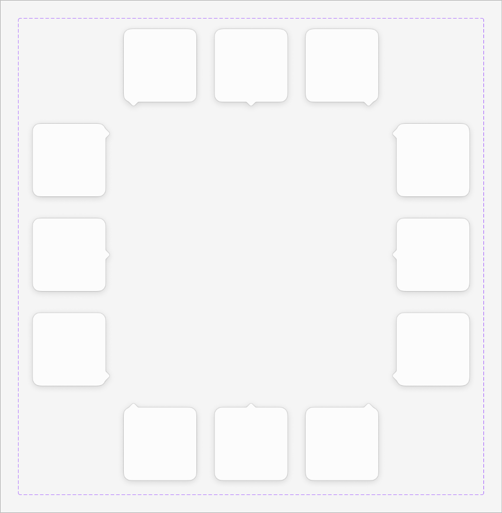

# Apple HIG Popovers System — macOS Admin Specification

> *"A popover is a transient view that appears above other content when people click or tap a control or interactive area."*  
> — **Apple Human Interface Guidelines (Popovers)** ([developer.apple.com/design/human-interface-guidelines/popovers](https://developer.apple.com/design/human-interface-guidelines/popovers))

Dokumen ini mendefinisikan standar resmi implementasi **Popovers (`NSPopover`)** pada macOS Tahoe UI Kit, matriks 12 posisi panah penunjuk (*beak / arrow*), aturan interaksi transien (*light dismiss*), geometri material kaca cair (*liquid glass*), serta penerapannya pada antarmuka backend/admin MobiCare.

---

## 1. Anatomi & Matriks 12 Posisi Panah Popover (Ref 43)



Popover Apple memiliki ciri visual paling khas berupa **panah penunjuk terintegrasi (*beak / arrow*)** yang mengarah langsung ke kontrol atau area pemicunya (*anchor element*). Gambar referensi resmi Apple Design Resources di atas memperlihatkan 12 konfigurasi posisi panah yang simetris:

### A. Tiga Sisi Atas (Panah Menunjuk ke Atas / Anchor di Atas Popover):
1. **Top-Leading / Top-Left Arrow**: Panah berada di sudut kiri atas, digunakan ketika kontrol pemicu berada di kiri atas (misal tombol pertama pada toolbar).
2. **Top-Center Arrow**: Panah berada tepat di tengah sisi atas, digunakan ketika kontrol pemicu berada tepat di atas popover.
3. **Top-Trailing / Top-Right Arrow**: Panah berada di sudut kanan atas, digunakan ketika kontrol pemicu berada di kanan atas (misal tombol filter di pojok kanan toolbar).

### B. Tiga Sisi Bawah (Panah Menunjuk ke Bawah / Anchor di Bawah Popover):
4. **Bottom-Leading / Bottom-Left Arrow**: Panah di sudut kiri bawah, menunjuk ke kontrol pemicu di bawahnya.
5. **Bottom-Center Arrow**: Panah di tengah bawah, menunjuk ke kontrol pemicu tepat di bawah popover (misal tombol pada statusbar bawah).
6. **Bottom-Trailing / Bottom-Right Arrow**: Panah di sudut kanan bawah, menunjuk ke kontrol di kanan bawah.

### C. Tiga Sisi Kiri (Panah Menunjuk ke Kiri / Anchor di Sisi Kiri Popover):
7. **Leading-Top / Left-Top Arrow**: Panah di sisi kiri atas, menunjuk ke item baris tabel atau menu di sebelah kiri.
8. **Leading-Center / Left-Center Arrow**: Panah tepat di tengah sisi kiri, menunjuk ke ikon atau avatar di sebelah kiri.
9. **Leading-Bottom / Left-Bottom Arrow**: Panah di sisi kiri bawah, menunjuk ke elemen bawah di sebelah kiri.

### D. Tiga Sisi Kanan (Panah Menunjuk ke Kanan / Anchor di Sisi Kanan Popover):
10. **Trailing-Top / Right-Top Arrow**: Panah di sisi kanan atas, menunjuk ke elemen di sisi kanan popover.
11. **Trailing-Center / Right-Center Arrow**: Panah di tengah kanan.
12. **Trailing-Bottom / Right-Bottom Arrow**: Panah di sisi kanan bawah.

---

## 2. Geometri & Spesifikasi Material Liquid Glass

Berdasarkan analisis pixel pada aset vektor resmi macOS Tahoe UI Kit, popover dibangun dengan spesifikasi presisi berikut:

| Elemen Geometri | Ukuran / Nilai | Penjelasan Teknis |
| :--- | :--- | :--- |
| **Radius Sudut (*Corner Radius*)** | **`12px` - `14px`** | Menggunakan kelengkungan kontinu squircle khas Apple, tanpa sudut patah tajam. |
| **Tinggi Panah (*Arrow Height*)** | **`8px` - `10px`** | Panjang juluran panah dari badan kontainer ke titik puncak penunjuk. |
| **Lebar Dasar Panah (*Arrow Base*)**| **`16px` - `20px`** | Lebar alas segitiga panah dengan transisi fillet melengkung (*smooth fillet*) menyatu ke kontainer. |
| **Jarak Offset dari Trigger** | **`4px` - `6px`** | Ruang nafas antara ujung lancip panah dengan batas fisik tombol kontrol pemicu. |
| **Material Latar Belakang** | **Liquid Glass Medium** | Light: `rgba(255, 255, 255, 0.88)`<br>Dark: `rgba(36, 36, 38, 0.85)` |
| **Efek Kaca (*Blur & Saturation*)** | **`blur(30px) saturate(190%)`** | Memberikan efek translusensi buram berkelas Apple tanpa mengorbankan keterbacaan teks. |
| **Garis Batas (*Hairline Border*)** | **`0.5px solid`** | Light: `rgba(0, 0, 0, 0.12)`<br>Dark: `rgba(255, 255, 255, 0.16)` |
| **Multi-layer Shadow (*Elevation*)**| **Floating Popover Shadow** | `0 16px 36px rgba(0, 0, 0, 0.18), 0 4px 10px rgba(0, 0, 0, 0.08)` |

---

## 3. Matriks Perbandingan Komponen Presentasi macOS

Seringkali terjadi kerancuan antara Popover, Menu, Sheet, Alert, dan Tooltip. Berikut pembedaan tegas menurut pedoman Apple HIG:

| Komponen | Karakter Interaksi | Panah Penunjuk (*Beak*) | Konten yang Ditampung | Perilaku Penutupan (*Dismissal*) |
| :--- | :--- | :---: | :--- | :--- |
| **Popover** (`NSPopover`) | **Transien / Ringan** | **YA** | Tampilan kaya (*rich view*): kartu profil, kalender tanggal, kalkulator, filter multi-kontrol. | Otomatis tutup saat klik di luar (*light dismiss*) atau tombol aksi selesai. |
| **Menu** (`NSMenu`) | **Transien Perintah** | **TIDAK** | Daftar vertikal aksi/perintah teks murni dengan shortcut keyboard (`⌘Z`, `⌘S`). | Otomatis tutup saat satu perintah diklik atau klik di luar. |
| **Sheet Modal** (`NSWindow.beginSheet`) | **Modal Tertaut Jendela** | **TIDAK** | Alur kerja lengkap (Save Dialog, formulir import data, pengaturan ekstensif). | Memblokir jendela induk sampai tombol Save / Cancel diklik. |
| **Alert Dialog** (`NSAlert`) | **Modal Kritis Memblokir**| **TIDAK** | Pesan konfirmasi kritis singkat (Hapus data permanen, peringatan unsaved changes). | Memblokir seluruh aplikasi/jendela hingga pilihan diambil. |
| **Tooltip** | **Pasif Hover** | **TIDAK** | Teks bantuan satu kalimat pendek (muncul setelah jeda kursor diam). | Otomatis hilang saat kursor bergerak menjauh. |

---

## 4. Prinsip & Aturan Emas Desain Apple untuk Popovers

### 1. Hanya Satu Popover pada Satu Waktu (*Show One Popover at a Time*)
> **Aturan Mutlak Apple HIG**: Jangan pernah memunculkan popover di dalam popover lain (*no cascading or nested popovers*). Jika interaksi di dalam popover memerlukan langkah lanjutan, perbarui tampilan di dalam popover tersebut (*view transition*) atau gunakan Sheet modal.

### 2. Hindari Tombol "Tutup" / "Batal" yang Berlebihan
Karena popover bersifat transien, pengguna mengharapkan popover **otomatis menutup saat mengeklik di area mana saja di luar popover** (*light dismiss*) atau mengeklik kembali tombol pemicunya. Jangan membebani ruang sempit popover dengan tombol "Tutup" kecuali popover memuat alur formulir yang memerlukan aksi eksplisit *"Simpan / Selesai"*.

### 3. Jaga Ukuran Tetap Kompak (*Keep It Compact*)
Popover dirancang untuk fokus pada tugas mikro yang cepat. Jangan membuat popover berukuran masif atau memuat halaman dengan scrollbar panjang yang melelahkan. Jika tugas membutuhkan banyak ruang, gunakan **Sheet Attached Modal** atau **Inspector Sidebar**.

### 4. Deteksi Batas Layar Dinamis (*Boundary Collision & Flipping*)
Popover harus secara otomatis menyesuaikan posisinya terhadap batas tepi viewport:
- Jika dibuka di dekat tepi bawah layar dan ruang tidak mencukupi, arah panah harus otomatis membalik ke atas (*flip to top*).
- Jika dibuka di tepi kanan layar, posisi panah bergeser ke arah kanan (*align right edge*) agar badan popover tidak terpotong keluar layar.

### 5. Tear-Off Panel (Fitur Khas macOS Desktop)
Pada ekosistem asli macOS, popover dapat ditarik (*drag tear-off*) untuk bertransformasi menjadi jendela melayang independen (*utility panel* / `NSPanel`) sehingga pengguna dapat terus melihat informasinya sambil berinteraksi dengan jendela utama.

---

## 5. Penerapan Nyata di Backend Admin MobiCare

| Kasus Penggunaan di MobiCare | Komponen / Rute | Letak Panah (*Arrow Position*) | Konten Popover |
| :--- | :--- | :--- | :--- |
| **Kartu Profil Cepat Pelanggan** | `CustomerQuickCard.tsx`<br>(`/admin/garansi`, `/admin/faktur`) | **Leading-Center (`◀`)** (menunjuk ke avatar/nama pelanggan di tabel) | Foto pelanggan, No. WhatsApp aktif (klik untuk chat), riwayat 3 servis terakhir, status membership. |
| **Filter Kolom Rentang Harga** | `PriceFilterPopover.tsx`<br>(`/admin/pricelist`) | **Top-Trailing (`▲` kanan)** (menunjuk ke ikon filter header tabel harga) | Dual-slider rentang harga (Rp 50rb s.d. Rp 3jt), tombol preset *Original*, *High Copy*, *Refurbished*. |
| **Date Range Selector** | `DateRangePopover.tsx`<br>(`/admin/dashboard`) | **Top-Leading (`▲` kiri)** (menunjuk ke tombol periode tanggal) | Kalender mini dua bulan berdampingan, tombol preset: *Hari Ini*, *7 Hari Terakhir*, *Bulan Ini*, *Kustom*. |
| **Kalkulator Margin Instan** | `MarginCalculatorPopover.tsx`<br>(`/admin/pricelist/ServiceEditor`) | **Bottom-Leading (`▼` kiri)** (menunjuk ke input harga modal) | Slider markup margin keuntungan (misal 30%), kalkulasi pajak PPh/PPN, dan tombol *"Terapkan ke Harga Jual"*. |
| **Detail Status Tracking Servis** | `RepairTimelinePopover.tsx`<br>(`/admin/servis`) | **Leading-Top (`◀` atas)** (menunjuk ke badge status di tabel) | Timeline vertikal riwayat pengerjaan: Teknisi penerima, proses pembongkaran, pergantian sparepart, uji QC. |

---

## 6. Implementasi CSS Token & Shape Geometri Popover

Berikut adalah implementasi CSS siap pakai untuk komponen Popover macOS dengan panah beradius halus dan efek liquid glass:

```css
/* --- macOS Popover Tokens --- */
:root {
  --mac-popover-bg: rgba(255, 255, 255, 0.88);
  --mac-popover-border: rgba(0, 0, 0, 0.12);
  --mac-popover-shadow: 0 16px 36px rgba(0, 0, 0, 0.18), 0 4px 10px rgba(0, 0, 0, 0.08);
  --mac-popover-radius: 12px;
  --mac-popover-arrow-size: 10px;
}

@media (prefers-color-scheme: dark) {
  :root {
    --mac-popover-bg: rgba(36, 36, 38, 0.85);
    --mac-popover-border: rgba(255, 255, 255, 0.16);
    --mac-popover-shadow: 0 20px 42px rgba(0, 0, 0, 0.45), 0 6px 14px rgba(0, 0, 0, 0.25);
  }
}

/* Base Popover Container */
.mac-popover {
  position: absolute;
  z-index: 1000;
  background: var(--mac-popover-bg);
  backdrop-filter: blur(30px) saturate(190%);
  -webkit-backdrop-filter: blur(30px) saturate(190%);
  border: 0.5px solid var(--mac-popover-border);
  border-radius: var(--mac-popover-radius);
  box-shadow: var(--mac-popover-shadow);
  padding: 12px 14px;
  min-width: 200px;
  max-width: 380px;
  font-family: -apple-system, BlinkMacSystemFont, "SF Pro Text", system-ui, sans-serif;
  font-size: 13px;
  line-height: 1.4;
  color: var(--mac-text-primary);
  animation: macPopoverSpringIn 0.22s cubic-bezier(0.16, 1, 0.3, 1);
  transform-origin: var(--popover-transform-origin, center);
}

/* Micro-spring Entrance Animation */
@keyframes macPopoverSpringIn {
  from {
    opacity: 0;
    transform: scale(0.94);
  }
  to {
    opacity: 1;
    transform: scale(1);
  }
}

/* Integrated Arrow Geometry (Using Pseudo-elements) */
.mac-popover::before,
.mac-popover::after {
  content: "";
  position: absolute;
  width: 0;
  height: 0;
  border-style: solid;
}

/* --- Arrow: Top-Center (Pointing UP) --- */
.mac-popover--arrow-top-center::before {
  top: -10px;
  left: 50%;
  transform: translateX(-50%);
  border-width: 0 10px 10px 10px;
  border-color: transparent transparent var(--mac-popover-border) transparent;
}
.mac-popover--arrow-top-center::after {
  top: -9px;
  left: 50%;
  transform: translateX(-50%);
  border-width: 0 9px 9px 9px;
  border-color: transparent transparent var(--mac-popover-bg) transparent;
}

/* --- Arrow: Top-Leading / Top-Left (Pointing UP) --- */
.mac-popover--arrow-top-left::before {
  top: -10px;
  left: 20px;
  border-width: 0 10px 10px 10px;
  border-color: transparent transparent var(--mac-popover-border) transparent;
}
.mac-popover--arrow-top-left::after {
  top: -9px;
  left: 21px;
  border-width: 0 9px 9px 9px;
  border-color: transparent transparent var(--mac-popover-bg) transparent;
}

/* --- Arrow: Bottom-Center (Pointing DOWN) --- */
.mac-popover--arrow-bottom-center::before {
  bottom: -10px;
  left: 50%;
  transform: translateX(-50%);
  border-width: 10px 10px 0 10px;
  border-color: var(--mac-popover-border) transparent transparent transparent;
}
.mac-popover--arrow-bottom-center::after {
  bottom: -9px;
  left: 50%;
  transform: translateX(-50%);
  border-width: 9px 9px 0 9px;
  border-color: var(--mac-popover-bg) transparent transparent transparent;
}

/* --- Arrow: Leading-Center / Left (Pointing LEFT) --- */
.mac-popover--arrow-left-center::before {
  left: -10px;
  top: 50%;
  transform: translateY(-50%);
  border-width: 10px 10px 10px 0;
  border-color: transparent var(--mac-popover-border) transparent transparent;
}
.mac-popover--arrow-left-center::after {
  left: -9px;
  top: 50%;
  transform: translateY(-50%);
  border-width: 9px 9px 9px 0;
  border-color: transparent var(--mac-popover-bg) transparent transparent;
}

/* Header inside Popover */
.mac-popover__header {
  display: flex;
  align-items: center;
  justify-content: space-between;
  padding-bottom: 8px;
  margin-bottom: 8px;
  border-bottom: 0.5px solid rgba(0, 0, 0, 0.08);
  font-weight: 600;
  font-size: 13px;
}

.mac-popover__close-btn {
  background: transparent;
  border: none;
  color: var(--mac-text-secondary);
  font-size: 14px;
  cursor: pointer;
  padding: 2px 4px;
  border-radius: 4px;
}
.mac-popover__close-btn:hover {
  background: rgba(0, 0, 0, 0.06);
  color: var(--mac-text-primary);
}
```

---

## 7. Checklist Verifikasi Standar Popover Apple

- [x] **Arrow Beak**: Memiliki panah penunjuk terintegrasi ke elemen kontrol pemicu.
- [x] **Light Dismiss**: Menutup secara instan saat pengguna mengeklik di luar area popover (*outside click*) atau menekan tombol `Escape`.
- [x] **Non-Cascading**: Tidak pernah membuka popover lain dari dalam popover aktif.
- [x] **Liquid Glass Medium**: Menggunakan material kaca translusen `blur(30px)` dengan hairline border `0.5px`.
- [x] **Kompak & Terfokus**: Berukuran ringkas untuk alur kerja mikro tanpa scrollbar panjang berlebih.
- [x] **Boundary Adaptability**: Membalik arah panah (*flipping*) atau menggeser posisi jika berada di ambang tepi layar.
