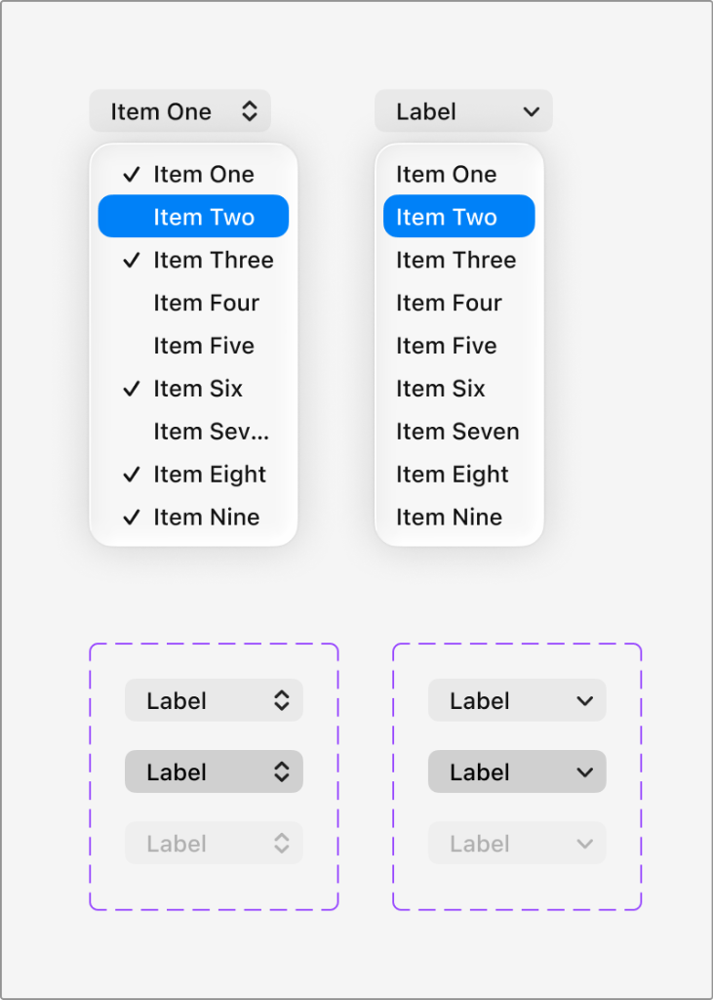
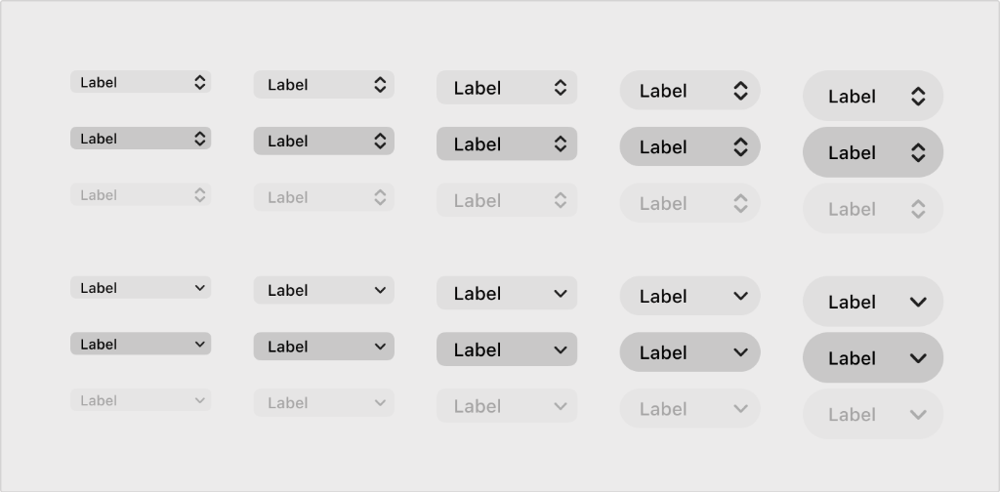

# Apple HIG Pop-Up vs Pull-Down Buttons System — macOS Admin Specification

> *"A pop-up button displays a menu of mutually exclusive options. A pull-down button displays a menu of items or actions that directly relate to the button’s purpose."*  
> — **Apple Human Interface Guidelines (Pop-up buttons & Pull-down buttons)** ([developer.apple.com/design/human-interface-guidelines/pop-up-buttons](https://developer.apple.com/design/human-interface-guidelines/pop-up-buttons) | [developer.apple.com/design/human-interface-guidelines/pull-down-buttons](https://developer.apple.com/design/human-interface-guidelines/pull-down-buttons))

Dokumen ini mendefinisikan standar pembedaan fundamental antara **Pop-Up Buttons (`NSPopUpButton`)** vs **Pull-Down Buttons (`NSPullDownButton`)**, indikator visual (panah ganda `⇅` vs panah tunggal `⌄`), perilaku pemutakhiran judul tombol, matriks 5 skala ukuran, serta penerapannya pada backend/admin MobiCare.

---

## 1. Perbedaan Mendasar Pop-Up vs Pull-Down Buttons (Ref 41)



Dalam ekosistem desain macOS, kedua tombol ini terlihat mirip namun memiliki fungsi dan semantik visual yang sangat berbeda:

| Aspek Karakteristik | Pop-Up Button (`NSPopUpButton`) | Pull-Down Button (`NSPullDownButton`) |
| :--- | :--- | :--- |
| **Ikon Indikator Resmi** | **Panah Ganda Vertikal (`⇅` / `▲▼`)** | **Panah Tunggal ke Bawah (`⌄` / `▼`)** |
| **Tujuan & Kegunaan** | Memilih **1 opsi tetap dari daftar opsi mutually exclusive** (pilihan tunggal eksklusif). | Memicu **tindakan atau perintah kerja** yang terkait langsung dengan label tombol. |
| **Perilaku Judul Tombol** | **Dinamis**: Judul tombol langsung berubah menampilkan nilai yang sedang aktif terpilih (misal dari *"Kategori"* menjadi *"LCD Original"*). | **Statis / Konstan**: Judul tombol tetap sama sebelum dan sesudah menu ditutup (misal *"Tindakan"*, *"Urutkan"*, *"Opsi"*). |
| **Tanda Centang Dropdown (`✓`)**| **Ada**: Opsi yang sedang aktif terpilih ditandai dengan tanda centang `✓` di sisi kiri. | **Tidak Ada**: Berisi daftar aksi/perintah (bisa memuat ikon dan shortcut) tanpa centang persisten. |
| **Nilai Default** | Menampilkan opsi rekomendasi default yang bermakna sejak awal. | Menampilkan kata kerja atau kata benda ringkas yang menjelaskan target tindakan. |

---

## 2. Anatomi Status Interaksi & Matriks 5 Skala Ukuran (Ref 42)



### Matriks 3 Status Interaksi:
1. **Default (Resting)**: Kapsul abu-abu ultra-halus `rgba(0, 0, 0, 0.06)` (Light) / `rgba(255, 255, 255, 0.08)` (Dark), border radius squircle, teks hitam `#1D1D1F`.
2. **Pressed / Active**: Kapsul abu-abu lebih pekat `rgba(0, 0, 0, 0.16)` / `#D1D1D6` menandakan menu flyout sedang terbuka di bawah tombol.
3. **Disabled**: Opasitas memudar (`opacity: 0.42`), teks dan chevron abu-abu redup, kursor `not-allowed`.

---

### Matriks 5 Skala Ukuran (Ref 42):

| Skala Ukuran | Tinggi (*Height*) | Font Size | Radius Sudut | Padding Samping | Rekomendasi Penggunaan di MobiCare |
| :--- | :--- | :--- | :--- | :--- | :--- |
| **Mini** | `20px` | `11px` | `4px` | `0 6px` | Filter sel tabel data padat, toolbar pagination. |
| **Small** | `24px` | `12px` | `5px` | `0 8px` | Secondary inspector sidebar, modal utility toolbar. |
| **Regular (Default)** | **`28px`** | **`13px`** | **`6px`** | **`0 10px`** | **Standar utama formulir admin MobiCare (macOS standard body).** |
| **Large** | `34px` | `14px` | `8px` | `0 12px` | Dialog formulir utama, Save Dialog format selector. |
| **Extra Large** | `40px` | `15px` | `10px` | `0 14px` | Standalone header filter global. |

---

## 3. Penerapan Nyata di Backend Admin MobiCare

### A. Kapan Menggunakan Pop-Up Button (`⇅`)?
Gunakan saat admin harus **memilih salah satu nilai/status**:
- **Pemilihan Kategori Servis (`ServiceEditor.tsx`)**: `LCD Original ⇅` (pilihan: LCD Original, Baterai, Kamera Belakang, Speaker, Port Charger).
- **Pemilihan Format Ekspor (`ExportModal.tsx`)**: `Excel Workbook (.xlsx) ⇅` (pilihan: .xlsx, .csv, .json).
- **Status Garansi (`/admin/garansi`)**: `Klaim Disetujui ⇅` (pilihan: Menunggu Verifikasi, Klaim Disetujui, Dalam Pengerjaan, Selesai, Ditolak).

### B. Kapan Menggunakan Pull-Down Button (`⌄`)?
Gunakan saat admin memicu **daftar aksi atau pengurutan**:
- **Bilah Aksi Massal (`PriceGrid.tsx`)**: `Tindakan ⌄` (menu aksi: *Ekspor Data Terpilih, Cetak Label Servis, Perbarui Margin Massal, Hapus Data Terpilih*).
- **Pengurutan Kolom Tabel**: `Urutkan ⌄` (menu aksi: *Berdasarkan Nama, Berdasarkan Harga Tertinggi, Berdasarkan Stok Terdikit*).
- **Opsi Filter Cepat**: `Filter Status ⌄` (menu aksi: *Tampilkan Semua, Hanya Stok Menipis, Hanya Promo Aktif*).

---

## 4. Implementasi CSS Utility (`.mac-popup-btn` & `.mac-pulldown-btn`)

```css
/* ==========================================================================
   Apple HIG macOS Native Pop-Up and Pull-Down Buttons
   ========================================================================== */

/* Basis Bersama */
.mac-menu-btn {
  display: inline-flex;
  align-items: center;
  justify-content: space-between;
  height: 28px; /* Standar Regular macOS 28px */
  padding: 0 10px;
  background: rgba(0, 0, 0, 0.06);
  border: 1px solid rgba(0, 0, 0, 0.1);
  border-radius: 6px;
  font-family: -apple-system, BlinkMacSystemFont, "SF Pro Text", "Helvetica Neue", sans-serif;
  font-size: 13px;
  font-weight: 400;
  color: #1d1d1f;
  cursor: pointer;
  user-select: none;
  box-shadow: 0 1px 2px rgba(0, 0, 0, 0.04);
  transition: background-color 0.12s ease, border-color 0.12s ease, transform 0.08s ease;
  gap: 8px;
}

.mac-menu-btn:hover {
  background: rgba(0, 0, 0, 0.09);
  border-color: rgba(0, 0, 0, 0.14);
}

.mac-menu-btn:active,
.mac-menu-btn.is-open {
  background: rgba(0, 0, 0, 0.16);
  border-color: rgba(0, 0, 0, 0.2);
  transform: scale(0.98);
}

.mac-menu-btn:disabled,
.mac-menu-btn.is-disabled {
  opacity: 0.42;
  cursor: not-allowed;
  pointer-events: none;
  box-shadow: none;
}

/* 1. POP-UP BUTTON (Panah Ganda ⇅) */
.mac-popup-btn .mac-btn-chevron {
  display: inline-flex;
  flex-direction: column;
  justify-content: center;
  align-items: center;
  width: 8px;
  height: 12px;
  color: rgba(0, 0, 0, 0.55);
  flex-shrink: 0;
}

/* 2. PULL-DOWN BUTTON (Panah Tunggal ⌄) */
.mac-pulldown-btn .mac-btn-chevron {
  display: inline-flex;
  align-items: center;
  justify-content: center;
  width: 10px;
  height: 10px;
  color: rgba(0, 0, 0, 0.55);
  flex-shrink: 0;
}

/* Skala Ukuran */
.mac-btn-mini   { height: 20px; font-size: 11px; padding: 0 6px; border-radius: 4px; }
.mac-btn-small  { height: 24px; font-size: 12px; padding: 0 8px; border-radius: 5px; }
.mac-btn-large  { height: 34px; font-size: 14px; padding: 0 12px; border-radius: 8px; }
.mac-btn-xlarge { height: 40px; font-size: 15px; padding: 0 14px; border-radius: 10px; }

/* Dark Mode Adaptation */
@media (prefers-color-scheme: dark) {
  .mac-menu-btn {
    background: rgba(255, 255, 255, 0.08);
    border-color: rgba(255, 255, 255, 0.12);
    color: #f5f5f7;
    box-shadow: 0 1px 2px rgba(0, 0, 0, 0.3);
  }
  .mac-menu-btn:hover {
    background: rgba(255, 255, 255, 0.12);
    border-color: rgba(255, 255, 255, 0.18);
  }
  .mac-menu-btn:active,
  .mac-menu-btn.is-open {
    background: rgba(255, 255, 255, 0.2);
  }
  .mac-menu-btn .mac-btn-chevron {
    color: rgba(255, 255, 255, 0.6);
  }
}
```
