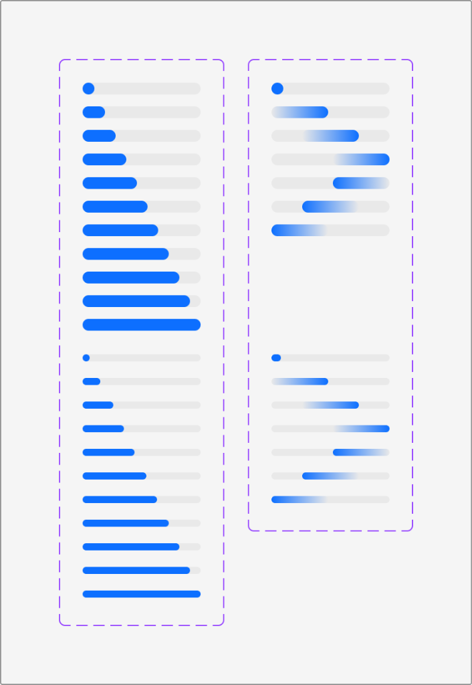

# Apple HIG Progress Indicators System — macOS Admin Specification

> *"Progress indicators let people know that your app isn’t stalled while it loads content or performs lengthy operations."*  
> — **Apple Human Interface Guidelines (Progress indicators)** ([developer.apple.com/design/human-interface-guidelines/progress-indicators](https://developer.apple.com/design/human-interface-guidelines/progress-indicators))

Dokumen ini mendefinisikan standar resmi implementasi **Progress Indicators (`NSProgressIndicator`)** pada macOS Tahoe UI Kit, matriks bar terukur (*determinate*) vs tak terukur (*indeterminate*), skala ketebalan Regular vs Small, animasi pulsa meluncur, serta penerapannya pada antarmuka backend/admin MobiCare.

---

## 1. Analisis Matriks Progress Bars (Ref 44)



Berdasarkan aset resmi Apple Design Resources di atas, indikator progres linear macOS dibagi menjadi 2 kolom dan 2 skala ketebalan utama:

### A. Kolom Kiri: Determinate Progress Bar (Terukur)
Digunakan ketika durasi atau kuantitas tugas **dapat dihitung secara terukur dan pasti** (misalnya: unduhan file 15 MB dari 30 MB, atau ekspor 450 dari 1.000 data servis).
- **Inkrementasi Visual**: Menampilkan progres dari titik awal berupa lingkaran (*dot*) di 0%, berangsur memanjang secara proporsional (~10%, 20%, 30%, 40%, 50%, 60%, 70%, 80%, 90%) hingga terisi penuh 100%.
- **Ujung Melengkung Kapsul (*Pill Caps*)**: Kedua ujung bar latar dan bar pengisi selalu berbentuk setengah lingkaran sempurna (*full border-radius*).
- **Dua Skala Ukuran**:
  1. **Regular Height (`~6px` - `8px`)**: Ditampilkan pada separuh atas kolom kiri, ideal untuk dialog modal (seperti `ExportModal.tsx`) atau lembar konfirmasi.
  2. **Small / Thin Height (`~3px` - `4px`)**: Ditampilkan pada separuh bawah kolom kiri, ideal untuk status bar, sel tabel, atau di dalam `Image Well`.

### B. Kolom Kanan: Indeterminate Progress Bar (Tak Terukur)
Digunakan ketika durasi proses **tidak dapat diprediksi secara matematis** (misalnya: inisialisasi koneksi server, query pencarian database kompleks, atau kompresi gambar awal).
- **Animasi Pulsa Meluncur (*Sweeping Pulse*)**: Sebuah segmen kapsul biru meluncur secara kontinu dari kiri ke kanan di sepanjang lintasan abu-abu.
- **Gradien Halus (*Feathered Gradient Edges*)**: Kapsul biru memiliki gradasi halus pada tepinya sehingga pergerakannya tampak lembut, tenang, dan tidak patah.
- **Dua Skala Ukuran**:
  1. **Regular Indeterminate (`~6px` - `8px`)**: Animasi kapsul bergradasi pada tinggi reguler.
  2. **Small Indeterminate (`~3px` - `4px`)**: Animasi garis mikro bergradasi tipis, sangat cocok diletakkan tepat di bawah header monobar saat data sedang dimuat.

---

## 2. Geometri, Warna & Spesifikasi Token

| Komponen / Properti | Light Mode | Dark Mode | Spesifikasi Teknis |
| :--- | :--- | :--- | :--- |
| **Track Latar Belakang** | `rgba(0, 0, 0, 0.08)` | `rgba(255, 255, 255, 0.12)` | Permukaan netral ultra-halus dengan sudut kapsul membulat. |
| **Fill Aktif (Determinate)** | `#007AFF` (Apple Blue) | `#0A84FF` (Apple Blue Dark) | Warna aksen sistem solid bervibrasi tinggi. |
| **Fill Pulsa (Indeterminate)**| Gradien `#007AFF` dengan fade | Gradien `#0A84FF` dengan fade | `linear-gradient(90deg, transparent 0%, #007AFF 50%, transparent 100%)` |
| **Tinggi Regular Bar** | `6px` | `6px` | Radius: `3px` (atau `9999px`). |
| **Tinggi Small Bar** | `3.5px` | `3.5px` | Radius: `2px` (atau `9999px`). |
| **Durasi Siklus Indeterminate**| `1.6s` | `1.6s` | `cubic-bezier(0.4, 0, 0.2, 1)` looping infinite. |

---

## 3. Komponen Pendukung: Activity Spinner (`NSProgressIndicatorSpinningStyle`)

Selain progress bar linear, macOS HIG menetapkan penggunaan **Activity Spinner** untuk area yang sangat terbatas:
- **Ukuran Standar**:
  - **Mini / Inline (`14px` - `16px`)**: Di dalam tombol saat status loading (misal tombol *"Menyimpan..."*).
  - **Medium (`24px` - `28px`)**: Di tengah area kartu saat memuat data grafik atau tabel.
  - **Large (`36px` - `48px`)**: Di tengah layar saat proses booting / inisialisasi seluruh modul.
- **Warna**: Mengikuti warna teks konteksnya (`currentColor`) dengan opasitas segmen bertingkat menyerupai roda kipas Apple.

---

## 4. Prinsip & Aturan Emas Desain Apple untuk Progress Indicators

### 1. Tampilkan Konten Instan Bila Memungkinkan (*Show Content Instantly*)
> **Aturan Apple HIG**: Jangan memblokir layar dengan progress bar kosong jika ada konten lokal, cache, atau struktur layout yang dapat ditampilkan segera. Gunakan teknik *optimistic UI* atau skeleton loading.

### 2. Beri Label Teks yang Deskriptif (*Provide Clear Text Context*)
Bila proses memakan waktu lebih dari 1-2 detik, selalu pasang label teks satu baris di atas atau di bawah bar progres yang menjelaskan aktivitas yang sedang berjalan:
- Contoh baik: *"Mengekspor 850 dari 1.250 item pricelist..."*, *"Mengunggah foto sparepart (1.2 MB / 3.4 MB)..."*
- Hindari label generik tanpa informasi: *"Memproses..."*, *"Loading..."*.

### 3. Sediakan Tombol Pembatalan untuk Operasi Panjang
Untuk operasi data berat (seperti unduh backup database atau ekspor ribuan baris), sediakan tombol pembatalan kecil (ikon silang bulat `(x)` atau tombol `Batal`) agar admin dapat menghentikan proses tanpa harus me-refresh browser.

### 4. Transisi Nilai yang Mulus (*Smooth Interpolation*)
Saat nilai determinate bertambah, gunakan transisi CSS `transition: width 0.25s cubic-bezier(0.16, 1, 0.3, 1)` agar bar tidak melompat secara kaku dan terkesan alami.

---

## 5. Penerapan Nyata di Backend Admin MobiCare

| Kasus Penggunaan di MobiCare | Komponen / Rute | Jenis & Ukuran Indikator | Karakteristik Visual & Fungsi |
| :--- | :--- | :--- | :--- |
| **Ekspor Database Pricelist** | `ExportModal.tsx`<br>(`/admin/pricelist`) | **Determinate Regular (6px)** | Menampilkan persentase ekspor baris data ke Excel/CSV (`68%`), jumlah baris terproses, dan tombol Batal. |
| **Upload Foto Sparepart & Galeri** | `ImageWell.tsx`<br>(`/admin/gallery`, `/admin/promo`) | **Determinate Small (3.5px)** | Menempel di batas bawah kotak pratinjau gambar saat mengunggah file media ke server. |
| **Pemuatan Data Filter Tabel** | `PriceGrid.tsx`<br>(Header Monobar) | **Indeterminate Small (3.5px)** | Garis tipis meluncur tepat di bawah titlebar monobar saat query filter kategori sedang dieksekusi. |
| **Sinkronisasi Cache Katalog** | Bilah Status Bawah (`StatusBar`) | **Indeterminate Small (3.5px)** | Meluncur di sudut kanan bawah saat data sinkron dengan server offline worker. |
| **Tombol Form Simpan Perubahan** | `AdminButton.tsx`<br>(Semua formulir admin) | **Inline Spinner (14px)** | Ikon spinner berputar menggantikan teks tombol saat mutasi data POST sedang diproses. |

---

## 6. Implementasi CSS Tokens & Keyframe Animations

```css
/* --- macOS Progress Indicator Tokens --- */
:root {
  --mac-progress-track: rgba(0, 0, 0, 0.08);
  --mac-progress-fill: #007AFF;
  --mac-progress-fill-gradient: linear-gradient(
    90deg,
    rgba(0, 122, 255, 0) 0%,
    rgba(0, 122, 255, 0.85) 45%,
    #007AFF 50%,
    rgba(0, 122, 255, 0.85) 55%,
    rgba(0, 122, 255, 0) 100%
  );
  --mac-progress-radius: 9999px;
  --mac-progress-height-regular: 6px;
  --mac-progress-height-small: 3.5px;
}

@media (prefers-color-scheme: dark) {
  :root {
    --mac-progress-track: rgba(255, 255, 255, 0.12);
    --mac-progress-fill: #0A84FF;
    --mac-progress-fill-gradient: linear-gradient(
      90deg,
      rgba(10, 132, 255, 0) 0%,
      rgba(10, 132, 255, 0.85) 45%,
      #0A84FF 50%,
      rgba(10, 132, 255, 0.85) 55%,
      rgba(10, 132, 255, 0) 100%
    );
  }
}

/* Base Track */
.mac-progress {
  position: relative;
  width: 100%;
  background: var(--mac-progress-track);
  border-radius: var(--mac-progress-radius);
  overflow: hidden;
}

/* Skala Ukuran */
.mac-progress--regular {
  height: var(--mac-progress-height-regular);
}

.mac-progress--small {
  height: var(--mac-progress-height-small);
}

/* Determinate Fill Bar */
.mac-progress__fill {
  height: 100%;
  background: var(--mac-progress-fill);
  border-radius: var(--mac-progress-radius);
  transition: width 0.25s cubic-bezier(0.16, 1, 0.3, 1);
}

/* Indeterminate Sweeping Pulse */
.mac-progress--indeterminate {
  background: var(--mac-progress-track);
}

.mac-progress--indeterminate .mac-progress__fill {
  position: absolute;
  top: 0;
  left: 0;
  width: 45%;
  height: 100%;
  background: var(--mac-progress-fill-gradient);
  border-radius: var(--mac-progress-radius);
  animation: macProgressSweep 1.6s cubic-bezier(0.4, 0, 0.2, 1) infinite;
}

@keyframes macProgressSweep {
  0% {
    transform: translateX(-100%);
  }
  100% {
    transform: translateX(320%);
  }
}

/* Inline Spinner macOS Native Kipas */
.mac-spinner {
  display: inline-block;
  width: 16px;
  height: 16px;
  border: 2px solid rgba(0, 122, 255, 0.25);
  border-top-color: var(--mac-progress-fill);
  border-radius: 50%;
  animation: macSpin 0.75s linear infinite;
}

@keyframes macSpin {
  to {
    transform: rotate(360deg);
  }
}
```

---

## 7. Checklist Verifikasi Standar Progress Indicators Apple

- [x] **Pembedaan Determinate vs Indeterminate**: Menggunakan determinate bila persentase dapat dihitung dan indeterminate bila tidak.
- [x] **Dua Skala Ketebalan**: Regular 6px untuk modal/kartu dan Small 3.5px untuk monobar/tabel/image well.
- [x] **Pill Caps & Gradien Pulsa**: Memiliki sudut membulat sempurna dan gradien lembut pada kedua ujung pulsa indeterminate.
- [x] **Label Kontekstual**: Menyertakan teks ringkas penjelasan progres dan estimasi kuantitas.
- [x] **Interpolasi Halus**: Menggunakan transisi kurva cubic-bezier saat nilai progres bertambah.
