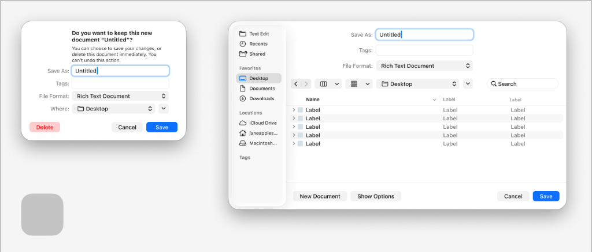

# Apple HIG Save Dialogs System — macOS Admin Specification

> *"Provide a save interface to let people change a file’s name, format, or location. By default, a new document’s title is 'Untitled' until people choose a custom name."*  
> — **Apple Human Interface Guidelines (File Management)** ([developer.apple.com/design/human-interface-guidelines/file-management](https://developer.apple.com/design/human-interface-guidelines/file-management))

Dokumen ini mendefinisikan standar dialog penyimpanan (*Save Dialog / Save As Sheet*), perbandingan varian kompak (*Compact / Unsaved Guard Sheet*) dengan varian penuh (*Expanded File Browser Sheet*), tata letak tombol aksi destruktif terisolasi (*isolated leading Delete button*), serta penerapannya untuk alur ekspor data dan pencegahan kehilangan data pada backend/admin MobiCare.

---

## 1. Karakteristik & Filosofi Apple HIG untuk Save Dialogs

Di lingkungan desktop macOS, dialog simpan (*Save Dialog*) disajikan sebagai **Sheet Modal** yang melekat langsung pada bingkai jendela induk (*window-attached sheet*):

1. **Dua Mode Presentasi (Ref 26)**:
   - **Compact Save Dialog (Mode Kompak)**:
     - Digunakan untuk penyimpanan cepat atau saat dialog dipicu oleh penutupan dokumen/halaman yang memiliki perubahan belum tersimpan (*unsaved changes blocker*).
     - Berisi input nama file (`Save As:`), tag, format file, dan pemilih folder ringkas (`Where: 📁 Desktop ⇅`) disertai tombol ekspansi (*disclosure button* `⌄`).
   - **Expanded Save Dialog (Mode Browser Lengkap)**:
     - Muncul ketika pengguna mengeklik tombol panah ekspansi `⌄` di sebelah dropdown lokasi.
     - Menyematkan antarmuka peramban Finder lengkap dua panel: sidebar favorit/lokasi di kiri, toolbar navigasi view switcher di atas, dan daftar file/folder di kanan.

2. **Pemisahan Spasial Tombol Aksi Destruktif (*Leading Delete vs Trailing Save*)**:
   - Sesuai standar tata letak Apple:
     - **Sisi Kiri (Leading)**: Tombol destruktif **`Delete` / `Buang Perubahan`** diletakkan terpisah sendiri di pojok kiri bawah menggunakan *soft red tint* (`rgba(255, 59, 48, 0.12)`, teks `#FF3B30`). Pemisahan fisik ini mencegah klik keliru secara dramatis.
     - **Sisi Kanan (Trailing)**: Pasangan tombol aman **`Cancel`** (netral abu-abu) dan **`Save`** (Primary Solid Apple Blue `#007AFF`).

3. **Kejelasan Komunikasi Status**:
   - Jika dipicu oleh upaya menutup lembar kerja yang belum disimpan:
     - Judul berupa pertanyaan langsung: *"Do you want to keep this new document 'Untitled'?"*
     - Deskripsi menjelaskan konsekuensi permanen: *"You can choose to save your changes, or delete this document immediately. You can't undo this action."*

---

## 2. Anatomi Varian Kompak vs Varian Penuh (Ref 26)



### Tabel Komparasi Fitur:

| Elemen Antarmuka | Compact Save Dialog (Kiri) | Expanded Save Dialog (Kanan) |
| :--- | :--- | :--- |
| **Lebar Kontainer** | `420px – 480px` | `720px – 860px` |
| **Header Status** | Ada (Judul pertanyaan tebal + teks penjelasan). | Ringkas (Langsung fokus ke bidang input). |
| **Bidang Input Utama** | `Save As:` (input teks + caret biru), `Tags:`, `File Format:` (pop-up button ⇅). | `Save As:`, `Tags:`, `File Format:` berada di pojok kanan atas form header. |
| **Pemilih Lokasi** | Dropdown ringkas satu baris (`Where: 📁 Desktop ⇅ ⌄`). | Finder Two-Pane Browser penuh (Sidebar Favorites/Locations + Table List View). |
| **Toolbar Navigasi** | Tidak ada. | Navigasi `< >`, View switcher segmented control (Icons/List/Columns), Sort order, dan Search bar pill. |
| **Tombol Kiri (Leading)**| `Delete` kapsul merah lembut (*soft red tint*). | Tombol aksi tambahan: `New Document` / `New Folder` dan `Show Options`. |
| **Tombol Kanan (Trailing)**| `Cancel` (pill abu-abu netral) + `Save` (pill biru solid `#007AFF`). | `Cancel` (pill abu-abu netral) + `Save` (pill biru solid `#007AFF`). |

---

## 3. Penerapan Nyata di Backend Admin MobiCare

### A. Dialog Ekspor Data Katalog & Laporan (`ExportModal.tsx`)
Ketika admin mengunduh data daftar harga (`/admin/pricelist`), riwayat servis, atau laporan garansi:
- Menampilkan **Compact Save Sheet**:
  - `Save As:` Pre-filled dengan nama bermakna, misal: `Pricelist-MobiCare-2026-10-22` (berfokus langsung dengan seleksi teks).
  - `File Format:` Pop-Up Button opsi format (`Excel Workbook (.xlsx)`, `Comma-Separated Values (.csv)`, `JSON Backup (.json)`).
  - `Where:` Menampilkan lokasi unduhan standar pengguna (`📁 Downloads ⇅`).
  - Tombol aksi: `Batal` (Cancel) dan `Unduh Data` (Save Apple Blue).

### B. Pelindung Data Belum Tersimpan (*Unsaved Changes Guard*)
Ketika admin sedang mengedit katalog harga atau mengubah status promo, lalu mencoba berpindah menu tanpa menekan simpan:
- Menampilkan **Compact Save Alert Sheet**:
  - **Judul**: *"Apakah Anda ingin menyimpan perubahan pada katalog harga?"*
  - **Deskripsi**: *"Perubahan yang belum disimpan akan hilang secara permanen jika Anda membuangnya sekarang."*
  - **Tombol Kiri (Leading)**: `Buang Perubahan` (*soft red tint*, teks `#FF3B30`).
  - **Tombol Kanan (Trailing)**: `Batal` (tetap di halaman edit) dan `Simpan Perubahan` (simpan ke database dan lanjutkan navigasi).

---

## 4. Implementasi CSS Utility (`.mac-save-sheet`)

```css
/* ==========================================================================
   Apple HIG macOS Save Dialog Sheet Component
   ========================================================================== */

/* Overlay Latar Belakang Jendela */
.mac-sheet-backdrop {
  position: fixed;
  inset: 0;
  background: rgba(0, 0, 0, 0.25);
  backdrop-filter: blur(8px);
  -webkit-backdrop-filter: blur(8px);
  display: flex;
  align-items: flex-start;
  justify-content: center;
  z-index: 999;
}

/* Lembar Dialog Sheet yang Melekat di Bawah Titlebar */
.mac-save-sheet {
  position: relative;
  width: 480px;
  margin-top: 38px; /* Tepat di bawah batas titlebar jendela macOS */
  background: #ffffff;
  border-radius: 12px;
  box-shadow: 
    0 20px 40px rgba(0, 0, 0, 0.2),
    0 0 0 1px rgba(0, 0, 0, 0.12);
  padding: 24px 28px 20px 28px;
  font-family: -apple-system, BlinkMacSystemFont, "SF Pro Text", "Helvetica Neue", sans-serif;
  animation: macSheetSlideDown 0.22s cubic-bezier(0.16, 1, 0.3, 1);
}

@keyframes macSheetSlideDown {
  from {
    transform: translateY(-20px) scale(0.98);
    opacity: 0;
  }
  to {
    transform: translateY(0) scale(1);
    opacity: 1;
  }
}

/* Header Status Unsaved Changes */
.mac-save-header {
  margin-bottom: 20px;
  text-align: left;
}

.mac-save-title {
  font-family: "SF Pro Display", -apple-system, BlinkMacSystemFont, sans-serif;
  font-size: 14px;
  font-weight: 700;
  color: #1d1d1f;
  margin: 0 0 6px 0;
}

.mac-save-description {
  font-size: 11px;
  line-height: 1.45;
  color: rgba(0, 0, 0, 0.55);
  margin: 0;
}

/* Grid Baris Formulir */
.mac-save-form-grid {
  display: grid;
  grid-template-columns: 80px 1fr;
  row-gap: 12px;
  column-gap: 12px;
  align-items: center;
  margin-bottom: 24px;
}

.mac-save-label {
  font-size: 12px;
  font-weight: 500;
  color: rgba(0, 0, 0, 0.65);
  text-align: right;
}

/* Input Teks Save As dengan Blue Focus Ring */
.mac-save-input {
  width: 100%;
  height: 26px;
  padding: 0 8px;
  font-size: 13px;
  color: #1d1d1f;
  background: #ffffff;
  border: 1px solid rgba(0, 0, 0, 0.15);
  border-radius: 6px;
  outline: none;
  box-shadow: 0 1px 2px rgba(0, 0, 0, 0.05);
  transition: border-color 0.15s ease, box-shadow 0.15s ease;
}

.mac-save-input:focus {
  border-color: #007aff;
  box-shadow: 0 0 0 3px rgba(0, 122, 255, 0.38);
}

/* Dropdown Lokasi & Format */
.mac-save-select-row {
  display: flex;
  align-items: center;
  gap: 6px;
}

.mac-save-select {
  flex: 1;
  height: 26px;
  padding: 0 24px 0 8px;
  font-size: 13px;
  color: #1d1d1f;
  background: #ffffff;
  border: 1px solid rgba(0, 0, 0, 0.15);
  border-radius: 6px;
  cursor: pointer;
  appearance: none;
  background-image: url("data:image/svg+xml,%3Csvg width='8' height='12' viewBox='0 0 8 12' fill='none' xmlns='http://www.w3.org/2000/svg'%3E%3Cpath d='M4 1L1 4H7L4 1Z' fill='%23666666'/%3E%3Cpath d='M4 11L7 8H1L4 11Z' fill='%23666666'/%3E%3C/svg%3E");
  background-repeat: no-repeat;
  background-position: right 8px center;
}

/* Bilah Tombol Aksi Bawah (Footer) */
.mac-save-footer {
  display: flex;
  align-items: center;
  justify-content: space-between;
}

.mac-save-trailing-group {
  display: flex;
  align-items: center;
  gap: 8px;
}

/* Tombol Destruktif Merah Lembut di Kiri */
.mac-btn-destructive-soft {
  padding: 5px 14px;
  font-size: 13px;
  font-weight: 500;
  color: #ff3b30;
  background: rgba(255, 59, 48, 0.12);
  border: none;
  border-radius: 9999px; /* Pill capsule */
  cursor: pointer;
  transition: background-color 0.12s ease, transform 0.08s ease;
}

.mac-btn-destructive-soft:hover {
  background: rgba(255, 59, 48, 0.18);
}

.mac-btn-destructive-soft:active {
  transform: scale(0.97);
  background: rgba(255, 59, 48, 0.24);
}

/* Tombol Batal & Simpan */
.mac-btn-cancel {
  padding: 5px 16px;
  font-size: 13px;
  font-weight: 500;
  color: #1d1d1f;
  background: rgba(0, 0, 0, 0.06);
  border: none;
  border-radius: 9999px;
  cursor: pointer;
  transition: background-color 0.12s ease, transform 0.08s ease;
}

.mac-btn-cancel:hover {
  background: rgba(0, 0, 0, 0.1);
}

.mac-btn-save {
  padding: 5px 18px;
  font-size: 13px;
  font-weight: 600;
  color: #ffffff;
  background: #007aff;
  border: none;
  border-radius: 9999px;
  cursor: pointer;
  box-shadow: 0 1px 3px rgba(0, 122, 255, 0.3);
  transition: opacity 0.12s ease, transform 0.08s ease;
}

.mac-btn-save:hover {
  opacity: 0.92;
}

.mac-btn-save:active {
  transform: scale(0.97);
}

/* Dark Mode Adaptation */
@media (prefers-color-scheme: dark) {
  .mac-save-sheet {
    background: #242426;
    box-shadow: 
      0 24px 48px rgba(0, 0, 0, 0.6),
      0 0 0 1px rgba(255, 255, 255, 0.12);
  }
  .mac-save-title { color: #f5f5f7; }
  .mac-save-description { color: rgba(255, 255, 255, 0.55); }
  .mac-save-label { color: rgba(255, 255, 255, 0.65); }
  .mac-save-input {
    background: rgba(255, 255, 255, 0.08);
    border-color: rgba(255, 255, 255, 0.14);
    color: #f5f5f7;
  }
  .mac-save-select {
    background: rgba(255, 255, 255, 0.08);
    border-color: rgba(255, 255, 255, 0.14);
    color: #f5f5f7;
  }
  .mac-btn-destructive-soft {
    background: rgba(255, 69, 58, 0.18);
    color: #ff453a;
  }
  .mac-btn-cancel {
    background: rgba(255, 255, 255, 0.12);
    color: #f5f5f7;
  }
  .mac-btn-save {
    background: #0a84ff;
  }
}
```
