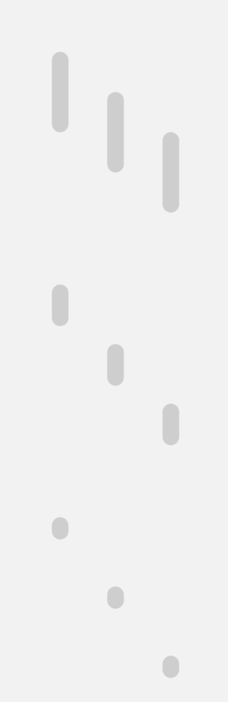
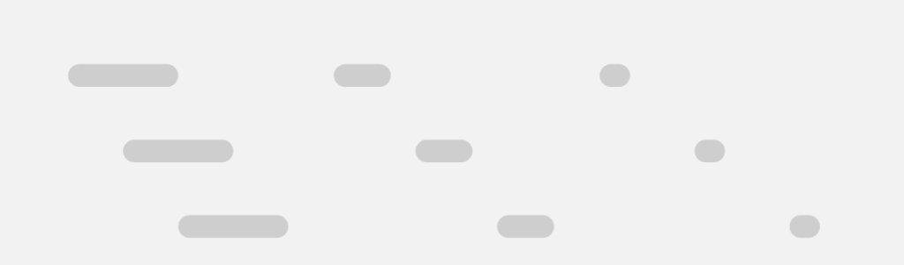

# Apple HIG Scrollbars System — macOS Admin Specification

> *"Scroll views themselves have no inherent appearance, but they display translucent scroll indicators that typically appear after a user begins scrolling. All scroll indicators provide visual feedback about the scrolling action, showing whether the currently visible content is near the beginning, middle, or end of the view."*  
> — **Apple Human Interface Guidelines (Scroll views & Scrollbars)** ([developer.apple.com/design/human-interface-guidelines/scroll-views](https://developer.apple.com/design/human-interface-guidelines/scroll-views))

Dokumen ini mendefinisikan standar resmi implementasi **Scrollbars & Scroll Views (`NSScroller` / `NSScrollView`)** pada macOS Tahoe UI Kit, matriks jempol gulir vertikal dan horizontal (*vertical & horizontal thumbs*), perilaku melayang non-intrusif (*floating overlay*), transisi pelebaran interaktif (*6px resting $\to$ 10px hover/drag*), efek elastis (*rubber-banding*), serta penerapannya pada antarmuka backend/admin MobiCare.

---

## 1. Analisis Aset Referensi Visual Apple Design Resources

### A. Ref 51 — Matriks Jempol Gulir Vertikal (*Vertical Scrollbars*)


Aset resmi di atas memperlihatkan 3 kategori panjang jempol (*thumb*) vertikal di 3 posisi gulir (Awal, Tengah, Akhir):
1. **Long Thumbs (~120px - 140px)**: Digunakan ketika jumlah konten yang tersembunyi relatif sedikit (misal rasio viewport terhadap konten adalah $1 : 1.5$).
2. **Medium Thumbs (~48px - 60px)**: Digunakan untuk panjang konten menengah (rasio viewport $1 : 3$).
3. **Short / Minimal Pill Thumbs (~18px - 22px)**: Digunakan ketika volume konten sangat besar (ribuan baris data tabel). macOS memberlakukan batas panjang minimum berbentuk kapsul bulat agar jempol gulir tidak mengecil hingga tak terlihat atau sulit dijangkau kursor.

---

### B. Ref 52 — Matriks Jempol Gulir Horizontal (*Horizontal Scrollbars*)


Aset resmi di atas memperlihatkan jempol gulir horizontal pada 3 posisi gulir (Kiri, Tengah, Kanan) dengan 3 variasi panjang proporsional:
- Mengadopsi ketebalan ramping yang sama persis dengan bar vertikal.
- Melayang anggun di batas bawah kontainer dengan bantalan margin napas 2px–3px dari tepi bawah.
- Ujung melengkung kapsul penuh (*pill-shaped caps*).

---

## 2. Geometri, Warna & Dua Status Ketebalan Interaktif

Berbeda dengan scrollbar sistem operasi lain yang memotong lebar layout secara kaku, scrollbar macOS mengadopsi prinsip **Floating Dynamic Overlay**:

| Parameter Teknis | Status Diam / Bergulir (*Resting*) | Status Sorot / Seret (*Hover & Drag*) | Keterangan Desain Apple |
| :--- | :--- | :--- | :--- |
| **Ketebalan (*Thickness*)** | **`6px`** (Ultra-slim) | **`10px`** (Expanded) | Melebar otomatis saat kursor mouse mendekat atau menyeret jempol gulir. |
| **Radius Kapsul (*Border Radius*)** | `9999px` (Full Pill) | `9999px` (Full Pill) | Ujung kapsul membulat sempurna tanpa sudut siku. |
| **Warna Thumb (Light Mode)** | `rgba(0, 0, 0, 0.32)` | `rgba(0, 0, 0, 0.65)` | Kontras halus yang tidak mengaburkan teks di bawahnya. |
| **Warna Thumb (Dark Mode)** | `rgba(255, 255, 255, 0.35)` | `rgba(255, 255, 255, 0.7)` | Putih translusen lembut di atas tema gelap. |
| **Warna Lintasan (*Track Background*)**| **Transparan Murni (`none`)** | **Transparan Murni (`none`)** | **Dilarang memberi warna track abu-abu solid**; konten di bawahnya harus tetap tembus pandang. |
| **Margin Bantalan (*Inset Padding*)** | `3px` dari tepi kontainer | `2px` dari tepi kontainer | Menghindari thumb menempel mati di tepi fisik jendela. |
| **Perilaku Menghilang (*Auto-Hide*)** | Memudar setelah 0.8s jeda | Tetap tampak selama kursor aktif | Menjaga antarmuka tetap bersih dan tenang (*zen restraint*). |

---

## 3. Prinsip & Aturan Emas Desain Apple untuk Scroll Views

### 1. Dilarang Menumpuk Scroll View dengan Arah Sama (*No Same-Orientation Nesting*)
> **Aturan Mutlak Apple HIG**: Jangan pernah menempatkan scroll view vertikal di dalam scroll view vertikal lain (*avoid vertical-in-vertical scroll trap*). Hal ini merusak pengalaman navigasi trackpad mouse dan membingungkan pengguna (*scroll wheel hijacking*).
> - *Pengecualian yang Diizinkan*: Scroll view ortogonal (misalnya strip thumbnail galeri horizontal di dalam halaman yang bergulir vertikal).

### 2. Isyarat Visual Konten Terpotong (*Affordance of Scrollability*)
Karena scrollbar macOS otomatis menghilang saat diam (*auto-hide*), pengguna mengandalkan isyarat visual untuk mengetahui bahwa suatu area dapat digulir. Buat baris atau kartu terakhir sedikit terpotong (*partial visual clipping*) di batas bawah viewport sebagai isyarat intuitif bahwa masih ada konten lanjutan.

### 3. Pantulan Elastis (*Rubber-Banding / Elastic Bounce*)
Scroll view macOS memiliki perilaku fisik elastis saat pengguna mencapai batas atas atau batas bawah konten. Jika diimplementasikan di browser web, pertahankan momentum scrolling alami dengan `-webkit-overflow-scrolling: touch` dan `overscroll-behavior: contain`.

### 4. Non-Intrusive Layout (Bebas Pergeseran Layout)
Scrollbar tidak boleh mengurangi lebar atau tinggi kontainer konten. Jangan biarkan kemunculan scrollbar menggeser posisi kolom tabel (*layout shift*).

---

## 4. Penerapan Nyata di Backend Admin MobiCare

| Kasus Penggunaan di MobiCare | Komponen / Rute | Orientasi Scroll | Karakteristik Visual & Fungsi |
| :--- | :--- | :--- | :--- |
| **Tabel Katalog Pricelist** | `PriceGrid.tsx`<br>(`/admin/pricelist`) | **Vertikal & Horizontal** | Scrollbar vertikal 6px melayang di sisi kanan baris data tanpa menggeser lebar kolom header; scrollbar horizontal melayang di bawah saat layar sempit. |
| **Sidebar Navigasi Menu** | `AdminNav.tsx` / `Sidebar` | **Vertikal** | Scrollbar ramping transparan yang hanya muncul saat kursor trackpad menggeser menu navigasi yang panjang. |
| **Strip Thumbnail Galeri** | `GalleryEditor.tsx`<br>(`/admin/gallery`) | **Horizontal** | Strip scrollbar horizontal tipis untuk menelusuri puluhan thumbnail foto servis Before & After. |
| **Pratinjau Data Modal Ekspor**| `ExportModal.tsx` | **Vertikal** | Scroll view di dalam lembar dialog modal sheet dengan thumb minimal untuk pratinjau 50 baris data pertama. |
| **Panel Log Riwayat Faktur** | `InvoiceAuditLog.tsx` | **Vertikal** | Area log catatan riwayat servis dengan auto-scroll ke entri terbaru. |

---

## 5. Implementasi CSS Tokens & Modern Web Custom Scrollbar

Berikut adalah arsitektur CSS siap pakai untuk menciptakan scrollbar macOS modern yang ramping, melayang, dan melebar anggun saat di-hover:

```css
/* --- macOS Scrollbar Tokens --- */
:root {
  --mac-scrollbar-thumb: rgba(0, 0, 0, 0.32);
  --mac-scrollbar-thumb-hover: rgba(0, 0, 0, 0.65);
  --mac-scrollbar-track: transparent;
  --mac-scrollbar-size-resting: 6px;
  --mac-scrollbar-size-hover: 10px;
}

@media (prefers-color-scheme: dark) {
  :root {
    --mac-scrollbar-thumb: rgba(255, 255, 255, 0.35);
    --mac-scrollbar-thumb-hover: rgba(255, 255, 255, 0.7);
  }
}

/* Standar Kontainer Scroll macOS */
.mac-scroll-view {
  overflow: auto;
  overscroll-behavior: contain;
  -webkit-overflow-scrolling: touch;
  
  /* Firefox Scrollbar Standard */
  scrollbar-width: thin;
  scrollbar-color: var(--mac-scrollbar-thumb) transparent;
}

/* WebKit / Chromium / Safari Native Overlay Scrollbars */
.mac-scroll-view::-webkit-scrollbar {
  width: var(--mac-scrollbar-size-resting);
  height: var(--mac-scrollbar-size-resting);
  transition: all 0.2s ease-in-out;
}

.mac-scroll-view:hover::-webkit-scrollbar {
  width: var(--mac-scrollbar-size-hover);
  height: var(--mac-scrollbar-size-hover);
}

/* Track Transparan Penuh */
.mac-scroll-view::-webkit-scrollbar-track {
  background: transparent;
}

/* Thumb Kapsul Melayang */
.mac-scroll-view::-webkit-scrollbar-thumb {
  background-color: var(--mac-scrollbar-thumb);
  border-radius: 9999px;
  border: 2px solid transparent; /* Buffer napas agar thumb tidak menempel */
  background-clip: content-box;
  transition: background-color 0.18s ease;
}

/* Thumb Hover State */
.mac-scroll-view::-webkit-scrollbar-thumb:hover {
  background-color: var(--mac-scrollbar-thumb-hover);
  border: 1px solid transparent;
}

/* Menghilangkan Tombol Panah Kuno macOS */
.mac-scroll-view::-webkit-scrollbar-button {
  display: none;
  width: 0;
  height: 0;
}

/* Sudut Pertemuan Vertikal & Horizontal */
.mac-scroll-view::-webkit-scrollbar-corner {
  background: transparent;
}
```

---

## 6. Checklist Verifikasi Standar Scrollbars Apple

- [x] **Floating Dynamic Overlay**: Melayang di atas konten tanpa memotong lebar atau memicu reflow layout.
- [x] **Lintasan Transparan Murni**: Track berlatar transparan tanpa warna abu-abu solid.
- [x] **Bentuk Kapsul Rounded**: Ujung membulat penuh `9999px`.
- [x] **Dua Ketebalan Interaktif**: Lebar istirahat `6px` melebar menjadi `10px` saat kursor mendekat atau menyeret.
- [x] **Panjang Minimum yang Terjamin**: Kapsul gulir tidak mengecil melebihi batas minimum (~18px) bahkan pada ribuan baris data.
- [x] **Bebas Scroll-Trap**: Tidak ada nesting scroll view vertikal di dalam vertikal.
