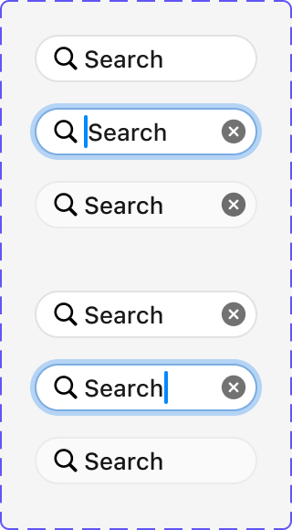
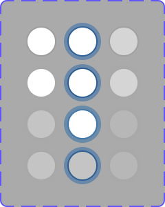
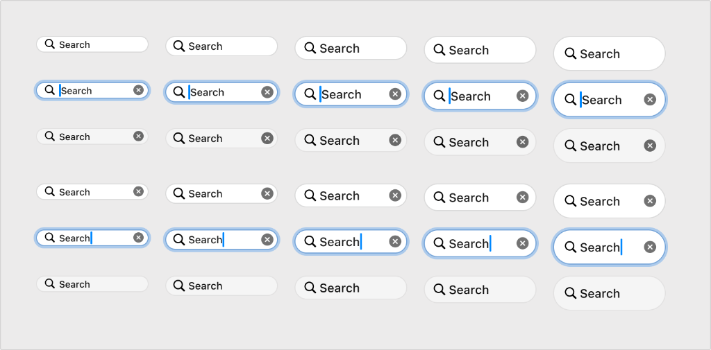

# Apple HIG Search Fields System — macOS Admin Specification

> *"A search field lets people search a collection of content for specific terms they enter."*  
> — **Apple Human Interface Guidelines (Search fields & Searching)** ([developer.apple.com/design/human-interface-guidelines/search-fields](https://developer.apple.com/design/human-interface-guidelines/search-fields) | [developer.apple.com/design/human-interface-guidelines/searching](https://developer.apple.com/design/human-interface-guidelines/searching))

Dokumen ini mendefinisikan standar resmi implementasi **Search Fields (`NSSearchField`)** pada macOS Tahoe UI Kit, matriks 5 skala ukuran, 6 status interaksi (fokus dengan cincin biru menyala & caret biru), anatomi tombol hapus (*clear button `(x)`*), tombol aksi lingkaran, serta penerapannya pada antarmuka backend/admin MobiCare.

---

## 1. Analisis Aset Referensi Visual Apple Design Resources

### A. Ref 45 — Status Interaktif Search Field Tunggal

1. **Resting / Empty**: Kapsul putih netral beradius penuh (*pill-shape*), ikon kaca pembesar redup `🔍`, placeholder teks *"Search"*, tanpa tombol hapus.
2. **Focused / Caret at Start**: Dikelilingi cincin fokus biru solid Apple (`#007AFF`) dengan bayangan luar lembut, caret kursor vertikal biru menyala di depan teks, dan tombol silang bulat `(x)` muncul di ujung kanan.
3. **Resting / Filled**: Teks query hitam tegas `#1D1D1F`, status blur tanpa cincin fokus, tombol hapus `(x)` tetap ada selama field terisi.
4. **Hover / Pressed**: Latar kapsul sedikit menggelap halus (`rgba(0, 0, 0, 0.04)`) saat kursor melintas.
5. **Focused / Caret at End**: Cincin fokus biru aktif dengan posisi kursor di ujung akhir teks query.
6. **Resting Filled tanpa Tombol**: Status terisi pasif setelah eksekusi pencarian selesai.

---

### B. Ref 46 — Matriks Status Tombol Pencarian Lingkaran (*Circular Search Button*)

Matriks 4 baris $\times$ 3 kolom tombol lingkaran pemicu pencarian cepat / Spotlight pada bilah toolbar macOS:
- **Kolom Kiri**: Status *Resting / Default* (cakram putih bersih dengan bayangan lembut).
- **Kolom Tengah**: Status *Active / Focused* dengan cincin fokus biru pekat khas macOS.
- **Kolom Kanan**: Status *Disabled / Translucent* (opasitas memudar untuk mode non-interaktif).

---

### C. Ref 47 — Anatomi Tombol Hapus Cepat (*Clear Button `(x)`*)

Tombol hapus instan resmi Apple (`xmark.circle.fill`):
- Berupa lingkaran hitam pekat semi-transparan (`rgba(0, 0, 0, 0.55)` Light / `rgba(255, 255, 255, 0.6)` Dark) dengan simbol silang putih di tengahnya.
- Berfungsi untuk menghapus seluruh teks pencarian dalam 1 kali klik dan langsung mengembalikan fokus kursor ke input teks tanpa me-refresh halaman.

---

### D. Ref 48 — Matriks Lengkap 5 Skala Ukuran $\times$ 6 Status


Matriks lengkap master set macOS Tahoe menampilkan 5 kolom ukuran di 6 status interaksi:

| Skala Ukuran | Tinggi (*Height*) | Font Size | Padding Kiri-Kanan | Ukuran Ikon `🔍` | Rekomendasi Penggunaan di MobiCare |
| :--- | :--- | :--- | :--- | :--- | :--- |
| **Mini** | `20px` | `11px` | `0 6px` | `11px` | Filter cepat di dalam header kolom tabel atau dropdown modal. |
| **Small** | `24px` | `12px` | `0 8px` | `12px` | Sidebar pencarian kategori atau panel utilitas inspector. |
| **Regular (Default)** | **`28px`** | **`13px`** | **`0 10px`** | **`13px`** | **Standar utama bilah toolbar & Monobar admin MobiCare.** |
| **Large** | `34px` | `14px` | `0 12px` | `15px` | Header pencarian modal dialog dan halaman Arsip Faktur. |
| **Extra Large** | `40px` | `15px` | `0 14px` | `17px` | Palet Pencarian Cepat Global (Spotlight Admin `⌘K`). |

---

## 2. Geometri, Warna & Spesifikasi Token

| Elemen Geometri | Light Mode | Dark Mode | Penjelasan Teknis |
| :--- | :--- | :--- | :--- |
| **Radius Kapsul (*Border Radius*)**| `9999px` (Full Pill) | `9999px` (Full Pill) | Bentuk oval simetris khas kontrol pencarian Apple. |
| **Latar Belakang (*Background*)** | `#FFFFFF` / `rgba(0,0,0,0.05)` | `rgba(255, 255, 255, 0.1)` | Bersih dan kontras terhadap panel toolbar kaca. |
| **Garis Batas (*Border*)** | `0.5px solid rgba(0,0,0,0.15)` | `0.5px solid rgba(255,255,255,0.18)` | Garis batas mikro tajam (*hairline*). |
| **Cincin Fokus (*Focus Ring*)** | `0 0 0 3px rgba(0, 122, 255, 0.4)` | `0 0 0 3px rgba(10, 132, 255, 0.5)` | Ring biru Apple menyala dengan blur difus halus. |
| **Warna Caret Kursor** | `#007AFF` | `#0A84FF` | Caret vertikal warna aksen biru. |
| **Warna Ikon Kaca Pembesar** | `rgba(0, 0, 0, 0.5)` | `rgba(255, 255, 255, 0.6)` | Ikon SVG SF Symbols `magnifyingglass`. |
| **Tombol Clear `(x)`** | `rgba(0, 0, 0, 0.5)` | `rgba(255, 255, 255, 0.65)` | Menjadi lebih gelap `rgba(0,0,0,0.8)` saat ditekan. |

---

## 3. Prinsip & Aturan Emas Desain Apple untuk Searching

### 1. Pencarian Instan / Responsif (*Instant / Live Filtering*)
> **Aturan Apple HIG**: Jangan memaksa admin menekan tombol "Enter" atau tombol "Cari" terpisah untuk melihat hasil. Lakukan live filtering saat admin mengetik (gunakan teknik debounce 150ms-250ms untuk optimasi query) agar tabel langsung menyaring data secara dinamis.

### 2. Placeholder yang Memperjelas Cakupan (*Scope-Reinforcing Placeholder*)
Tulis teks placeholder yang secara spesifik memberi tahu admin apa yang bisa dicari:
- Contoh baik: *"Cari tipe HP (iPhone 15, S24), SKU, atau suku cadang..."*
- Hindari: *"Cari..."* (terlalu ambigu tanpa konteks).

### 3. Satu Lokasi Pencarian Terpadu (*Unified Search Location*)
Tempatkan kolom pencarian di posisi yang konsisten dan mudah dijangkau di seluruh sistem admin—secara default diletakkan di **sisi kanan toolbar Monobar** atau diakses global via pintasan keyboard **`⌘K`**.

### 4. Tombol Hapus Cepat (*Clear Button Mandatory*)
Tombol silang `(x)` wajib muncul otomatis saat input berisi teks. Mengklik tombol ini harus langsung:
1. Mengosongkan string pencarian seketika.
2. Mengembalikan tampilan tabel ke daftar lengkap tanpa filter.
3. Mempertahankan fokus kursor di dalam kolom pencarian (*no focus loss*).

### 5. Pintasan Keyboard Standar macOS
- **`⌘F` (Find)**: Langsung memindahkan fokus kursor ke search field pada tabel/halaman yang aktif.
- **`Escape`**: Mengosongkan teks pencarian atau menutup hasil pencarian.
- **`⌘K` (Spotlight Quick Search)**: Membuka modal Spotlight pencarian universal di seluruh data admin.

---

## 4. Penerapan Nyata di Backend Admin MobiCare

| Kasus Penggunaan di MobiCare | Komponen / Rute | Ukuran Search Field | Karakteristik Visual & Fungsi |
| :--- | :--- | :--- | :--- |
| **Pencarian Katalog Pricelist** | `PriceGrid.tsx`<br>(`/admin/pricelist`) | **Regular (28px)** | Berada di kanan Monobar. Menyaring seketika ribuan baris harga berdasarkan nama model HP, tipe layar, atau kode part. |
| **Spotlight Pencarian Cepat Admin**| `AdminSpotlight.tsx`<br>(Global Header `⌘K`) | **Extra Large (40px)** | Modal pencarian cepat universal: cari nota servis, nama pelanggan WhatsApp, promo aktif, atau menu navigasi. |
| **Pencarian Galeri Foto Servis** | `GalleryEditor.tsx`<br>(`/admin/gallery`) | **Small (24px)** | Menyaring album foto Before & After berdasarkan kategori kerusakan (LCD, Water Damage, Baterai). |
| **Filter Cepat Dropdown SKU** | `ServiceEditor.tsx`<br>(Modal Tambah Suku Cadang) | **Mini (20px)** | Input pencarian mini di dalam popover pemilihan SKU untuk menyortir pilihan suku cadang panjang. |

---

## 5. Implementasi CSS Tokens & Komponen Search Field

```css
/* --- macOS Search Field Tokens --- */
:root {
  --mac-search-bg: #FFFFFF;
  --mac-search-border: rgba(0, 0, 0, 0.15);
  --mac-search-text: #1D1D1F;
  --mac-search-placeholder: rgba(0, 0, 0, 0.45);
  --mac-search-icon: rgba(0, 0, 0, 0.5);
  --mac-search-focus-ring: 0 0 0 3px rgba(0, 122, 255, 0.4);
  --mac-search-caret: #007AFF;
}

@media (prefers-color-scheme: dark) {
  :root {
    --mac-search-bg: rgba(255, 255, 255, 0.12);
    --mac-search-border: rgba(255, 255, 255, 0.18);
    --mac-search-text: #FFFFFF;
    --mac-search-placeholder: rgba(255, 255, 255, 0.45);
    --mac-search-icon: rgba(255, 255, 255, 0.6);
    --mac-search-focus-ring: 0 0 0 3px rgba(10, 132, 255, 0.5);
    --mac-search-caret: #0A84FF;
  }
}

/* Base Pill Search Field Container */
.mac-search-wrap {
  position: relative;
  display: inline-flex;
  align-items: center;
  background: var(--mac-search-bg);
  border: 0.5px solid var(--mac-search-border);
  border-radius: 9999px;
  box-shadow: 0 1px 2px rgba(0, 0, 0, 0.04);
  transition: all 0.18s cubic-bezier(0.16, 1, 0.3, 1);
  box-sizing: border-box;
}

.mac-search-wrap:hover {
  border-color: rgba(0, 0, 0, 0.25);
}

.mac-search-wrap:focus-within {
  border-color: var(--mac-search-caret);
  box-shadow: var(--mac-search-focus-ring);
}

/* Skala Ukuran Search Field */
.mac-search-wrap--mini {
  height: 20px;
  padding: 0 6px;
  font-size: 11px;
}
.mac-search-wrap--small {
  height: 24px;
  padding: 0 8px;
  font-size: 12px;
}
.mac-search-wrap--regular {
  height: 28px;
  padding: 0 10px;
  font-size: 13px;
}
.mac-search-wrap--large {
  height: 34px;
  padding: 0 12px;
  font-size: 14px;
}
.mac-search-wrap--xl {
  height: 40px;
  padding: 0 14px;
  font-size: 15px;
}

/* Icon Kaca Pembesar Leading */
.mac-search-icon {
  display: flex;
  align-items: center;
  justify-content: center;
  color: var(--mac-search-icon);
  margin-right: 6px;
  flex-shrink: 0;
  pointer-events: none;
}

/* Input Teks Asli */
.mac-search-input {
  width: 100%;
  border: none;
  background: transparent;
  outline: none;
  color: var(--mac-search-text);
  font-family: -apple-system, BlinkMacSystemFont, "SF Pro Text", system-ui, sans-serif;
  font-size: inherit;
  caret-color: var(--mac-search-caret);
  padding: 0;
  margin: 0;
}

.mac-search-input::placeholder {
  color: var(--mac-search-placeholder);
}

/* Tombol Clear Trailing (x) */
.mac-search-clear-btn {
  display: flex;
  align-items: center;
  justify-content: center;
  background: rgba(0, 0, 0, 0.45);
  border: none;
  border-radius: 50%;
  width: 14px;
  height: 14px;
  color: #FFFFFF;
  font-size: 10px;
  line-height: 1;
  cursor: pointer;
  margin-left: 6px;
  flex-shrink: 0;
  padding: 0;
  transition: background 0.12s ease;
}

.mac-search-clear-btn:hover {
  background: rgba(0, 0, 0, 0.7);
}

.mac-search-clear-btn:active {
  background: #000000;
}
```

---

## 6. Checklist Verifikasi Standar Search Fields Apple

- [x] **Kapsul Rounded Penuh**: Sudut berbentuk full pill `9999px`.
- [x] **Ikon Kaca Pembesar di Kiri**: Ikon pembesar proporsional mendampingi teks input.
- [x] **Tombol Hapus `(x)`**: Muncul otomatis saat terisi, mengosongkan teks dengan 1 klik, dan mempertahankan fokus kursor.
- [x] **Cincin Fokus Biru Apple**: Glow ring `0 0 0 3px rgba(0, 122, 255, 0.4)` dengan caret biru solid `#007AFF`.
- [x] **Matriks 5 Ukuran**: Skala lengkap dari Mini 20px hingga Extra Large 40px.
- [x] **Pintasan Keyboard**: Terhubung dengan `⌘F` (tabel lokal) dan `⌘K` (Spotlight global).
