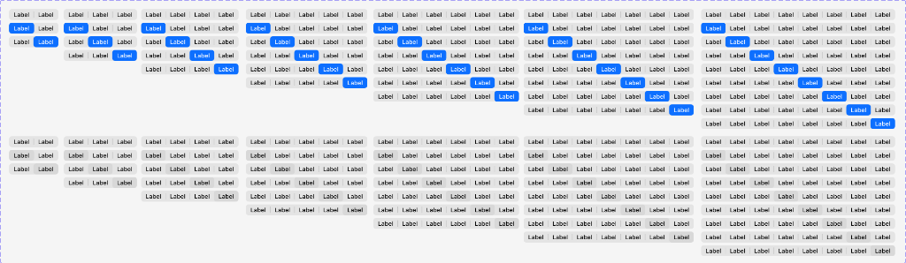
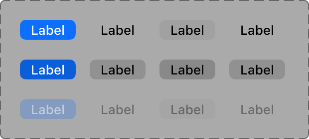

# Apple HIG Segmented Controls System — macOS Admin Specification

> *"A segmented control is a linear set of two or more segments, each of which functions as a button. Use a segmented control to provide closely related choices that affect an object, state, or view."*  
> — **Apple Human Interface Guidelines (Segmented controls)** ([developer.apple.com/design/human-interface-guidelines/segmented-controls](https://developer.apple.com/design/human-interface-guidelines/segmented-controls))

Dokumen ini mendefinisikan standar resmi implementasi **Segmented Controls (`NSSegmentedControl`)** pada macOS Tahoe UI Kit, matriks 2 varian gaya (Solid Apple Blue vs Neutral Frosted Capsule), rentang 2 hingga 8 segmen, 3 status interaksi, 3 mode pemilihan (*Select One, Select Any, Momentary*), serta penerapannya pada antarmuka backend/admin MobiCare.

---

## 1. Analisis Matriks Varian Gaya & Jumlah Segmen (Ref 49)



Aset master Apple Design Resources di atas menampilkan dua baris sistemik komprehensif dari kontrol 2 segmen hingga 8 segmen:

### A. Varian 1: Colored Accent (Solid Apple Blue `#007AFF`) — Separuh Atas
- **Karakteristik Visual**:
  - Segmen aktif berwarna **Solid Apple Blue (`#007AFF`)** dengan teks putih kontras tinggi (`#FFFFFF`).
  - Segmen inaktif berlatar transparan dengan teks abu-abu gelap `#1D1D1F` dan garis pemisah vertikal halus 1px (*hairline divider*).
  - Garis batas luar berbalut kapsul rounded halus dengan wash latar belakang abu-abu transparan.
- **Kapan Digunakan**:
  - Pilihan segmen yang merepresentasikan **filter status primer, aksi kunci, atau kategori utama** di mana visibilitas dan kontras tinggi sangat dibutuhkan (misal filter: *[ Semua | iPhone | iPad | MacBook ]*).

---

### B. Varian 2: Neutral / Gray Frosted Capsule (macOS Standard Material) — Separuh Bawah
- **Karakteristik Visual**:
  - Segmen aktif berbalut **kapsul putih/abu-abu netral terangkat (*raised card pill*)** dengan bayangan mikro halus `box-shadow: 0 1px 3px rgba(0, 0, 0, 0.12)` dan border mikro `0.5px solid rgba(0, 0, 0, 0.08)`.
  - Segmen inaktif menyatu ke dalam track latar belakang abu-abu ultra-halus `rgba(0, 0, 0, 0.06)` (Light) / `rgba(255, 255, 255, 0.08)` (Dark).
  - Transisi pergeseran segmen aktif menggunakan animasi geser halus (*sliding pill animation*).
- **Kapan Digunakan**:
  - **Pengubah Tampilan (*View Switchers*)** seperti beralih antara List View, Grid View, dan Calendar View.
  - Pengubah skala waktu di chart dashboard (misal: *[ Hari Ini | 7 Hari | Bulan Ini ]*).

---

### C. Rentang Jumlah Segmen (2 s.d. 8 Segmen)
- **2 Segmen**: Pilihan biner (*[ Ya | Tidak ]*, *[ Beli | Jual ]*, *[ Aktif | Nonaktif ]*).
- **3 Segmen**: Pilihan trio standar (*[ Hari | Minggu | Bulan ]*, *[ Tabel | Grid | Kartu ]*).
- **4 Segmen**: Kategori perangkat utama (*[ Semua | iPhone | iPad | Mac ]*).
- **5 s.d. 8 Segmen**: Filter sub-kategori sparepart (*[ LCD | Baterai | Kamera | Port | Speaker | Casing ]*).

---

## 2. Anatomi Status Interaksi Segmen (Ref 50)



1. **Resting / Default (Baris 1)**:
   - Segmen Aktif: Biru solid `#007AFF` (atau kapsul putih netral dengan drop shadow).
   - Segmen Inaktif: Latar transparan dengan teks berbobot reguler/medium.
   - Segmen Inaktif Hover: Kapsul abu-abu transparan `rgba(0, 0, 0, 0.08)` muncul lembut di bawah kursor.
2. **Pressed / Active Click (Baris 2)**:
   - Segmen Aktif: Biru lebih pekat `#0062CC` dengan kompresi skala mikro `transform: scale(0.98)`.
   - Segmen Inaktif Ditekan: Kapsul abu-abu pekat `rgba(0, 0, 0, 0.16)`.
3. **Disabled / Translucent (Baris 3)**:
   - Seluruh kontrol memudar (`opacity: 0.42`), teks dan warna aksen menjadi redup transparan, kursor `not-allowed`.

---

## 3. Tiga Mode Pemilihan macOS (`trackingMode`)

Dalam sistem asli AppKit (`NSSegmentedControl`), terdapat 3 mode perilaku:

| Mode Pemilihan | Sifat Pemilihan | Contoh Penggunaan di Admin MobiCare |
| :--- | :--- | :--- |
| **Select One** (*Default*) | **Mutually Exclusive**: Tepat satu segmen aktif pada satu waktu (seperti radio group). | Pilihan View Mode (*Tabel* vs *Grid*), Status Nota (*Menunggu* vs *Selesai*). |
| **Select Any** (*Multi-select*) | **Independent Toggle**: Nol, satu, atau beberapa segmen dapat aktif bersamaan. | Filter atribut suku cadang (*[ Original ] [ Bergaransi ] [ Stok Tersedia ]*). |
| **Momentary** | **Action Buttons**: Segmen kembali ke status normal segera setelah diklik (tanpa menyimpan state aktif). | Tombol navigasi toolbar (*[ < Kembali | Lanjut > ]*), zoom *[ + | - ]*. |

---

## 4. Prinsip & Aturan Emas Desain Apple untuk Segmented Controls

### 1. Lebar Segmen yang Seimbang (*Maintain Equal Widths*)
> **Aturan Apple HIG**: Seluruh segmen di dalam satu kontrol harus memiliki lebar yang seragam (*equal width* `flex: 1`) untuk menjaga keseimbangan visual dan mencegah kesan acak.

### 2. Jangan Mencampur Teks dan Ikon (*Keep Content Consistent*)
Pertahankan konsistensi tipe konten:
- Jika menggunakan teks, gunakan teks untuk semua segmen (*Label 1, Label 2, Label 3*).
- Jika menggunakan ikon (SF Symbols), gunakan ikon untuk semua segmen (misal ikon *List, Grid, Columns*).
- Dilarang keras mencampur segmen pertama teks dan segmen kedua ikon dalam satu kontrol.

### 3. Batasi Jumlah Segmen (Maksimal 5-7 Segmen)
Pada antarmuka desktop, batasi maksimal 7 atau 8 segmen. Jika pilihan melebihi 8 opsi, gunakan **Pop-Up Button (`⇅`)** atau **Combo Box** agar tidak menghabiskan lebar horizontal toolbar.

### 4. Animasi Sliding Kapsul yang Mulus
Pada gaya Neutral Frosted, perpindahan indikator aktif dari satu segmen ke segmen lain harus menggunakan transisi pegas fisik khas Apple: `transition: all 0.24s cubic-bezier(0.16, 1, 0.3, 1)`.

---

## 5. Penerapan Nyata di Backend Admin MobiCare

| Kasus Penggunaan di MobiCare | Komponen / Rute | Gaya & Jumlah Segmen | Karakteristik Visual & Fungsi |
| :--- | :--- | :--- | :--- |
| **View Switcher Katalog** | `PriceGrid.tsx`<br>(Monobar Toolbar) | **Neutral Style — 3 Segmen** | Beralih antara tampilan: `[ ≡ Tabel | ⊞ Grid Kartu | ▤ Ringkas ]`. |
| **Filter Kategori Utama HP** | `PriceGrid.tsx`<br>(Sub-toolbar Kategori) | **Blue Accent — 4 Segmen** | Filter cepat perangkat: `[ Semua | iPhone | iPad | MacBook ]`. |
| **Rentang Waktu Analitik** | `Dashboard.tsx`<br>(Header Omset Servis) | **Neutral Style — 3 Segmen** | Pemilih periode: `[ Hari Ini | 7 Hari Terakhir | Bulan Ini ]`. |
| **Status Klaim Garansi** | `WarrantyClaim.tsx`<br>(`/admin/garansi`) | **Blue Accent — 4 Segmen** | Filter status tiket: `[ Menunggu Verifikasi | Disetujui | Dalam Servis | Selesai ]`. |
| **Navigasi Riwayat Toolbar** | `Monobar.tsx` (Kiri Toolbar) | **Momentary — 2 Segmen** | Tombol riwayat navigasi rute: `[ ‹ Kembali | Maju › ]`. |

---

## 6. Implementasi CSS Tokens & Komponen Segmented Control

```css
/* --- macOS Segmented Control Tokens --- */
:root {
  --mac-seg-track-bg: rgba(0, 0, 0, 0.06);
  --mac-seg-track-border: rgba(0, 0, 0, 0.1);
  --mac-seg-track-radius: 8px;
  --mac-seg-height: 28px;
  --mac-seg-text-color: #1D1D1F;
  --mac-seg-text-muted: rgba(0, 0, 0, 0.6);
  
  /* Neutral Raised Active Pill */
  --mac-seg-pill-bg: #FFFFFF;
  --mac-seg-pill-shadow: 0 1px 3px rgba(0, 0, 0, 0.12), 0 0.5px 1px rgba(0, 0, 0, 0.08);
  
  /* Blue Accent Active Pill */
  --mac-seg-blue-bg: #007AFF;
  --mac-seg-blue-text: #FFFFFF;
  --mac-seg-blue-shadow: 0 1px 2px rgba(0, 122, 255, 0.3);
}

@media (prefers-color-scheme: dark) {
  :root {
    --mac-seg-track-bg: rgba(255, 255, 255, 0.08);
    --mac-seg-track-border: rgba(255, 255, 255, 0.12);
    --mac-seg-text-color: #FFFFFF;
    --mac-seg-text-muted: rgba(255, 255, 255, 0.6);
    
    --mac-seg-pill-bg: rgba(255, 255, 255, 0.18);
    --mac-seg-pill-shadow: 0 1px 3px rgba(0, 0, 0, 0.35);
    
    --mac-seg-blue-bg: #0A84FF;
    --mac-seg-blue-text: #FFFFFF;
    --mac-seg-blue-shadow: 0 1px 2px rgba(10, 132, 255, 0.4);
  }
}

/* Base Track */
.mac-segmented-control {
  position: relative;
  display: inline-flex;
  align-items: center;
  background: var(--mac-seg-track-bg);
  border: 0.5px solid var(--mac-seg-track-border);
  border-radius: var(--mac-seg-track-radius);
  padding: 2px;
  height: var(--mac-seg-height);
  box-sizing: border-box;
  user-select: none;
}

/* Individual Segment Item */
.mac-segmented-control__item {
  position: relative;
  flex: 1;
  display: flex;
  align-items: center;
  justify-content: center;
  height: 100%;
  padding: 0 12px;
  border: none;
  background: transparent;
  color: var(--mac-seg-text-muted);
  font-family: -apple-system, BlinkMacSystemFont, "SF Pro Text", system-ui, sans-serif;
  font-size: 13px;
  font-weight: 500;
  border-radius: calc(var(--mac-seg-track-radius) - 2px);
  cursor: pointer;
  transition: all 0.18s cubic-bezier(0.16, 1, 0.3, 1);
  white-space: nowrap;
  outline: none;
  z-index: 2;
}

.mac-segmented-control__item:hover:not(.is-active) {
  background: rgba(0, 0, 0, 0.04);
  color: var(--mac-seg-text-color);
}

.mac-segmented-control__item:active:not(.is-active) {
  background: rgba(0, 0, 0, 0.08);
}

/* --- Style 1: Neutral Raised White Pill --- */
.mac-segmented-control--neutral .mac-segmented-control__item.is-active {
  background: var(--mac-seg-pill-bg);
  color: var(--mac-seg-text-color);
  font-weight: 600;
  box-shadow: var(--mac-seg-pill-shadow);
}

/* --- Style 2: Blue Accent Solid Pill --- */
.mac-segmented-control--accent-blue .mac-segmented-control__item.is-active {
  background: var(--mac-seg-blue-bg);
  color: var(--mac-seg-blue-text);
  font-weight: 600;
  box-shadow: var(--mac-seg-blue-shadow);
}

/* Dividers between inactive segments */
.mac-segmented-control__item + .mac-segmented-control__item::before {
  content: "";
  position: absolute;
  left: 0;
  top: 4px;
  bottom: 4px;
  width: 1px;
  background: rgba(0, 0, 0, 0.12);
  transition: opacity 0.18s ease;
}

.mac-segmented-control__item.is-active::before,
.mac-segmented-control__item.is-active + .mac-segmented-control__item::before {
  opacity: 0;
}
```

---

## 7. Checklist Verifikasi Standar Segmented Controls Apple

- [x] **Dua Varian Gaya**: Neutral Frosted Capsule untuk view switcher dan Blue Accent untuk filter status primer.
- [x] **Lebar Segmen Seragam**: Seluruh segmen menggunakan lebar proporsional seimbang (*equal width*).
- [x] **Konsistensi Konten**: Tidak mencampur teks dan ikon dalam satu kontrol yang sama.
- [x] **Tiga Mode Pemilihan**: Mendukung *Select One* (eksklusif), *Select Any* (multi-toggle), dan *Momentary* (aksi).
- [x] **Efek Transisi Halus**: Animasi pergeseran segmen aktif dengan kurva pegas macOS `cubic-bezier(0.16, 1, 0.3, 1)`.
