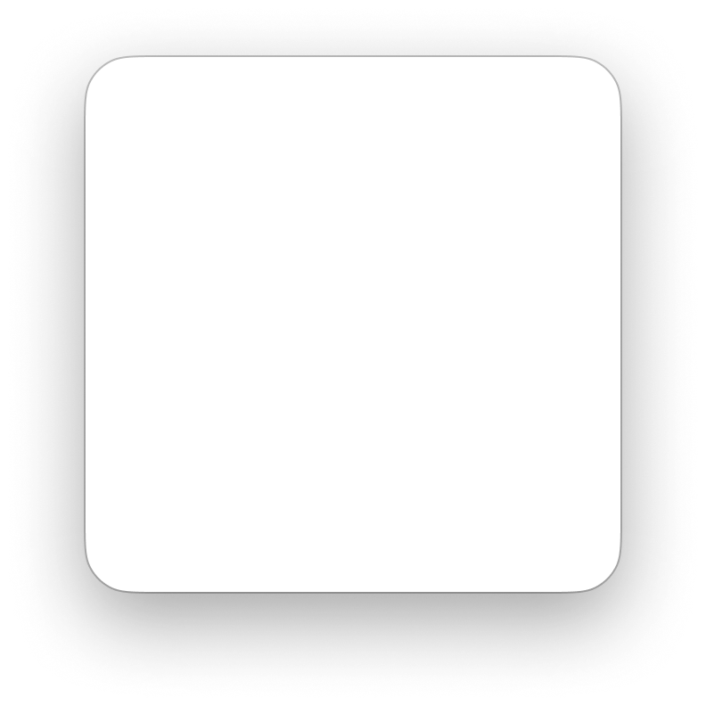

# Apple HIG Sheets System — macOS Admin Specification

> *"A sheet helps people perform a scoped task that’s closely related to their current context. A sheet appears as a card that partially covers the underlying content, often dimming the parent view to maintain context while keeping users focused on the task."*  
> — **Apple Human Interface Guidelines (Sheets)** ([developer.apple.com/design/human-interface-guidelines/sheets](https://developer.apple.com/design/human-interface-guidelines/sheets))

Dokumen ini mendefinisikan standar resmi implementasi **Sheet Presentation (`NSWindow.beginSheet`)** pada macOS Tahoe UI Kit, geometri kontainer kartu squircle 22px, elevasi bayangan atmosferik dalam, tirai peredup latar belakang (*dimming backdrop*), modalitas tertaut jendela (*window-modal*), serta penerapannya pada antarmuka backend/admin MobiCare.

---

## 1. Analisis Geometri Kontainer Sheet (Ref 53)



Aset resmi Apple Design Resources di atas menampilkan kanvas dasar kontainer Sheet macOS Tahoe tanpa konten, memperlihatkan proporsi fisik murni yang menjadi standar sistem:

| Parameter Geometri | Nilai / Spesifikasi Teknis | Karakteristik Desain Apple |
| :--- | :--- | :--- |
| **Radius Sudut (*Corner Radius*)** | **`22px`** (Squircle Kontinu) | Lengkungan squircle khas Apple yang sangat halus dan harmonis dengan radius jendela utama (26px). |
| **Material Latar Belakang** | **Liquid Glass Heavy** | Light: `rgba(255, 255, 255, 0.94)`<br>Dark: `rgba(38, 38, 42, 0.92)` |
| **Efek Translusensi (*Backdrop Filter*)** | **`blur(40px) saturate(190%)`** | Efek kaca buram premium yang mempertahankan privasi konten di belakangnya tanpa kehilangan kedalaman material. |
| **Garis Batas (*Hairline Border*)** | **`0.5px solid`** | Light: `rgba(0, 0, 0, 0.12)`<br>Dark: `rgba(255, 255, 255, 0.15)` |
| **Elevasi Bayangan (*Atmospheric Shadow*)**| **Multi-layer Deep Shadow** | `0 24px 64px rgba(0, 0, 0, 0.28), 0 8px 20px rgba(0, 0, 0, 0.1)` |
| **Lebar Kontainer Standar** | `480px` s.d. `680px` | Proporsional untuk menampung formulir 1–2 kolom tanpa membuat layar terasa penuh. |

---

## 2. Modalitas Tertaut Jendela (*Window-Modal Behavior*)

Prinsip fundamental macOS yang membedakan Sheet dengan modal dialog sistem operasi lain:
1. **Window-Modal, Bukan App-Modal**:
   - Sheet meluncur tertaut pada jendela tempat aksi dipicu (*attached sheet*) atau mengambang di tengah jendela tersebut.
   - **Hanya jendela induk yang diblokir**. Pengguna masih dapat menggeser jendela aplikasi lain di sampingnya, melihat data di monitor kedua, atau mengakses menu bar atas (`⌘-menus`).
2. **Tirai Peredup (*Dimming Backdrop*)**:
   - Area di belakang sheet di dalam jendela induk diberi lapisan peredup transparan halus: `rgba(0, 0, 0, 0.2)` (Light Mode) atau `rgba(0, 0, 0, 0.45)` (Dark Mode).

---

## 3. Matriks Pembedaan Komponen Presentasi macOS

| Aspek Komparasi | Sheet Modal (`NSWindow.beginSheet`) | Popover (`NSPopover`) | Alert Dialog (`NSAlert`) |
| :--- | :--- | :--- | :--- |
| **Tujuan Utama** | Menyelesaikan **tugas berlingkup terfokus** (Edit form, ekspor data, konfigurasi). | **Interaksi mikro cepat** (Pilih tanggal, intip profil pelanggan, kalkulator). | **Peringatan / konfirmasi kritis** (Hapus data, unsaved changes guard). |
| **Karakter Modalitas**| Modal tertaut jendela induk (memerlukan Simpan atau Batal). | Transien ringan (*light dismiss* menutup saat klik di luar). | Modal kritis memblokir jendela/aplikasi. |
| **Tirai Peredup** | **Ada** (meredupkan jendela induk). | **Tidak Ada** (konten bawah tetap terang). | **Ada** (meredupkan jendela atau desktop). |
| **Panah Penunjuk** | **Tidak Ada**. | **Ada** (menunjuk langsung ke trigger). | **Tidak Ada**. |
| **Batas Ruang** | Lega (`480px` - `720px`). | Ringkas (`200px` - `380px`). | Sangat ringkas (`280px` - `320px`). |

---

## 4. Anatomi Struktur Internal Sheet macOS

```
+-------------------------------------------------------------+
|  [Ikon / Title]  Edit Suku Cadang iPhone 15 Pro             |  <- Header (15px-17px Bold)
|  Perbarui harga modal, stok gudang, dan garansi resmi.      |  <- Deskripsi (12px Muted)
+-------------------------------------------------------------+
|                                                             |
|  [ Form Controls / Grouped Boxes .mac-box (12px radius) ]   |  <- Body Content
|  - Nama Sparepart: [ LCD Super Retina XDR OLED        ]     |
|  - Kategori:       [ Layanan Penggantian Layar    ⇅   ]     |
|  - Harga Modal:    [ Rp 2.450.000                     ]     |
|                                                             |
+-------------------------------------------------------------+
| [Hapus] (Merah Kiri)                     [Batal]  [Simpan]  |  <- Footer Trailing Bar
+-------------------------------------------------------------+
```

### Standar Tombol Footer:
- **Leading Edge (Pojok Kiri Bawah)**: Tombol aksi destruktif jika ada (misal `Hapus Item` berbalut soft red tint `rgba(255, 59, 48, 0.12)`).
- **Trailing Edge (Pojok Kanan Bawah)**:
  - Tombol **`Batal`** (Neutral Gray Pill) di sisi kiri.
  - Tombol **`Simpan / Selesai`** (Solid Apple Blue `#007AFF`) di paling kanan sebagai aksi utama.

---

## 5. Prinsip & Aturan Emas Desain Apple untuk Sheets

### 1. Dilarang Menumpuk Sheet di Atas Sheet (*Never Stack Sheets*)
> **Aturan Mutlak Apple HIG**: Jangan pernah membuka sheet lain di atas sheet yang sedang aktif. Jika tugas memerlukan langkah lanjutan (misal: Pilih Foto Galeri di dalam Form Servis), perbarui konten internal di dalam sheet yang sama (*in-sheet view transition*) atau gunakan Popover.

### 2. Konfirmasi Perlindungan Data (*Unsaved Changes Guard*)
Jika admin telah mengisi atau mengubah data formulir di dalam sheet lalu menekan tombol `Batal` atau tombol `Escape`, aplikasi wajib memunculkan modal Alert konfirmasi bertumpuk:
> *"Apakah Anda yakin ingin membuang perubahan? Perubahan yang belum disimpan akan hilang."*  
> `[Simpan]` `[Buang Perubahan (Merah)]` `[Lanjutkan Mengedit]`

### 3. Aksesibilitas Keyboard Wajib
- **`Return` / `Enter`**: Memicu tombol aksi utama (*Simpan / Selesai*).
- **`Escape`**: Memicu tombol pembatalan (*Batal*).
- **`Tab`**: Siklus fokus terkunci di dalam elemen sheet (*focus trap*).

---

## 6. Penerapan Nyata di Backend Admin MobiCare

| Kasus Penggunaan di MobiCare | Komponen / Rute | Ukuran Sheet | Konten & Alur Kerja |
| :--- | :--- | :--- | :--- |
| **Tambah & Edit Katalog Servis** | `ServiceEditorSheet.tsx`<br>(`/admin/pricelist`) | **Medium (560px)** | Formulir bertingkat: model perangkat, grade suku cadang, kalkulasi margin, upload foto komponen. |
| **Ekspor Data Katalog & Laporan** | `ExportModal.tsx`<br>(`/admin/pricelist`) | **Regular (480px)** | Pemilihan format file (Excel, CSV, JSON), kolom yang disertakan, dan progress bar terukur. |
| **Kelola Poster Promo Baru** | `PromoEditorSheet.tsx`<br>(`/admin/promo`) | **Large (640px)** | Upload poster promo via Image Well, penentuan diskon persen/nominal, dan jadwal tanggal tayang. |
| **Verifikasi Klaim Garansi** | `WarrantyClaimSheet.tsx`<br>(`/admin/garansi`) | **Medium (540px)** | Validasi nota servis fisik, checklist inspeksi teknisi, dan keputusan persetujuan garansi. |

---

## 7. Implementasi CSS Tokens & Komponen Sheet Modal

```css
/* --- macOS Sheet Modal Tokens --- */
:root {
  --mac-sheet-bg: rgba(255, 255, 255, 0.94);
  --mac-sheet-border: rgba(0, 0, 0, 0.12);
  --mac-sheet-radius: 22px;
  --mac-sheet-shadow: 0 24px 64px rgba(0, 0, 0, 0.28), 0 8px 20px rgba(0, 0, 0, 0.1);
  --mac-sheet-backdrop: rgba(0, 0, 0, 0.22);
}

@media (prefers-color-scheme: dark) {
  :root {
    --mac-sheet-bg: rgba(38, 38, 42, 0.92);
    --mac-sheet-border: rgba(255, 255, 255, 0.15);
    --mac-sheet-shadow: 0 32px 72px rgba(0, 0, 0, 0.55), 0 12px 24px rgba(0, 0, 0, 0.3);
    --mac-sheet-backdrop: rgba(0, 0, 0, 0.45);
  }
}

/* Dimming Backdrop Overlay */
.mac-sheet-backdrop {
  position: fixed;
  inset: 0;
  z-index: 900;
  background: var(--mac-sheet-backdrop);
  backdrop-filter: blur(4px);
  -webkit-backdrop-filter: blur(4px);
  display: flex;
  align-items: center;
  justify-content: center;
  animation: macBackdropFadeIn 0.2s ease-out;
}

/* Sheet Card Container */
.mac-sheet {
  position: relative;
  background: var(--mac-sheet-bg);
  backdrop-filter: blur(40px) saturate(190%);
  -webkit-backdrop-filter: blur(40px) saturate(190%);
  border: 0.5px solid var(--mac-sheet-border);
  border-radius: var(--mac-sheet-radius);
  box-shadow: var(--mac-sheet-shadow);
  width: 90%;
  max-width: 560px;
  max-height: 85vh;
  display: flex;
  flex-direction: column;
  overflow: hidden;
  animation: macSheetSlideUp 0.28s cubic-bezier(0.16, 1, 0.3, 1);
}

/* Micro-spring Slide Up Animation */
@keyframes macSheetSlideUp {
  from {
    opacity: 0;
    transform: translateY(24px) scale(0.97);
  }
  to {
    opacity: 1;
    transform: translateY(0) scale(1);
  }
}

@keyframes macBackdropFadeIn {
  from { opacity: 0; }
  to { opacity: 1; }
}

/* Sheet Header */
.mac-sheet__header {
  padding: 20px 24px 12px;
  border-bottom: 0.5px solid rgba(0, 0, 0, 0.08);
}
.mac-sheet__title {
  font-family: -apple-system, BlinkMacSystemFont, "SF Pro Display", system-ui, sans-serif;
  font-size: 16px;
  font-weight: 700;
  color: var(--mac-text-primary);
  margin: 0 0 4px 0;
}
.mac-sheet__subtitle {
  font-size: 12.5px;
  color: var(--mac-text-secondary);
  margin: 0;
}

/* Sheet Body */
.mac-sheet__body {
  padding: 20px 24px;
  overflow-y: auto;
  flex: 1;
}

/* Sheet Footer */
.mac-sheet__footer {
  padding: 14px 24px;
  border-top: 0.5px solid rgba(0, 0, 0, 0.08);
  display: flex;
  align-items: center;
  justify-content: space-between;
  background: rgba(0, 0, 0, 0.015);
}

.mac-sheet__footer-actions {
  display: flex;
  gap: 10px;
  margin-left: auto;
}
```

---

## 8. Checklist Verifikasi Standar Sheets Apple

- [x] **Radius Squircle 22px**: Menggunakan sudut membulat kontinu `22px` sesuai spesifikasi kanvas resmi.
- [x] **Liquid Glass Heavy**: Efek translusensi kaca `blur(40px) saturate(190%)` dengan hairline border `0.5px`.
- [x] **Pemisahan Spasial Tombol**: Aksi destruktif di kiri (*leading*) dan aksi Batal/Simpan di kanan (*trailing*).
- [x] **Bebas Nesting Sheet**: Tidak pernah memunculkan sheet di atas sheet lain.
- [x] **Perlindungan Perubahan Belum Disimpan**: Konfirmasi alert saat form dibatalkan dalam keadaan terisi.
- [x] **Aksesibilitas Keyboard Penuh**: `Return` untuk simpan, `Escape` untuk batal, dan focus trap aktif.
