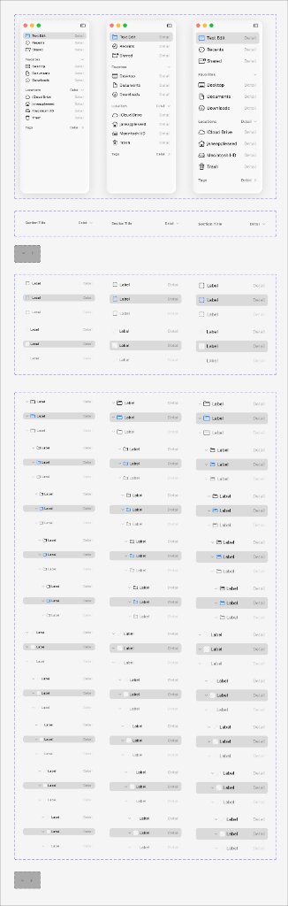

# Apple HIG Sidebars System — macOS Admin Specification

> *"A sidebar appears on the leading side of a view and lets people navigate between sections in your app or game. A sidebar can help people understand your app's structure and quickly access key areas."*  
> — **Apple Human Interface Guidelines (Sidebars)** ([developer.apple.com/design/human-interface-guidelines/sidebars](https://developer.apple.com/design/human-interface-guidelines/sidebars))

Dokumen ini mendefinisikan standar resmi implementasi **Sidebar Navigation (`NSSplitViewController` / `NSOutlineView` Sidebar Style)** pada macOS Tahoe UI Kit, integrasi Traffic Lights dan tombol toggle `[ |]`, seksi pengelompokan (*collapsible section headers*), gaya seleksi kapsul (*row selection pill*), hierarki pohon berjenjang (*indented tree outline view*), serta penerapannya pada antarmuka backend/admin MobiCare.

---

## 1. Analisis Master Matriks Sidebar macOS Tahoe (Ref 54)



Aset resmi Apple Design Resources di atas menampilkan master koleksi terlengkap komponen sidebar macOS Tahoe yang terbagi menjadi 5 seksi fungsional:

### A. Tiga Varian Shell Jendela Sidebar Penuh (Atas)
1. **Traffic Lights & Header Terpadu**: Tiga lampu kontrol jendela (Merah `#FF5F56`, Kuning `#FFBD2E`, Hijau `#27C93F`) terletak di kiri atas, bersanding dengan tombol toggle sidebar `[ |]` (`sidebar.left`).
2. **Pengelompokan Seksi Logis**: Menampilkan grup navigasi bertingkat:
   - Header Utama: *Nama Modul / Aplikasi*.
   - Grup Cepat: *Recent*, *Shared*.
   - Grup Favorit: *Desktop*, *Documents*, *Downloads*.
   - Grup Lokasi / Entitas: *iCloud Drive*, *Macintosh HD*, *Trash*.
   - Grup Tag / Label Kategori.

---

### B. Anatomi Header Seksi (*Section Header Rows*)
- **Tipografi**: Huruf kecil berbobot tebal atau Titlecase halus (`font-size: 11px - 12px`, `font-weight: 700`, warna teks sekunder).
- **Indikator Pengungkapan (*Disclosure Chevron*)**: Dilengkapi tombol panah `⌄` (saat terbuka) dan `›` (saat tertutup) di sisi kanan (*trailing edge*) untuk melipat seksi yang jarang digunakan.
- **Teks Detail / Counter**: Menampilkan jumlah item atau label status di sebelah kanan (misal: *Favorit [3]*, *Lokasi [Detail ⌄]*).

---

### C. Anatomi Seleksi Baris Datar (*Flat List Row Selection*)
- **Bentuk Kapsul Rounded**: Baris aktif dibungkus kapsul membulat beradius **`5px` - `6px`** dengan padding internal `4px 8px`.
- **Dua Gaya Latar Seleksi**:
  1. **Neutral Frosted Pill (Standar Sidebar)**: Latar abu-abu netral semi-transparan `rgba(0, 0, 0, 0.08)` (Light) / `rgba(255, 255, 255, 0.12)` (Dark), menjaga fokus tetap tertuju pada panel data utama di sebelah kanan.
  2. **Solid Blue Pill (Active Focus)**: Latar Solid Apple Blue `#007AFF` dengan teks dan ikon putih saat sidebar memegang fokus interaksi keyboard utama.
- **Elemen Pelengkap Baris**: Ikon SF Symbols 16px di kiri (*leading*), label menu 13px di tengah, dan teks detail/counter di kanan (*trailing*).

---

### D. Tampilan Pohon Berjenjang (*Hierarchical Tree / Outline View*)
Bagian bawah Ref 54 menampilkan 3 kolom variasi indentasi pohon berjenjang (*nested levels*):
- **Level 1 (Induk Utama)**: Margin kiri `0px`, dilengkapi disclosure triangle `⌄` dan ikon folder `📁`.
- **Level 2 (Sub-Kategori)**: Indentasi `16px` ke dalam.
- **Level 3 (Item / SKU Spesifik)**: Indentasi `32px` ke dalam.
- **Independensi Seleksi**: Seleksi kapsul rounded dapat berpindah mulus ke level induk maupun level anak tanpa merusak alignment garis vertikal visual.

---

## 2. Geometri, Material & Pembagian Spasial

| Parameter Fisik | Nilai / Spesifikasi Teknis | Keterangan Desain Apple |
| :--- | :--- | :--- |
| **Lebar Sidebar Standar** | **`220px` - `260px`** | Proporsi ideal yang tidak memakan ruang tabel data di layar desktop 1440px. |
| **Lebar Minimum / Maksimum** | Min `180px`, Max `340px` | Batas resizing splitter divider. |
| **Material Latar Belakang** | **Liquid Glass UltraThin** | Light: `rgba(246, 246, 246, 0.85)`<br>Dark: `rgba(30, 30, 32, 0.8)` |
| **Efek Kaca (*Blur*)** | **`blur(30px) saturate(190%)`** | Vibrancy sidebar material (`NSVisualEffectView`). |
| **Garis Pembatas Vertikal** | **`0.5px solid rgba(0, 0, 0, 0.12)`** | Pemisah tajam (*splitter hairline*) antara sidebar dan panel konten kanan. |
| **Tinggi Baris (*Row Height*)** | **`28px` - `30px`** | Tinggi baris ergonomis untuk klik cepat kursor mouse. |
| **Radius Kapsul Seleksi** | **`6px`** | Sudut membulat halus di dalam kontainer sidebar. |

---

## 3. Prinsip & Aturan Emas Desain Apple untuk Sidebars

### 1. Sederhanakan Kedalaman Hierarki (Maksimal 2-3 Tingkat)
> **Aturan Apple HIG**: Jangan membuat struktur pohon navigasi yang terlalu dalam di dalam sidebar. Batasi maksimal 2 hingga 3 tingkat kedalaman (Grup $\to$ Kategori $\to$ Sub-item). Jika data memiliki lebih dari 3 tingkat, gunakan tampilan tabel kolom (*Column View*) di panel utama.

### 2. Sediakan Akses Cepat ke Area Utama di Grup Teratas
Letakkan halaman yang paling sering diakses (seperti *Dashboard Ringkasan*, *Nota Berjalan*, dan *Klaim Menunggu*) di kelompok paling atas (*Quick Access / Favorit*) tanpa perlu membuka-tutup folder.

### 3. Persistensi Status Buka-Tutup Seksi (*State Persistence*)
Simpan status ekspansi (*expanded / collapsed*) dari setiap header seksi di `localStorage`. Saat admin memuat ulang browser, susunan seksi yang sedang dibuka tidak boleh ter-reset kembali ke default.

### 4. Responsivitas Layar Sempit & Tombol Toggle `[ |]`
- Pada layar laptop kecil atau jendela yang dikecilkan, sediakan tombol **Toggle Sidebar `[ |]`** di toolbar.
- Klik pada tombol toggle harus menganimasikan sidebar meluncur masuk/keluar secara mulus (`transition: transform 0.25s cubic-bezier(0.16, 1, 0.3, 1)`).

---

## 4. Penerapan Nyata di Backend Admin MobiCare

Susunan struktur sidebar lengkap untuk dashboard admin MobiCare (`AdminSidebar.tsx`):

```
+-------------------------------------------------------------+
|  🔴 🟡 🟢   [ |]                                            |  <- Traffic Lights & Toggle Button
|                                                             |
|  RINGKASAN & OPERASIONAL                                    |  <- Seksi 1 (Header 11px Bold)
|  [ 📊 Dashboard Analitik                         Detail ]   |
|  [ 🧾 Nota & Faktur Servis                        [ 5 ] ]   |  <- Badge 5 nota pending
|  [ 🛡️ Klaim Garansi Berjalan                      [ 2 ] ]   |  <- Badge 2 klaim baru
|                                                             |
|  KATALOG SUKU CADANG                             Detail ⌄   |  <- Seksi 2 (Collapsible)
|  [ 📦 Semua Pricelist Sparepart                         ]   |
|  ⌄ 📁 iPhone Display & LCD                                  |  <- Tree Level 1
|      [ 📱 iPhone 15 Series                       Detail ]   |  <- Tree Level 2 (Selected)
|      [ 📱 iPhone 14 Series                       Detail ]   |
|      [ 📱 iPhone 13 / 12 Series                  Detail ]   |
|  › 📁 Baterai & Power Management                            |
|  › 📁 Modul Kamera & Sensor TrueDepth                       |
|                                                             |
|  MEDIA & PROMOSI                                 Detail ⌄   |  <- Seksi 3 (Collapsible)
|  [ 🖼️ Galeri Before & After                             ]   |
|  [ 🏷️ Banner Promo Aktif                                ]   |
|                                                             |
|  PENGATURAN TOKO & SISTEM                                   |  <- Seksi 4
|  [ 📍 Lokasi Cabang Store Bali                          ]   |
|  [ ⚙️ Pengaturan Pengguna & Hak Akses                   ]   |
+-------------------------------------------------------------+
```

---

## 5. Implementasi CSS Tokens & Komponen Sidebar

```css
/* --- macOS Sidebar Tokens --- */
:root {
  --mac-sidebar-bg: rgba(246, 246, 246, 0.85);
  --mac-sidebar-border: rgba(0, 0, 0, 0.12);
  --mac-sidebar-width: 240px;
  --mac-sidebar-row-height: 28px;
  --mac-sidebar-row-radius: 6px;
  --mac-sidebar-row-hover: rgba(0, 0, 0, 0.04);
  --mac-sidebar-row-active: rgba(0, 0, 0, 0.08);
  --mac-sidebar-row-active-blue: #007AFF;
  --mac-sidebar-text-primary: #1D1D1F;
  --mac-sidebar-text-secondary: rgba(0, 0, 0, 0.55);
}

@media (prefers-color-scheme: dark) {
  :root {
    --mac-sidebar-bg: rgba(30, 30, 32, 0.8);
    --mac-sidebar-border: rgba(255, 255, 255, 0.15);
    --mac-sidebar-row-hover: rgba(255, 255, 255, 0.06);
    --mac-sidebar-row-active: rgba(255, 255, 255, 0.12);
    --mac-sidebar-row-active-blue: #0A84FF;
    --mac-sidebar-text-primary: #FFFFFF;
    --mac-sidebar-text-secondary: rgba(255, 255, 255, 0.55);
  }
}

/* Sidebar Container */
.mac-sidebar {
  width: var(--mac-sidebar-width);
  height: 100vh;
  background: var(--mac-sidebar-bg);
  backdrop-filter: blur(30px) saturate(190%);
  -webkit-backdrop-filter: blur(30px) saturate(190%);
  border-right: 0.5px solid var(--mac-sidebar-border);
  display: flex;
  flex-direction: column;
  user-select: none;
  overflow: hidden;
  box-sizing: border-box;
}

/* Header Area (Traffic Lights & Controls) */
.mac-sidebar__header {
  height: 52px;
  padding: 0 16px;
  display: flex;
  align-items: center;
  justify-content: space-between;
  flex-shrink: 0;
}

/* Scrollable Navigation List */
.mac-sidebar__nav {
  flex: 1;
  padding: 8px 10px;
  overflow-y: auto;
  scrollbar-width: thin;
}

/* Section Header */
.mac-sidebar__section-title {
  display: flex;
  align-items: center;
  justify-content: space-between;
  font-family: -apple-system, BlinkMacSystemFont, "SF Pro Text", system-ui, sans-serif;
  font-size: 11px;
  font-weight: 700;
  text-transform: uppercase;
  letter-spacing: 0.04em;
  color: var(--mac-sidebar-text-secondary);
  padding: 12px 8px 4px 8px;
  cursor: pointer;
}

/* Navigation Row Item */
.mac-sidebar__row {
  display: flex;
  align-items: center;
  height: var(--mac-sidebar-row-height);
  padding: 0 8px;
  border-radius: var(--mac-sidebar-row-radius);
  color: var(--mac-sidebar-text-primary);
  font-size: 13px;
  font-weight: 400;
  text-decoration: none;
  cursor: pointer;
  transition: all 0.12s ease;
  margin-bottom: 1px;
}

.mac-sidebar__row:hover:not(.is-active) {
  background: var(--mac-sidebar-row-hover);
}

/* Active Row Selection (Neutral Style) */
.mac-sidebar__row.is-active {
  background: var(--mac-sidebar-row-active);
  font-weight: 600;
}

/* Active Row Selection (Blue Solid Accent Variant) */
.mac-sidebar__row.is-active-blue {
  background: var(--mac-sidebar-row-active-blue);
  color: #FFFFFF;
  font-weight: 600;
}
.mac-sidebar__row.is-active-blue .mac-sidebar__icon,
.mac-sidebar__row.is-active-blue .mac-sidebar__badge {
  color: #FFFFFF;
}

/* Leading Icon */
.mac-sidebar__icon {
  margin-right: 8px;
  display: flex;
  align-items: center;
  justify-content: center;
  font-size: 15px;
  color: var(--mac-sidebar-text-secondary);
  width: 18px;
}

/* Trailing Badge Counter */
.mac-sidebar__badge {
  margin-left: auto;
  font-size: 11px;
  font-weight: 600;
  color: var(--mac-sidebar-text-secondary);
  background: rgba(0, 0, 0, 0.06);
  padding: 1px 6px;
  border-radius: 9999px;
  font-variant-numeric: tabular-nums;
}

/* Tree Level Indentation */
.mac-sidebar__row--indent-1 { padding-left: 24px; }
.mac-sidebar__row--indent-2 { padding-left: 40px; }
.mac-sidebar__row--indent-3 { padding-left: 56px; }
```

---

## 6. Checklist Verifikasi Standar Sidebars Apple

- [x] **Traffic Lights & Toggle `[ |]` Terpadu**: Diletakkan presisi di baris header atas sidebar.
- [x] **Material Liquid Glass UltraThin**: Translusensi `blur(30px)` dengan hairline divider `0.5px`.
- [x] **Kapsul Seleksi Beradius 6px**: Seleksi baris dengan sudut membulat yang nyaman dipandang.
- [x] **Collapsible Section Headers**: Judul grup huruf kecil tebal dengan disclosure chevron `⌄`/`›`.
- [x] **Dukungan Tree Outline View**: Indentasi bertingkat yang rapi untuk struktur katalog sparepart bertingkat.
- [x] **Badge Counter Tabular**: Angka counter tiket dengan font angka tabular (`tnum`).
