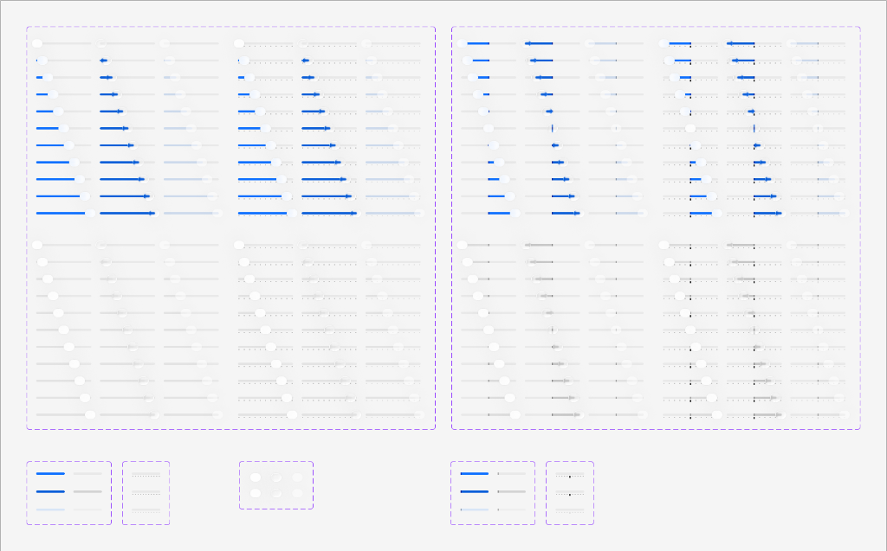

# Apple HIG Sliders System — macOS Admin Specification

> *"A slider is a horizontal track with a control, called a thumb, that people can adjust between a minimum and maximum value. A slider lets people make fine adjustments to a value, such as volume, brightness, or percentage."*  
> — **Apple Human Interface Guidelines (Sliders)** ([developer.apple.com/design/human-interface-guidelines/sliders](https://developer.apple.com/design/human-interface-guidelines/sliders))

Dokumen ini mendefinisikan standar resmi implementasi **Sliders (`NSSlider`)** pada macOS Tahoe UI Kit, matriks 3 arsitektur kontrol (Searah Kontinu, Dua Arah Berpusat di Tengah, dan Diskrit dengan *Tick Marks*), anatomi cakram jempol (*thumb knob*), elevasi bayangan 3D, umpan balik numerik instan, serta penerapannya pada antarmuka backend/admin MobiCare.

---

## 1. Analisis Master Matriks Slider macOS Tahoe (Ref 55)



Aset resmi Apple Design Resources di atas memperlihatkan sistem matriks slider paling komprehensif di macOS, terbagi menjadi dua blok kartu besar dan kumpulan template komponen:

### A. Blok Kiri: Unidirectional Sliders (Slider Searah 0% $\to$ 100%)
1. **Continuous Tinted Fill (Separuh Atas)**:
   - Sisi kiri jempol (*leading track*) diisi warna **Solid Apple Blue (`#007AFF`)**.
   - Sisi kanan jempol (*trailing track*) tetap berupa lintasan abu-abu netral transparan.
   - Tersedia dalam varian kontinu murni (*smooth continuous*) dan varian bertangga dengan titik penanda (*tick marks dots*).
2. **Neutral / Plain Slider (Separuh Bawah)**:
   - Lintasan abu-abu netral di kedua sisi jempol tanpa isian warna solid.
   - Digunakan untuk kontrol di mana representasi kuantitas tidak perlu mendominasi secara visual.

---

### B. Blok Kanan: Centered / Bi-directional Sliders (Slider Dua Arah Berpusat di Tengah)
1. **Titik Acuan Nol di Tengah (*Origin at Center 50%*)**:
   - Titik awal netral berada tepat di tengah lintasan dengan garis penanda sumbu (*center notch divider*).
   - Menggeser jempol ke kiri: Isian biru melebar ke arah kiri menandakan nilai negatif atau pengurangan (*decrease*).
   - Menggeser jempol ke kanan: Isian biru melebar ke arah kanan menandakan nilai positif atau penambahan (*increase*).
2. **Kapan Digunakan**:
   - Penyesuaian nilai relatif, seperti penyesuaian markup/diskon relatif ($-30\%$ s.d. $+30\%$), keseimbangan audio, atau eksposur saturasi warna foto servis.

---

### C. Anatomi Jempol (*Thumb Knob*) & Status Interaksi
- **Bentuk & Ukuran**: Cakram lingkaran sempurna berdiameter **`16px` - `18px`** (`border-radius: 50%`).
- **Material & Bayangan**: Permukaan putih murni `#FFFFFF` dengan bayangan elevasi mikro `box-shadow: 0 2px 4px rgba(0, 0, 0, 0.2), 0 0 1px rgba(0, 0, 0, 0.15)`.
- **Status Interaktif**:
  - *Resting*: Cakram putih mengambang anggun di atas lintasan.
  - *Focused*: Dikelilingi cincin fokus biru solid `0 0 0 2.5px #007AFF`.
  - *Pressed / Dragging*: Permukaan sedikit menggelap halus (`rgba(0, 0, 0, 0.05)`).
  - *Disabled*: Cakram dan track memudar dengan opasitas `0.42`.

---

## 2. Geometri, Warna & Spesifikasi Token

| Komponen / Properti | Light Mode | Dark Mode | Spesifikasi Teknis |
| :--- | :--- | :--- | :--- |
| **Tinggi Lintasan (*Track Height*)**| **`4px`** | **`4px`** | Kapsul ramping beradius penuh (`border-radius: 9999px`). |
| **Latar Lintasan Kosong** | `rgba(0, 0, 0, 0.1)` | `rgba(255, 255, 255, 0.16)` | Permukaan netral transparan. |
| **Isian Aktif (*Active Fill*)** | `#007AFF` (Apple Blue) | `#0A84FF` (Apple Blue Dark) | Solid warna aksen sistem. |
| **Diameter Jempol (*Thumb Diameter*)**| **`16px`** | **`16px`** | Proporsional dengan tinggi lintasan 4px. |
| **Warna Jempol (*Thumb Surface*)** | `#FFFFFF` | `#E5E5E7` | Cakram putih kontras tinggi. |
| **Tanda Titik (*Tick Marks*)** | `rgba(0, 0, 0, 0.25)` | `rgba(255, 255, 255, 0.3)` | Titik lingkaran 2px di bawah lintasan. |

---

## 3. Tiga Arsitektur Slider Resmi Apple

| Varian Slider | Karakteristik Lintasan | Arah Isian Warna | Kasus Penggunaan Ideal di MobiCare |
| :--- | :--- | :--- | :--- |
| **Searah Kontinu (*Unidirectional*)** | Nilai minimum di kiri, maksimum di kanan. | Kiri ke kanan (`0%` $\to$ `100%`). | Pengaturan margin markup suku cadang (`10%` - `80%`), diskon promo. |
| **Dua Arah Berpusat (*Bi-directional*)** | Titik netral berada di tengah lintasan (`50%`). | Meluas dari tengah ke kiri/kanan. | Penyesuaian margin fleksibel ($-20\%$ s.d. $+20\%$), kalibrasi warna foto. |
| **Diskrit Berjenjang (*Discrete Stepped*)** | Dilengkapi tanda centang (*tick marks*) diskrit. | Mengunci (*snap*) pada nilai tetap. | Pemilihan durasi garansi servis (*1 bln, 3 bln, 6 bln, 12 bln*). |

---

## 4. Prinsip & Aturan Emas Desain Apple untuk Sliders

### 1. Umpan Balik Nilai Seketika (*Immediate Real-time Feedback*)
> **Aturan Apple HIG**: Jangan menunda pembaruan nilai hingga admin melepaskan kursor mouse. Seluruh label angka dan kalkulasi harga harus diperbarui secara instan pada event `input` saat jempol sedang diseret.

### 2. Dampingkan dengan Input Numerik Stepper
Slider sangat baik untuk eksplorasi visual nilai, tetapi sulit digunakan untuk memasukkan angka yang sangat presisi (seperti tepat `27.5%`). **Dampingkan selalu slider dengan input teks atau numeric stepper** agar admin dapat memilih antara menyeret jempol atau mengetik angka pasti.

### 3. Sertakan Ikon Minimum & Maksimum
Tempatkan ikon SF Symbols deskriptif di kedua ujung lintasan untuk memperjelas konteks:
- Contoh: Ikon persentase kecil `％` di kiri dan persentase besar di kanan.
- Ikon volume speaker rendah di kiri dan speaker penuh di kanan.

### 4. Aksesibilitas Keyboard
Saat slider menerima fokus kursor (`focus-visible`):
- Tombol panah `←` / `→` menggeser nilai sebesar 1 langkah kecil (misal $1\%$).
- Tombol `Page Up` / `Page Down` menggeser nilai sebesar 1 langkah besar (misal $10\%$).

---

## 5. Penerapan Nyata di Backend Admin MobiCare

| Kasus Penggunaan di MobiCare | Komponen / Rute | Varian Slider | Karakteristik Visual & Fungsi |
| :--- | :--- | :--- | :--- |
| **Kalkulator Margin Markup Servis** | `MarginCalculatorPopover.tsx`<br>(`/admin/pricelist`) | **Searah Kontinu (0% - 80%)** | Menggeser persentase keuntungan sparepart, otomatis menghitung harga jual akhir secara real-time. |
| **Filter Rentang Harga Katalog** | `PriceFilterPopover.tsx`<br>(Header Monobar) | **Dual-Thumb Range Slider** | Dua jempol untuk menentukan batas harga minimum (misal Rp 100.000) dan maksimum (Rp 2.500.000). |
| **Penyesuaian Harga Relatif Promo** | `PromoAdjustmentSlider.tsx`<br>(`/admin/promo`) | **Dua Arah Berpusat (-30% s.d. +30%)** | Menentukan diskon khusus hari libur (arah kiri) atau penyesuaian biaya jasa kilat (arah kanan). |
| **Durasi Garansi Suku Cadang** | `WarrantySelector.tsx`<br>(`/admin/garansi`) | **Diskrit Berjenjang (4 Ticks)** | Mengunci pada 4 pilihan garansi resmi: `[ 30 Hari | 90 Hari | 180 Hari | 365 Hari ]`. |

---

## 6. Implementasi CSS Tokens & Komponen Slider

```css
/* --- macOS Slider Tokens --- */
:root {
  --mac-slider-track-bg: rgba(0, 0, 0, 0.1);
  --mac-slider-track-fill: #007AFF;
  --mac-slider-thumb-bg: #FFFFFF;
  --mac-slider-thumb-shadow: 0 2px 4px rgba(0, 0, 0, 0.2), 0 0 1px rgba(0, 0, 0, 0.15);
  --mac-slider-thumb-size: 16px;
  --mac-slider-track-height: 4px;
}

@media (prefers-color-scheme: dark) {
  :root {
    --mac-slider-track-bg: rgba(255, 255, 255, 0.16);
    --mac-slider-track-fill: #0A84FF;
    --mac-slider-thumb-bg: #E5E5E7;
    --mac-slider-thumb-shadow: 0 2px 6px rgba(0, 0, 0, 0.4), 0 0 1px rgba(0, 0, 0, 0.3);
  }
}

/* Slider Wrap Container */
.mac-slider-group {
  display: flex;
  align-items: center;
  gap: 10px;
  width: 100%;
}

/* Custom Native Range Input */
.mac-slider {
  -webkit-appearance: none;
  appearance: none;
  width: 100%;
  height: var(--mac-slider-track-height);
  background: var(--mac-slider-track-bg);
  border-radius: 9999px;
  outline: none;
  cursor: pointer;
  margin: 8px 0;
  position: relative;
}

/* Chrome / Safari / Edge Track Fill via CSS Variable */
.mac-slider::-webkit-slider-runnable-track {
  height: var(--mac-slider-track-height);
  border-radius: 9999px;
  background: linear-gradient(
    to right,
    var(--mac-slider-track-fill) 0%,
    var(--mac-slider-track-fill) var(--slider-progress, 0%),
    var(--mac-slider-track-bg) var(--slider-progress, 0%),
    var(--mac-slider-track-bg) 100%
  );
}

/* Chrome / Safari / Edge Thumb Knob */
.mac-slider::-webkit-slider-thumb {
  -webkit-appearance: none;
  appearance: none;
  width: var(--mac-slider-thumb-size);
  height: var(--mac-slider-thumb-size);
  border-radius: 50%;
  background: var(--mac-slider-thumb-bg);
  box-shadow: var(--mac-slider-thumb-shadow);
  border: 0.5px solid rgba(0, 0, 0, 0.06);
  cursor: grab;
  margin-top: calc((var(--mac-slider-thumb-size) - var(--mac-slider-track-height)) / -2);
  transition: transform 0.1s ease, box-shadow 0.12s ease;
}

.mac-slider::-webkit-slider-thumb:active {
  cursor: grabbing;
  transform: scale(0.96);
  background: #F2F2F7;
}

/* Focus Visible State */
.mac-slider:focus-visible::-webkit-slider-thumb {
  box-shadow: 0 0 0 3px rgba(0, 122, 255, 0.4), var(--mac-slider-thumb-shadow);
}

/* Bi-directional Centered Slider Fill */
.mac-slider--centered::-webkit-slider-runnable-track {
  background: linear-gradient(
    to right,
    var(--mac-slider-track-bg) 0%,
    var(--mac-slider-track-bg) min(50%, var(--slider-progress, 50%)),
    var(--mac-slider-track-fill) min(50%, var(--slider-progress, 50%)),
    var(--mac-slider-track-fill) max(50%, var(--slider-progress, 50%)),
    var(--mac-slider-track-bg) max(50%, var(--slider-progress, 50%)),
    var(--mac-slider-track-bg) 100%
  );
}

/* Numeric Value Badge */
.mac-slider-value {
  font-family: -apple-system, BlinkMacSystemFont, "SF Pro Text", system-ui, sans-serif;
  font-size: 13px;
  font-weight: 600;
  color: var(--mac-text-primary);
  font-variant-numeric: tabular-nums;
  min-width: 44px;
  text-align: right;
}
```

---

## 7. Checklist Verifikasi Standar Sliders Apple

- [x] **Tiga Arsitektur Slider**: Mendukung model searah kontinu, dua arah berpusat (*bi-directional centered*), dan diskrit bertingkat (*tick marks*).
- [x] **Jempol 16px dengan 3D Elevation**: Cakram bulat putih dengan bayangan mikro halus dan cincin fokus biru saat aktif.
- [x] **Lintasan Ramping 4px**: Kapsul melengkung penuh dengan pengisian warna biru Apple di sisi aktif.
- [x] **Umpan Balik Real-time**: Angka diperbarui langsung saat seret (*live onInput*).
- [x] **Didampingi Input Angka**: Nilai dilengkapi teks atau stepper untuk pengetikan presisi.
- [x] **Aksesibilitas Tombol Panah**: Navigasi keyboard `←` / `→` untuk penyesuaian nilai halus.
