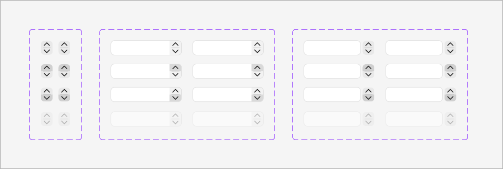
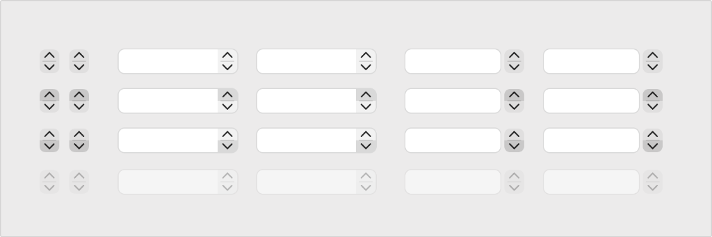

# Apple HIG Steppers System — macOS Admin Specification

> *"A stepper is a two-segment control that people use to increase or decrease an incremental value. A stepper is most effective when people need to make small changes to an incremental value. Because a stepper doesn’t display a value, make sure people always know which value it affects."*  
> — **Apple Human Interface Guidelines (Steppers)** ([developer.apple.com/design/human-interface-guidelines/steppers](https://developer.apple.com/design/human-interface-guidelines/steppers))

Dokumen ini mendefinisikan standar resmi implementasi **Steppers (`NSStepper`)** pada macOS Tahoe UI Kit, pembedaan Standalone Stepper vs Integrated Text Field Stepper, 4 status interaktif segmen (*Resting, Top Pressed, Bottom Pressed, Disabled*), akselerasi penekanan berkelanjutan (*click-and-hold*), pintasan produktivitas `Shift + Click` ($10\times$ magnitudo), serta penerapannya pada antarmuka backend/admin MobiCare.

---

## 1. Analisis Aset Referensi Visual Apple Design Resources (Ref 56 & Ref 57)




Aset master Apple Design Resources di atas memperlihatkan dua bentuk penyajian stepper resmi di macOS diuji di 4 status interaksi:

### A. Dua Bentuk Penyajian Resmi macOS
1. **Standalone Stepper (`NSStepper`)**:
   - Berupa kontrol kapsul mandiri dengan dua segmen bertumpuk vertikal: panah atas `⌃` (*increment*) dan panah bawah `⌄` (*decrement*).
   - Selalu diletakkan berdampingan erat di samping kanan label teks yang dipengaruhinya.
2. **Integrated Stepper Text Field (`[ 3.00 ] ⌃⌄`)**:
   - Kontrol hibrida terpadu di mana tombol stepper tersemat langsung di sisi kanan (*trailing edge*) di dalam kontainer input angka.
   - Memberikan fleksibilitas ganda: pengguna dapat mengetik angka pasti secara manual ATAU mengeklik panah untuk menaikkan/menurunkan angka secara bertahap.

---

### B. Empat Status Interaktif Segmen
1. **Status 1: Resting / Default (Baris 1)**:
   - Kedua segmen berlatar transparan netral dengan ikon chevron hitam `#1D1D1F`.
2. **Status 2: Top Segment Pressed (`⌃` Aktif - Baris 2)**:
   - Kapsul segmen atas menggelap menjadi abu-abu pekat `rgba(0, 0, 0, 0.16)` / `#D1D1D6` saat ditekan, menandakan aksi penambahan sedang berlangsung.
3. **Status 3: Bottom Segment Pressed (`⌄` Aktif - Baris 3)**:
   - Kapsul segmen bawah menggelap saat ditekan, menandakan aksi pengurangan sedang berlangsung.
4. **Status 4: Disabled / Non-Interaktif (Baris 4)**:
   - Seluruh kontrol memudar (`opacity: 0.4`), chevron berwarna abu-abu redup, kursor `not-allowed`.

---

## 2. Geometri, Warna & Spesifikasi Token

| Elemen Komponen | Ukuran / Nilai | Penjelasan Teknis |
| :--- | :--- | :--- |
| **Lebar Stepper Mandiri** | **`14px` - `16px`** | Lebar tombol dua segmen vertikal. |
| **Tinggi Stepper Mandiri** | **`22px` - `24px`** | Proporsional dengan input teks standar macOS 28px. |
| **Tinggi Tiap Segmen** | `11px` - `12px` | Kapsul atas dan kapsul bawah terpisah garis tipis 0.5px. |
| **Radius Kapsul Stepper** | `4px` | Sudut membulat halus khas kontrol sistem macOS. |
| **Warna Chevron `⌃` / `⌄`** | `#1D1D1F` (Light) / `#FFFFFF` (Dark) | Ikon panah mikro SF Symbols tebal. |
| **Latar Segmen Ditekan** | `rgba(0, 0, 0, 0.14)` (Light) / `rgba(255, 255, 255, 0.2)` (Dark) | Umpan balik visual saat tombol diklik. |

---

## 3. Fitur Produktivitas Tinggi Khas macOS Desktop

Sesuai pedoman rekayasa antarmuka macOS (`AppKit`), stepper dilengkapi kemampuan interaksi produktif:
1. **Continuous Stepping on Click-and-Hold**:
   - Jika admin menekan dan menahan (*mouse down hold*) salah satu tombol panah, nilai akan terus bertambah atau berkurang secara kontinu tanpa harus mengeklik berulang-ulang.
   - Kecepatan bertambah secara bertahap (*gradual acceleration*) setelah 0.5 detik penahanan.
2. **Shift-Click for 10x Magnitude Acceleration**:
   - Menahan tombol **`Shift` saat mengeklik stepper** akan melipatgandakan besaran nilai langkah menjadi **$10\times$ lipat**:
     - Standar click: $+1$ unit $\to$ `Shift + Click`: $+10$ unit.
     - Standar click: $+0.5\%$ margin $\to$ `Shift + Click`: $+5.0\%$ margin.
     - Standar click: $+5$ menit durasi $\to$ `Shift + Click`: $+30$ menit durasi.
3. **Pintasan Keyboard Panah Atas & Bawah (`↑` / `↓`)**:
   - Saat fokus berada di dalam input angka, menekan tombol panah `↑` di keyboard menaikkan nilai dan panah `↓` menurunkan nilai.

---

## 4. Prinsip & Aturan Emas Desain Apple untuk Steppers

### 1. Perjelas Nilai yang Dipengaruhi (*Make the Affected Value Obvious*)
> **Aturan Mutlak Apple HIG**: Karena stepper tidak menampilkan angka di dalam dirinya sendiri, pastikan letak stepper selalu menempel langsung di samping label atau input nilai yang dipengaruhinya. Jangan letakkan stepper terpisah jauh dari angka.

### 2. Format Angka Tabular Wajib (`font-variant-numeric: tabular-nums`)
Setiap angka yang dikontrol oleh stepper wajib menggunakan angka tabular monospaced (*tabular figures*) agar saat nilai berubah dari `9` ke `10` atau `99` ke `100`, lebar teks tidak meloncat-loncat (*no jitter*).

### 3. Batasi Nilai Minimum & Maksimum yang Masuk Akal
Cegah nilai negatif pada kuantitas fisik (misal stok sparepart tidak boleh $< 0$). Nonaktifkan segmen panah bawah `⌄` (menjadi disabled redup) ketika nilai telah mencapai batas minimum.

---

## 5. Penerapan Nyata di Backend Admin MobiCare

| Kasus Penggunaan di MobiCare | Komponen / Rute | Bentuk Stepper | Perilaku & Nilai Langkah |
| :--- | :--- | :--- | :--- |
| **Kuantitas Stok Suku Cadang** | `InventoryStock.tsx`<br>(`/admin/pricelist`) | **Integrated Stepper Text Field** | `[ 15 ] ⌃⌄ Unit`<br>Step: 1 unit, `Shift + Click`: 10 unit. Min: 0. |
| **Estimasi Waktu Pengerjaan** | `ServiceEditor.tsx`<br>(Modal Tambah Servis) | **Integrated Stepper Text Field** | `[ 45 ] ⌃⌄ Menit`<br>Step: 5 menit, `Shift + Click`: 15 menit. Min: 10. |
| **Persentase Margin Markup** | `MarginCalculatorPopover.tsx` | **Integrated Stepper Text Field** | `[ 25.0 ] ⌃⌄ %`<br>Step: 0.5%, `Shift + Click`: 5.0%. Min: 0%. |
| **Diskon Nominal Promo** | `PromoEditor.tsx`<br>(`/admin/promo`) | **Integrated Stepper Text Field** | `[ 10 ] ⌃⌄ %`<br>Step: 1%, `Shift + Click`: 5%. Min: 1%, Max: 90%. |
| **Masa Garansi Kustom** | `WarrantyCustomModal.tsx` | **Standalone Stepper** | Berada di samping label: `Durasi Garansi: 60 Hari [ ⌃⌄ ]`. |

---

## 6. Implementasi CSS Tokens & Komponen Stepper

```css
/* --- macOS Stepper Tokens --- */
:root {
  --mac-stepper-bg: rgba(0, 0, 0, 0.05);
  --mac-stepper-hover: rgba(0, 0, 0, 0.09);
  --mac-stepper-active: rgba(0, 0, 0, 0.16);
  --mac-stepper-border: rgba(0, 0, 0, 0.12);
  --mac-stepper-color: #1D1D1F;
}

@media (prefers-color-scheme: dark) {
  :root {
    --mac-stepper-bg: rgba(255, 255, 255, 0.08);
    --mac-stepper-hover: rgba(255, 255, 255, 0.13);
    --mac-stepper-active: rgba(255, 255, 255, 0.22);
    --mac-stepper-border: rgba(255, 255, 255, 0.15);
    --mac-stepper-color: #FFFFFF;
  }
}

/* Standalone Two-Segment Stepper */
.mac-stepper {
  display: inline-flex;
  flex-direction: column;
  width: 16px;
  height: 24px;
  background: var(--mac-stepper-bg);
  border: 0.5px solid var(--mac-stepper-border);
  border-radius: 4px;
  overflow: hidden;
  user-select: none;
  box-sizing: border-box;
}

.mac-stepper__btn {
  flex: 1;
  display: flex;
  align-items: center;
  justify-content: center;
  border: none;
  background: transparent;
  padding: 0;
  margin: 0;
  color: var(--mac-stepper-color);
  cursor: pointer;
  transition: background 0.1s ease;
  outline: none;
}

.mac-stepper__btn:hover {
  background: var(--mac-stepper-hover);
}

.mac-stepper__btn:active {
  background: var(--mac-stepper-active);
}

.mac-stepper__btn:disabled {
  opacity: 0.35;
  cursor: not-allowed;
}

/* Divider between Up and Down buttons */
.mac-stepper__btn--up {
  border-bottom: 0.5px solid var(--mac-stepper-border);
}

.mac-stepper__chevron {
  width: 8px;
  height: 5px;
  stroke: currentColor;
  stroke-width: 1.5;
  fill: none;
}

/* Integrated Stepper Text Field Wrapper */
.mac-stepper-input-wrap {
  display: inline-flex;
  align-items: center;
  height: 28px;
  background: #FFFFFF;
  border: 0.5px solid rgba(0, 0, 0, 0.15);
  border-radius: 6px;
  padding: 0 4px 0 8px;
  box-shadow: 0 1px 2px rgba(0, 0, 0, 0.04);
  transition: all 0.18s ease;
}

.mac-stepper-input-wrap:focus-within {
  border-color: #007AFF;
  box-shadow: 0 0 0 3px rgba(0, 122, 255, 0.35);
}

.mac-stepper-input {
  border: none;
  background: transparent;
  outline: none;
  font-family: -apple-system, BlinkMacSystemFont, "SF Pro Text", system-ui, sans-serif;
  font-size: 13px;
  font-variant-numeric: tabular-nums;
  color: #1D1D1F;
  width: 60px;
  text-align: right;
  padding-right: 6px;
}
```

---

## 7. Checklist Verifikasi Standar Steppers Apple

- [x] **Dua Bentuk Penyajian**: Mendukung Standalone Stepper dan Integrated Stepper Text Field.
- [x] **Empat Status Interaktif**: Resting, Top Pressed, Bottom Pressed, dan Disabled redup saat mencapai batas.
- [x] **Continuous Stepping**: Nilai bertambah kontinu saat tombol ditekan dan ditahan (*mouse hold*).
- [x] **Shift-Click 10x**: Mendukung tombol `Shift + Click` untuk lompatan nilai $10\times$ lebih cepat.
- [x] **Angka Tabular Monospaced**: Menggunakan `font-variant-numeric: tabular-nums` untuk mencegah jitter visual.
- [x] **Dukungan Keyboard Panah `↑` / `↓`**: Nilai dapat disesuaikan via tombol panah saat input aktif.
