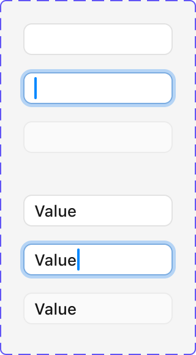
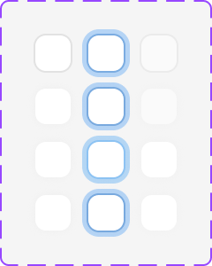
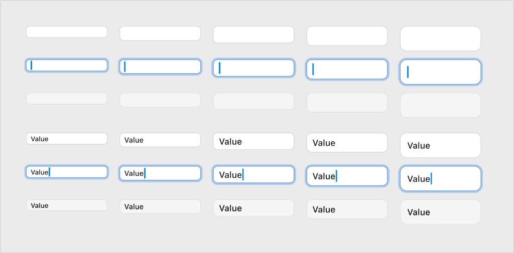

# Apple HIG Text Fields System — macOS Admin Specification

> *"A text field is a rectangular area in which people enter or edit small, specific pieces of text. Use a text field to accept a small amount of text, such as a name, an address, or a search term. If you need to accept a large amount of text, use a text view instead."*  
> — **Apple Human Interface Guidelines (Text Fields)** ([developer.apple.com/design/human-interface-guidelines/text-fields](https://developer.apple.com/design/human-interface-guidelines/text-fields))

Dokumen ini mendefinisikan arsitektur dan spesifikasi resmi implementasi **Text Fields (`NSTextField`)** pada macOS Tahoe UI Kit, 6 status interaktif field (*Resting, Focused, Hover, Resting Filled, Focused Filled, Disabled*), matriks 5 skala ukuran resmi macOS (*Mini, Small, Regular 28px, Large, Extra Large*), varian **Square Cells / PIN & OTP Matrix**, penanganan cincin fokus solid Apple Blue (`#007AFF`), teks bantu (*placeholder*), penataan label (*leading vs stacked*), pemformat angka otomatis, dan penerapannya pada seluruh form backend/admin MobiCare.

---

## 1. Analisis Aset Referensi Visual Apple Design Resources (Ref 58, Ref 59 & Ref 60)





Aset master Apple Design Resources di atas merangkum tiga pilar utama sistem input teks macOS:

### A. Enam Status Interaktif Text Field (Ref 58)
1. **Status 1: Resting Empty (Placeholder)**:
   - Kontainer berlatar putih bersih `#FFFFFF` (Light) atau `rgba(255, 255, 255, 0.08)` (Dark) dengan border netral halus `1px solid rgba(0, 0, 0, 0.12)`.
   - Placeholder teks tampil dalam warna abu-abu tersier `rgba(0, 0, 0, 0.38)` / `rgba(255, 255, 255, 0.40)`.
2. **Status 2: Focused Empty (Caret Aktif & Blue Focus Ring)**:
   - Cincin fokus solid khas Apple memancar di sekeliling border: `box-shadow: 0 0 0 3px rgba(0, 122, 255, 0.40)`.
   - Garis batas utama berubah menjadi warna aksen sistem `#007AFF`.
   - Caret (kursor ketik vertikal) berkedip dengan warna biru solid `#007AFF`.
3. **Status 3: Hover**:
   - Border menggelap secara subtil `1px solid rgba(0, 0, 0, 0.22)` untuk memberikan umpan balik taktil saat kursor mouse melintas di atas field.
4. **Status 4: Resting Filled (Terisi Teks)**:
   - Teks input berwarna hitam pekat `#1D1D1F` (Light) atau putih terang `#FFFFFF` (Dark) dengan tipografi SF Pro Regular.
   - Tanpa cincin fokus saat kursor berpindah ke elemen lain (*blurred*).
5. **Status 5: Focused Filled (Aktif Mengedit Teks)**:
   - Mempertahankan teks terisi dengan kursor ketik aktif dan cincin fokus biru `0 0 0 3px rgba(0, 122, 255, 0.40)`.
6. **Status 6: Disabled (Non-Interaktif)**:
   - Latar belakang berubah abu-abu pudar `rgba(0, 0, 0, 0.04)`.
   - Border memudar `rgba(0, 0, 0, 0.06)`, teks redup `rgba(0, 0, 0, 0.25)`, kursor mouse menjadi `not-allowed`.

---

### B. Matriks Square Cells / OTP & PIN Inputs (Ref 59)
- **Geometri Bujur Sangkar (Squircle)**: Sel individual berukuran `36px × 36px` hingga `44px × 44px` dengan sudut membulat `8px`.
- **Penggunaan Khusus**:
  1. Kode verifikasi OTP SMS / WhatsApp saat serah terima perangkat.
  2. PIN otorisasi transaksi kasir (void nota, diskon khusus manajer).
  3. Pemindaian digit serial IMEI / Serial Number pendek.
- **Perilaku Navigasi Cerdas**: Saat admin mengetik 1 digit, fokus otomatis melompat ke sel berikutnya (*auto-advance*). Menekan `Backspace` menghapus digit aktif dan memindahkan fokus kembali ke sel sebelumnya.

---

### C. Matriks 5 Skala Ukuran Standar macOS (Ref 60)

| Skala Ukuran | Tinggi Kontainer | Ukuran Font / SF Pro | Radius Sudut | Padding Horizontal | Kasus Penggunaan di macOS & Admin MobiCare |
| :--- | :--- | :--- | :--- | :--- | :--- |
| **Mini** | **`20px`** | `11px` (Caption 2) | `4px` | `6px` | Inspector bar compact, utility panels, mini filter data baris tabel. |
| **Small** | **`24px`** | `12px` (Caption 1) | `5px` | `8px` | Toolbar sekunder, baris tabel inline editable, modal utilitas padat. |
| **Regular** | **`28px`** *(Standar macOS)* | `13px` (Subheadline) | **`6px`** | `10px` | **Ukuran default utama seluruh form setting, dialog simpan, dan modal.** |
| **Large** | **`34px`** | `15px` (Callout) | `8px` | `12px` | Form entri penting: input nomor nota servis, plat nomor, nomor WhatsApp. |
| **Extra Large** | **`40px`** | `17px` (Body Bold) | `10px` | `14px` | Hero input di dashboard: barcode scanner modal, pencarian global raksasa. |

---

## 2. Karakteristik & Aturan Emas Apple HIG untuk Text Fields

### 1. Gunakan Text Field untuk Input Teks Pendek Satu Baris
> **Aturan HIG**: Text field dirancang eksklusif untuk data satu baris (*single-line*). Jika admin perlu memasukkan keluhan kerusakan panjang, catatan teknisi multi-paragraf, atau riwayat log, gunakan **Text View (`NSTextView`)** yang mendukung multi-line dengan scrollbar vertikal otomatis.

### 2. Berikan Label yang Jelas & Konsisten
- Posisikan label di sebelah kiri (*leading aligned*) untuk dialog bertipe form formil macOS standar, atau di atas field (*stacked*) untuk form pengisian cepat pada panel inspektor.
- Hindari mengandalkan placeholder semata sebagai pengganti label. Placeholder akan lenyap saat teks diketik, sehingga membingungkan admin jika lupa data apa yang diminta.

### 3. Tampilkan Teks Placeholder yang Membantu (*Helpful Placeholder*)
- Berikan contoh format data yang benar di placeholder, misalnya `"0812-3456-7890"` untuk nomor telepon, `"A 1234 BCD"` untuk plat nomor kendaraan servis, atau `"iPhone 14 Pro Max 256GB"` untuk nama perangkat.
- Placeholder harus ringkas dan tidak memuat instruksi operasional yang panjang.

### 4. Tombol Hapus Cepat (*Clear Button*)
- Pada field input yang berpotensi sering dihapus atau diganti nilainya (seperti pencarian serial atau filter teks), sematkan tombol hapus bulat `xmark.circle.fill` di sisi kanan (*trailing edge*) yang hanya muncul ketika field terisi teks.

### 5. Cincin Fokus Sistem & Aksesibilitas Keyboard
- Selalu sediakan cincin fokus tegas beradius lembut saat pengguna melakukan navigasi keyboard (`Tab` dan `Shift + Tab`).
- Jangan pernah menghilangkan outline fokus (`outline: none` tanpa pengganti `box-shadow` Apple Blue) karena akan merusak aksesibilitas desktop keyboard.

---

## 3. Penerapan Nyata di Backend Admin MobiCare

| Kasus Penggunaan di MobiCare | Komponen / Halaman | Ukuran Field | Fitur Khusus |
| :--- | :--- | :--- | :--- |
| **Pencarian Cepat No. Nota / IMEI** | Header Bar / Global Search | **Large (`34px`)** | Ikon `magnifyingglass` di kiri, tombol hapus `xmark.circle.fill` di kanan. |
| **Input Nama Pelanggan & WhatsApp** | Modal Pendaftaran Servis Baru | **Regular (`28px`)** | Formatting nomor telepon otomatis `08xx-xxxx-xxxx`, label di sisi kiri rata kanan. |
| **Harga Suku Cadang & Jasa** | Editor Pricelist (`/admin/pricelist`) | **Regular (`28px`)** | Prefix `Rp` tersemat di sisi kiri, format angka ribuan tabular (`tabular-nums`). |
| **PIN Otorisasi Diskon Kasir** | Modal Void & Approval Diskon | **Square Cells (`40px × 40px`)** | 6 sel bujur sangkar, auto-jump, masking bulatan `••••••` untuk kerahasiaan. |
| **Filter Cepat Kolom Tabel** | Baris Filter Tabel Inventaris | **Small (`24px`)** | Ukuran ringkas untuk menghemat ruang vertikal grid data. |
| **Catatan Keluhan Kerusakan** | Kartu Detail Pengerjaan | **Text View (Multi-line)** | Menggunakan `textarea` beradius `8px` dengan min-height `72px`. |

---

## 4. Spesifikasi Token CSS macOS Text Fields

```css
/* ==========================================================================
   macOS Tahoe Text Fields System Tokens
   ========================================================================== */

:root {
  /* Colors - Light Mode */
  --mac-input-bg: #FFFFFF;
  --mac-input-border: rgba(0, 0, 0, 0.12);
  --mac-input-border-hover: rgba(0, 0, 0, 0.22);
  --mac-input-text: #1D1D1F;
  --mac-input-placeholder: rgba(0, 0, 0, 0.38);
  --mac-input-disabled-bg: rgba(0, 0, 0, 0.04);
  --mac-input-disabled-border: rgba(0, 0, 0, 0.06);
  --mac-input-disabled-text: rgba(0, 0, 0, 0.25);

  /* Focus Ring */
  --mac-input-focus-border: #007AFF;
  --mac-input-focus-ring: 0 0 0 3px rgba(0, 122, 255, 0.40);
  --mac-input-caret: #007AFF;

  /* Sizes */
  --mac-input-h-mini: 20px;
  --mac-input-h-sm: 24px;
  --mac-input-h-reg: 28px;
  --mac-input-h-lg: 34px;
  --mac-input-h-xl: 40px;

  /* Radii */
  --mac-input-r-mini: 4px;
  --mac-input-r-sm: 5px;
  --mac-input-r-reg: 6px;
  --mac-input-r-lg: 8px;
  --mac-input-r-xl: 10px;
}

@media (prefers-color-scheme: dark) {
  :root {
    --mac-input-bg: rgba(255, 255, 255, 0.08);
    --mac-input-border: rgba(255, 255, 255, 0.14);
    --mac-input-border-hover: rgba(255, 255, 255, 0.26);
    --mac-input-text: #FFFFFF;
    --mac-input-placeholder: rgba(255, 255, 255, 0.40);
    --mac-input-disabled-bg: rgba(255, 255, 255, 0.03);
    --mac-input-disabled-border: rgba(255, 255, 255, 0.06);
    --mac-input-disabled-text: rgba(255, 255, 255, 0.25);
    --mac-input-focus-ring: 0 0 0 3px rgba(10, 132, 255, 0.45);
    --mac-input-caret: #0A84FF;
  }
}

/* Base Field Class */
.mac-text-field {
  appearance: none;
  width: 100%;
  background: var(--mac-input-bg);
  border: 1px solid var(--mac-input-border);
  color: var(--mac-input-text);
  font-family: -apple-system, BlinkMacSystemFont, "SF Pro Text", "Helvetica Neue", sans-serif;
  caret-color: var(--mac-input-caret);
  outline: none;
  transition: border-color 0.12s ease, box-shadow 0.12s ease, background-color 0.12s ease;
}

.mac-text-field::placeholder {
  color: var(--mac-input-placeholder);
  opacity: 1;
}

.mac-text-field:hover:not(:focus):not(:disabled) {
  border-color: var(--mac-input-border-hover);
}

.mac-text-field:focus {
  border-color: var(--mac-input-focus-border);
  box-shadow: var(--mac-input-focus-ring);
}

.mac-text-field:disabled {
  background: var(--mac-input-disabled-bg);
  border-color: var(--mac-input-disabled-border);
  color: var(--mac-input-disabled-text);
  cursor: not-allowed;
}

/* Size Variants */
.mac-text-field-mini {
  height: var(--mac-input-h-mini);
  padding: 0 6px;
  font-size: 11px;
  border-radius: var(--mac-input-r-mini);
}

.mac-text-field-small {
  height: var(--mac-input-h-sm);
  padding: 0 8px;
  font-size: 12px;
  border-radius: var(--mac-input-r-sm);
}

.mac-text-field-regular {
  height: var(--mac-input-h-reg);
  padding: 0 10px;
  font-size: 13px;
  border-radius: var(--mac-input-r-reg);
}

.mac-text-field-large {
  height: var(--mac-input-h-lg);
  padding: 0 12px;
  font-size: 15px;
  border-radius: var(--mac-input-r-lg);
}

.mac-text-field-xl {
  height: var(--mac-input-h-xl);
  padding: 0 14px;
  font-size: 17px;
  border-radius: var(--mac-input-r-xl);
}

/* Square Cell PIN Input */
.mac-pin-cell {
  width: 40px;
  height: 40px;
  text-align: center;
  font-size: 18px;
  font-weight: 600;
  border-radius: 8px;
  font-variant-numeric: tabular-nums;
  background: var(--mac-input-bg);
  border: 1px solid var(--mac-input-border);
  color: var(--mac-input-text);
  caret-color: var(--mac-input-caret);
  outline: none;
  transition: border-color 0.12s ease, box-shadow 0.12s ease;
}

.mac-pin-cell:focus {
  border-color: var(--mac-input-focus-border);
  box-shadow: var(--mac-input-focus-ring);
}
```

---

## 5. Komponen React TSX Standar macOS Admin

Berikut adalah implementasi komponen `MacTextField` dan `MacPinInput` siap pakai untuk form admin MobiCare:

```tsx
// components/admin/ui/MacTextField.tsx
"use client";

import React, { forwardRef, useState } from "react";
import { XMarkIcon } from "@heroicons/react/20/solid";

export interface MacTextFieldProps extends React.InputHTMLAttributes<HTMLInputElement> {
  sizeVariant?: "mini" | "small" | "regular" | "large" | "xl";
  clearable?: boolean;
  prefixElement?: React.ReactNode;
  suffixElement?: React.ReactNode;
  onClear?: () => void;
}

export const MacTextField = forwardRef<HTMLInputElement, MacTextFieldProps>(
  (
    {
      sizeVariant = "regular",
      clearable = false,
      prefixElement,
      suffixElement,
      onClear,
      className = "",
      value,
      onChange,
      disabled,
      ...props
    },
    ref
  ) => {
    const [internalVal, setInternalVal] = useState(value ?? "");

    const handleChange = (e: React.ChangeEvent<HTMLInputElement>) => {
      setInternalVal(e.target.value);
      onChange?.(e);
    };

    const handleClear = () => {
      setInternalVal("");
      if (onClear) {
        onClear();
      } else {
        const fakeEvent = {
          target: { value: "" },
        } as React.ChangeEvent<HTMLInputElement>;
        onChange?.(fakeEvent);
      }
    };

    const sizeClass = {
      mini: "mac-text-field-mini",
      small: "mac-text-field-small",
      regular: "mac-text-field-regular",
      large: "mac-text-field-large",
      xl: "mac-text-field-xl",
    }[sizeVariant];

    const currentVal = value !== undefined ? value : internalVal;
    const hasValue = String(currentVal).length > 0;

    return (
      <div className="relative flex items-center w-full">
        {prefixElement && (
          <div className="absolute left-2.5 flex items-center pointer-events-none text-neutral-400">
            {prefixElement}
          </div>
        )}

        <input
          ref={ref}
          value={currentVal}
          onChange={handleChange}
          disabled={disabled}
          className={`mac-text-field ${sizeClass} ${
            prefixElement ? "pl-8" : ""
          } ${clearable || suffixElement ? "pr-8" : ""} ${className}`}
          {...props}
        />

        {clearable && hasValue && !disabled && (
          <button
            type="button"
            onClick={handleClear}
            className="absolute right-2 p-0.5 rounded-full text-neutral-400 hover:text-neutral-600 dark:hover:text-neutral-200 transition-colors"
          >
            <XMarkIcon className="w-3.5 h-3.5" />
          </button>
        )}

        {suffixElement && !clearable && (
          <div className="absolute right-2.5 flex items-center pointer-events-none text-neutral-400">
            {suffixElement}
          </div>
        )}
      </div>
    );
  }
);

MacTextField.displayName = "MacTextField";
```

```tsx
// components/admin/ui/MacPinInput.tsx
"use client";

import React, { useRef, useState } from "react";

export interface MacPinInputProps {
  length?: number;
  value: string;
  onChange: (pin: string) => void;
  masked?: boolean;
  disabled?: boolean;
}

export function MacPinInput({
  length = 6,
  value,
  onChange,
  masked = false,
  disabled = false,
}: MacPinInputProps) {
  const inputRefs = useRef<(HTMLInputElement | null)[]>([]);

  const digits = value.padEnd(length, " ").slice(0, length).split("");

  const handleChange = (index: number, e: React.ChangeEvent<HTMLInputElement>) => {
    const val = e.target.value.replace(/\D/g, "");
    if (!val) return;

    const char = val[val.length - 1]; // Ambil karakter terakhir diketik
    const newDigits = [...digits];
    newDigits[index] = char;
    const newPin = newDigits.join("").trim();
    onChange(newPin);

    // Otomatis melompat ke sel berikutnya
    if (index < length - 1) {
      inputRefs.current[index + 1]?.focus();
    }
  };

  const handleKeyDown = (index: number, e: React.KeyboardEvent<HTMLInputElement>) => {
    if (e.key === "Backspace") {
      e.preventDefault();
      const newDigits = [...digits];
      newDigits[index] = " ";
      const newPin = newDigits.join("").trim();
      onChange(newPin);

      // Mundur ke sel sebelumnya jika kosong
      if (index > 0) {
        inputRefs.current[index - 1]?.focus();
      }
    } else if (e.key === "ArrowLeft" && index > 0) {
      inputRefs.current[index - 1]?.focus();
    } else if (e.key === "ArrowRight" && index < length - 1) {
      inputRefs.current[index + 1]?.focus();
    }
  };

  return (
    <div className="flex items-center gap-2">
      {Array.from({ length }).map((_, idx) => (
        <input
          key={idx}
          ref={(el) => {
            inputRefs.current[idx] = el;
          }}
          type={masked ? "password" : "text"}
          inputMode="numeric"
          maxLength={1}
          value={digits[idx] === " " ? "" : digits[idx]}
          onChange={(e) => handleChange(idx, e)}
          onKeyDown={(e) => handleKeyDown(idx, e)}
          disabled={disabled}
          className="mac-pin-cell"
        />
      ))}
    </div>
  );
}
```

---

## 6. Checklist Verifikasi Implementasi HIG

- [x] Kontainer input beradius presisi sesuai skala (`4px`, `5px`, `6px`, `8px`, `10px`).
- [x] Ukuran default untuk modal, sheet, dan form admin adalah **Regular (`28px`)**.
- [x] Cincin fokus memancarkan Apple Blue `#007AFF` dengan ketebalan 3px tanpa merusak tata letak fisik (*zero-layout-shift*).
- [x] Warna kursor ketik (*caret*) konsisten aksen biru.
- [x] Placeholder menggunakan warna tersier yang kontras terbaca namun tidak disalahartikan sebagai teks terisi.
- [x] Format Square Cell mendukung verifikasi PIN kasir & OTP serah terima servis dengan lompatan otomatis (*auto-advance*).
- [x] Input angka menggunakan font tabular `tabular-nums` untuk perataan angka presisi.
