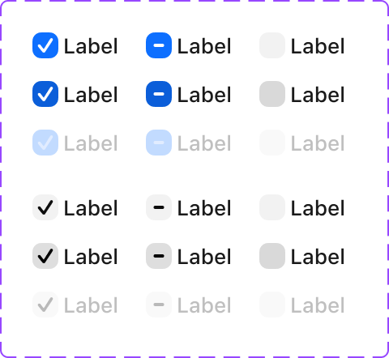
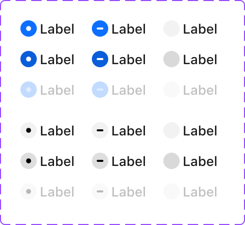
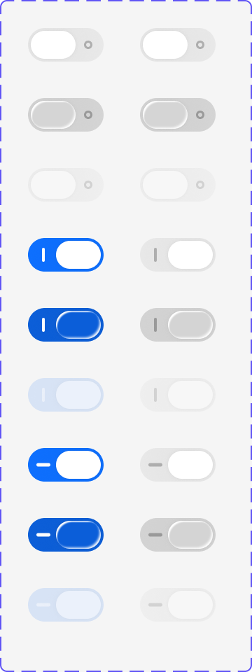
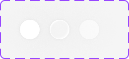

# Apple HIG Toggles System — macOS Admin Specification

> *"A toggle lets people choose between a pair of opposing states, like on and off, using a different appearance to indicate each state."*  
> — **Apple Human Interface Guidelines (Toggles)** ([developer.apple.com/design/human-interface-guidelines/toggles](https://developer.apple.com/design/human-interface-guidelines/toggles))

Dokumen ini mendefinisikan standar resmi implementasi **Toggles** pada macOS Tahoe UI Kit yang mencakup tiga kontrol semantik sistem: **Switches (`NSSwitch`)**, **Checkboxes (`NSButton` type switch)**, dan **Radio Buttons (`NSButton` type radio)**. Meliputi analisis 4 aset master Apple Design Resources (Ref 61, 62, 63, 64), 3 status pilihan (*On/Checked, Off/Unchecked, Mixed/Indeterminate*), status interaktif (*Resting, Hover/Pressed, Disabled*), serta penerapannya pada seluruh pengaturan dan tabel backend/admin MobiCare.

---

## 1. Analisis Aset Referensi Visual Apple Design Resources (Ref 61 - 64)






Aset master Apple Design Resources di atas merangkum tiga instrumen kontrol logika biner pada ekosistem macOS:

### A. Matriks Checkboxes (Ref 61)
- **Tiga Status Pilihan (*Selection States*)**:
  1. **Checked (`✓`)**: Kotak squircle `14px × 14px` (radius `3.5px`) terisi warna solid Apple Blue `#007AFF` dengan tanda centang putih bersih tebal, ATAU gaya minimalis outline dengan centang hitam pekat.
  2. **Mixed / Indeterminate (`-`)**: Menampilkan strip horizontal putih di tengah latar biru atau strip hitam di tengah kotak kosong. Digunakan pada header tabel saat sebagian baris terpilih (*partial selection*).
  3. **Unchecked (Kosong)**: Kotak berlatar putih bersih dengan border netral halus `rgba(0, 0, 0, 0.18)`.
- **Status Interaksi Baris**:
  - *Default*: Tampilan kontras standar.
  - *Hover / Pressed*: Kotak menggelap lembut, memberikan umpan balik penekanan mikro (*micro-compression*).
  - *Disabled*: Memudar dengan opasitas `0.35 - 0.40`, centang redup, kursor `not-allowed`.

---

### B. Matriks Radio Buttons (Ref 62)
- **Karakteristik Mutually Exclusive**: Digunakan khusus untuk memilih **tepat satu opsi** dari sekelompok kecil pilihan.
- **Tiga Status Pilihan**:
  1. **Selected (`◉`)**: Lingkaran luar `14px × 14px` dengan titik lingkaran solid (*inner dot*) `6px` di tengahnya berwarna aksen Apple Blue `#007AFF` atau hitam pekat `#1D1D1F`.
  2. **Mixed / Indeterminate (`-`)**: Lingkaran dengan tanda strip minus di tengah (jarang digunakan untuk radio, namun tersedia untuk seleksi grup bertingkat).
  3. **Unselected (Kosong)**: Lingkaran kosong dengan border netral `rgba(0, 0, 0, 0.18)` dan latar putih/transparan.
- **Status Interaksi**:
  - *Default*: Titik fokus tajam.
  - *Pressed*: Latar belakang lingkaran menggelap saat mouse menekan.
  - *Disabled*: Memudar redup tanpa respon kursor.

---

### C. Matriks Switch Toggles & Knobs (Ref 63 & 64)
- **Karakteristik Efek Seketika (*Immediate Effect*)**: Switch segera mengubah kondisi sistem tanpa perlu tombol "Simpan" terpisah.
- **Geometri & Proporsi Switch macOS**:
  - **Dimensi Track**: Lebar `38px`, tinggi `22px`, beradius kapsul penuh `11px` (`border-radius: 9999px`).
  - **Dimensi Knob (Ref 64)**: Cakram lingkaran putih murni `18px × 18px` dengan bayangan halus (`box-shadow: 0 1px 3px rgba(0, 0, 0, 0.2), 0 0.5px 1px rgba(0, 0, 0, 0.1)`).
- **Tiga Varian Track (Ref 63)**:
  1. **Status ON**: Latar belakang solid Apple Blue `#007AFF` (atau Green `#34C759` khas iOS/macOS System Settings) dengan knob bergeser ke kanan.
  2. **Status OFF**: Latar belakang abu-abu netral semi-transparan `rgba(0, 0, 0, 0.12)` dengan knob di kiri.
  3. **Status Mixed / Indeterminate**: Menampilkan indikator strip garis `-` di dalam track untuk status pengaturan gabungan.
- **Simbol Aksesibilitas Opsional**: Garis vertikal `|` di status ON dan lingkaran kecil `o` di status OFF terpatri di dalam lintasan untuk pengguna dengan keterbatasan penglihatan warna.

---

## 2. Aturan Emas Pemilihan Kontrol Apple HIG

| Jenis Kontrol | Kapan Harus Digunakan? | Kapan TIDAK Boleh Digunakan? |
| :--- | :--- | :--- |
| **Switch** (`NSSwitch`) | • Mengaktifkan/menonaktifkan fitur atau preferensi mandiri.<br>• Efek perubahan langsung aktif seketika (*immediate action*). | • Dalam form dialog dokumen yang masih menunggu tombol *Simpan*.<br>• Memilih dari sekumpulan opsi ganda dalam satu kategori. |
| **Checkbox** (`NSButton`) | • Memilih satu atau beberapa opsi independen dalam daftar.<br>• Kontrol seleksi baris massal di tabel data (*Select All*).<br>• Persetujuan syarat & ketentuan. | • Memilih satu opsi eksklusif dari daftar pilihan.<br>• Menyalakan/mematikan fitur global yang butuh efek instan. |
| **Radio Button** (`NSButton`) | • Memilih tepat 1 opsi eksklusif dari 2–5 pilihan.<br>• Seluruh opsi harus terlihat langsung tanpa membuka dropdown. | • Jika opsi lebih dari 5 (gunakan Pop-Up Button `⇅`).<br>• Pengguna dapat memilih lebih dari satu opsi. |

---

## 3. Penerapan Nyata di Backend Admin MobiCare

| Kasus Penggunaan di MobiCare | Komponen / Halaman | Jenis Kontrol | Perilaku & Status |
| :--- | :--- | :--- | :--- |
| **Toggle Status Buka Cabang Toko** | `/admin/settings` (Cabang Bali) | **Switch (`38px × 22px`)** | Efek instan: Toko Buka (Hijau `#34C759`) vs Tutup (Abu-abu), langsung mengubah badge di halaman publik. |
| **Visibilitas Banner Promo Aktif** | `/admin/promo` | **Switch (`38px × 22px`)** | Efek instan: Aktif tayang (`#007AFF`) vs Nonaktif draft. |
| **Seleksi Baris Massal Data Servis** | Header Tabel `AdminDataTable` | **Checkbox (Indeterminate `-`)** | Status *Mixed* saat 3 dari 10 baris tercentang. Klik header mengubah semua menjadi Checked (`✓`). |
| **Pilihan Cakupan Suku Cadang** | Modal Tambah Servis | **Checkboxes Majemuk (`✓`)** | Admin dapat mencentang: `[✓] LCD Asli`, `[✓] Pemasangan`, `[ ] Lem Waterproof`. |
| **Metode Pembayaran Kasir** | Modal Pembayaran Faktur | **Radio Buttons (`◉`)** | Opsi eksklusif: `(◉) QRIS Statis`, `( ) Transfer Bank`, `( ) Tunai Kasir`. |
| **Kategori Garansi Servis** | `/admin/garansi` | **Radio Buttons (`◉`)** | Opsi eksklusif: `(◉) 90 Hari Standar`, `( ) 180 Hari Prioritas`, `( ) Lifetime Garansi Lem`. |

---

## 4. Spesifikasi Token CSS macOS Toggles

```css
/* ==========================================================================
   macOS Tahoe Toggles System Tokens
   ========================================================================== */

:root {
  /* Switch Tokens */
  --mac-switch-width: 38px;
  --mac-switch-height: 22px;
  --mac-switch-knob-size: 18px;
  --mac-switch-bg-off: rgba(0, 0, 0, 0.14);
  --mac-switch-bg-off-hover: rgba(0, 0, 0, 0.20);
  --mac-switch-bg-on: #007AFF; /* Apple Accent Blue */
  --mac-switch-bg-on-system: #34C759; /* Apple System Green */
  --mac-switch-knob-bg: #FFFFFF;
  --mac-switch-knob-shadow: 0 1px 3px rgba(0, 0, 0, 0.25), 0 0.5px 1px rgba(0, 0, 0, 0.12);

  /* Checkbox & Radio Tokens */
  --mac-control-size: 15px;
  --mac-checkbox-radius: 4px;
  --mac-control-border: rgba(0, 0, 0, 0.22);
  --mac-control-border-hover: rgba(0, 0, 0, 0.35);
  --mac-control-bg: #FFFFFF;
  --mac-control-checked-bg: #007AFF;
  --mac-control-checked-color: #FFFFFF;

  /* Focus Ring */
  --mac-toggle-focus-ring: 0 0 0 3px rgba(0, 122, 255, 0.40);
}

@media (prefers-color-scheme: dark) {
  :root {
    --mac-switch-bg-off: rgba(255, 255, 255, 0.18);
    --mac-switch-bg-off-hover: rgba(255, 255, 255, 0.26);
    --mac-control-border: rgba(255, 255, 255, 0.28);
    --mac-control-border-hover: rgba(255, 255, 255, 0.45);
    --mac-control-bg: rgba(255, 255, 255, 0.08);
  }
}

/* --- Switch Component --- */
.mac-switch {
  position: relative;
  display: inline-flex;
  align-items: center;
  width: var(--mac-switch-width);
  height: var(--mac-switch-height);
  border-radius: 9999px;
  background: var(--mac-switch-bg-off);
  cursor: pointer;
  border: none;
  padding: 2px;
  outline: none;
  transition: background-color 0.2s cubic-bezier(0.16, 1, 0.3, 1), box-shadow 0.15s ease;
}

.mac-switch:focus-visible {
  box-shadow: var(--mac-toggle-focus-ring);
}

.mac-switch.is-on {
  background: var(--mac-switch-bg-on);
}

.mac-switch.is-on-green {
  background: var(--mac-switch-bg-on-system);
}

.mac-switch-knob {
  width: var(--mac-switch-knob-size);
  height: var(--mac-switch-knob-size);
  border-radius: 50%;
  background: var(--mac-switch-knob-bg);
  box-shadow: var(--mac-switch-knob-shadow);
  transform: translateX(0);
  transition: transform 0.2s cubic-bezier(0.16, 1, 0.3, 1);
}

.mac-switch.is-on .mac-switch-knob {
  transform: translateX(16px);
}

.mac-switch:disabled {
  opacity: 0.4;
  cursor: not-allowed;
}

/* --- Checkbox Component --- */
.mac-checkbox {
  appearance: none;
  width: var(--mac-control-size);
  height: var(--mac-control-size);
  border-radius: var(--mac-checkbox-radius);
  border: 1px solid var(--mac-control-border);
  background: var(--mac-control-bg);
  cursor: pointer;
  outline: none;
  display: inline-grid;
  place-content: center;
  transition: all 0.12s ease;
}

.mac-checkbox:hover:not(:disabled) {
  border-color: var(--mac-control-border-hover);
}

.mac-checkbox:focus-visible {
  box-shadow: var(--mac-toggle-focus-ring);
  border-color: #007AFF;
}

.mac-checkbox:checked,
.mac-checkbox.is-indeterminate {
  background: var(--mac-control-checked-bg);
  border-color: var(--mac-control-checked-bg);
}

.mac-checkbox:checked::before {
  content: "";
  width: 9px;
  height: 5px;
  border-left: 2px solid #FFFFFF;
  border-bottom: 2px solid #FFFFFF;
  transform: rotate(-45deg) translate(1px, -1px);
}

.mac-checkbox.is-indeterminate::before {
  content: "";
  width: 7px;
  height: 2px;
  background: #FFFFFF;
  border-radius: 1px;
}

/* --- Radio Component --- */
.mac-radio {
  appearance: none;
  width: var(--mac-control-size);
  height: var(--mac-control-size);
  border-radius: 50%;
  border: 1px solid var(--mac-control-border);
  background: var(--mac-control-bg);
  cursor: pointer;
  outline: none;
  display: inline-grid;
  place-content: center;
  transition: all 0.12s ease;
}

.mac-radio:hover:not(:disabled) {
  border-color: var(--mac-control-border-hover);
}

.mac-radio:focus-visible {
  box-shadow: var(--mac-toggle-focus-ring);
  border-color: #007AFF;
}

.mac-radio:checked {
  background: var(--mac-control-checked-bg);
  border-color: var(--mac-control-checked-bg);
}

.mac-radio:checked::before {
  content: "";
  width: 5px;
  height: 5px;
  border-radius: 50%;
  background: #FFFFFF;
}
```

---

## 5. Komponen React TSX Siap Pakai

```tsx
// components/admin/ui/MacSwitch.tsx
"use client";

import React from "react";

export interface MacSwitchProps {
  checked: boolean;
  onChange: (checked: boolean) => void;
  disabled?: boolean;
  colorScheme?: "blue" | "green";
  label?: string;
  description?: string;
}

export function MacSwitch({
  checked,
  onChange,
  disabled = false,
  colorScheme = "blue",
  label,
  description,
}: MacSwitchProps) {
  const isGreen = colorScheme === "green";

  return (
    <label className={`inline-flex items-center gap-3 cursor-pointer ${disabled ? "opacity-40 cursor-not-allowed" : ""}`}>
      <button
        type="button"
        role="switch"
        aria-checked={checked}
        disabled={disabled}
        onClick={() => !disabled && onChange(!checked)}
        className={`mac-switch ${checked ? (isGreen ? "is-on-green" : "is-on") : ""}`}
      >
        <span className="mac-switch-knob" />
      </button>

      {(label || description) && (
        <div className="flex flex-col">
          {label && <span className="text-[13px] font-medium text-neutral-900 dark:text-neutral-100">{label}</span>}
          {description && <span className="text-[11px] text-neutral-500 dark:text-neutral-400">{description}</span>}
        </div>
      )}
    </label>
  );
}
```

```tsx
// components/admin/ui/MacCheckbox.tsx
"use client";

import React, { forwardRef, useEffect, useRef } from "react";

export interface MacCheckboxProps extends React.InputHTMLAttributes<HTMLInputElement> {
  indeterminate?: boolean;
  label?: string;
  description?: string;
}

export const MacCheckbox = forwardRef<HTMLInputElement, MacCheckboxProps>(
  ({ indeterminate = false, label, description, className = "", checked, disabled, ...props }, ref) => {
    const internalRef = useRef<HTMLInputElement | null>(null);

    useEffect(() => {
      const el = ref && typeof ref !== "function" ? ref.current : internalRef.current;
      if (el) {
        el.indeterminate = indeterminate;
      }
    }, [indeterminate, ref]);

    return (
      <label className={`inline-flex items-start gap-2.5 cursor-pointer select-none ${disabled ? "opacity-40 cursor-not-allowed" : ""}`}>
        <div className="pt-0.5">
          <input
            type="checkbox"
            ref={ref || internalRef}
            checked={checked}
            disabled={disabled}
            className={`mac-checkbox ${indeterminate ? "is-indeterminate" : ""} ${className}`}
            {...props}
          />
        </div>
        {(label || description) && (
          <div className="flex flex-col">
            {label && <span className="text-[13px] font-medium text-neutral-800 dark:text-neutral-200">{label}</span>}
            {description && <span className="text-[11px] text-neutral-500 dark:text-neutral-400">{description}</span>}
          </div>
        )}
      </label>
    );
  }
);

MacCheckbox.displayName = "MacCheckbox";
```

```tsx
// components/admin/ui/MacRadio.tsx
"use client";

import React, { createContext, useContext } from "react";

interface RadioGroupContextType {
  name: string;
  value: string;
  onChange: (val: string) => void;
  disabled?: boolean;
}

const RadioGroupContext = createContext<RadioGroupContextType | null>(null);

export interface MacRadioGroupProps {
  name: string;
  value: string;
  onChange: (val: string) => void;
  disabled?: boolean;
  children: React.ReactNode;
  orientation?: "vertical" | "horizontal";
  className?: string;
}

export function MacRadioGroup({
  name,
  value,
  onChange,
  disabled = false,
  children,
  orientation = "vertical",
  className = "",
}: MacRadioGroupProps) {
  return (
    <RadioGroupContext.Provider value={{ name, value, onChange, disabled }}>
      <div
        role="radiogroup"
        className={`flex ${orientation === "vertical" ? "flex-col gap-2.5" : "flex-row gap-5 flex-wrap"} ${className}`}
      >
        {children}
      </div>
    </RadioGroupContext.Provider>
  );
}

export interface MacRadioProps extends Omit<React.InputHTMLAttributes<HTMLInputElement>, "onChange"> {
  value: string;
  label?: string;
  description?: string;
}

export function MacRadio({ value, label, description, disabled, className = "", ...props }: MacRadioProps) {
  const context = useContext(RadioGroupContext);

  if (!context) {
    throw new Error("MacRadio must be used within a MacRadioGroup");
  }

  const isChecked = context.value === value;
  const isDisabled = disabled || context.disabled;

  return (
    <label className={`inline-flex items-start gap-2.5 cursor-pointer select-none ${isDisabled ? "opacity-40 cursor-not-allowed" : ""}`}>
      <div className="pt-0.5">
        <input
          type="radio"
          name={context.name}
          value={value}
          checked={isChecked}
          disabled={isDisabled}
          onChange={() => context.onChange(value)}
          className={`mac-radio ${className}`}
          {...props}
        />
      </div>
      {(label || description) && (
        <div className="flex flex-col">
          {label && <span className="text-[13px] font-medium text-neutral-800 dark:text-neutral-200">{label}</span>}
          {description && <span className="text-[11px] text-neutral-500 dark:text-neutral-400">{description}</span>}
        </div>
      )}
    </label>
  );
}
```

---

## 6. Contoh Penggunaan Komposit pada Form Admin MobiCare

```tsx
// components/admin/settings/ServiceSettingsCard.tsx
"use client";

import React, { useState } from "react";
import { MacSwitch } from "../ui/MacSwitch";
import { MacCheckbox } from "../ui/MacCheckbox";
import { MacRadioGroup, MacRadio } from "../ui/MacRadio";

export function ServiceSettingsCard() {
  const [storeOpen, setStoreOpen] = useState(true);
  const [autoInvoice, setAutoInvoice] = useState(true);
  const [sendWhatsApp, setSendWhatsApp] = useState(true);
  const [paymentMethod, setPaymentMethod] = useState("qris");

  return (
    <div className="mac-box p-4 max-w-lg space-y-5">
      <h3 className="text-[14px] font-semibold text-neutral-900 dark:text-neutral-100 border-b border-black/5 dark:border-white/5 pb-2">
        Konfigurasi Operasional Toko
      </h3>

      {/* Switch: Efek Instan */}
      <div className="flex items-center justify-between">
        <div>
          <div className="text-[13px] font-medium text-neutral-900 dark:text-neutral-100">Status Operasional Cabang Bali</div>
          <div className="text-[11px] text-neutral-500">Menampilkan status buka/tutup di situs publik seketika.</div>
        </div>
        <MacSwitch
          checked={storeOpen}
          onChange={setStoreOpen}
          colorScheme="green"
        />
      </div>

      {/* Checkboxes: Seleksi Majemuk */}
      <div className="pt-2 border-t border-black/5 dark:border-white/5 space-y-2">
        <span className="text-[12px] font-medium text-neutral-500">Notifikasi Otomatis</span>
        <div className="space-y-2">
          <MacCheckbox
            checked={autoInvoice}
            onChange={(e) => setAutoInvoice(e.target.checked)}
            label="Generate Faktur PDF Otomatis"
            description="Membuat dokumen invoice PDF saat servis dinyatakan selesai."
          />
          <MacCheckbox
            checked={sendWhatsApp}
            onChange={(e) => setSendWhatsApp(e.target.checked)}
            label="Kirim Notifikasi WhatsApp ke Pelanggan"
            description="Mengirim template pesan otomatis saat status pengerjaan berubah."
          />
        </div>
      </div>

      {/* Radio: Pilihan Tunggal Eksklusif */}
      <div className="pt-2 border-t border-black/5 dark:border-white/5 space-y-2">
        <span className="text-[12px] font-medium text-neutral-500">Metode Pembayaran Utama</span>
        <MacRadioGroup
          name="default-payment"
          value={paymentMethod}
          onChange={setPaymentMethod}
          orientation="vertical"
        >
          <MacRadio value="qris" label="QRIS Dinamis" description="Terbit otomatis di layar kasir dengan konfirmasi webhook." />
          <MacRadio value="transfer" label="Transfer Rekening Bank" description="BCA & Mandiri dengan verifikasi bukti transfer manual." />
          <MacRadio value="cash" label="Tunai di Kasir" description="Pembayaran cash fisik di konter kasir toko." />
        </MacRadioGroup>
      </div>
    </div>
  );
}
```

---

## 7. Checklist Verifikasi Implementasi HIG

- [x] Switch memiliki animasi pergeseran knob transisi pegas (*fluid spring transition* `0.2s cubic-bezier(0.16, 1, 0.3, 1)`).
- [x] Checkbox mendukung 3 status seleksi mutlak: Checked (`✓`), Unchecked (kosong), dan Indeterminate (`-`) untuk tabel data.
- [x] Radio Button mematuhi aturan eksklusif tunggal (*mutually exclusive*) dengan titik dot tengah 5px.
- [x] Cincin fokus keyboard Apple Blue (`0 0 0 3px rgba(0, 122, 255, 0.40)`) hadir saat navigasi keyboard (`Tab` & `Spacebar`).
- [x] Status disabled memiliki opasitas redup `0.4` dan kursor `not-allowed`.
- [x] Label teks sejajar rapi secara vertikal dengan tinggi kontrol `15px` - `22px`.
- [x] Mendukung prefers-reduced-motion untuk mematikan transisi knob pegas bagi pengguna dengan sensitivitas gerak.
- [x] Kompatibel dengan pembaca layar (*screen reader*) via `role="switch"`, `aria-checked`, dan `role="radiogroup"`.
