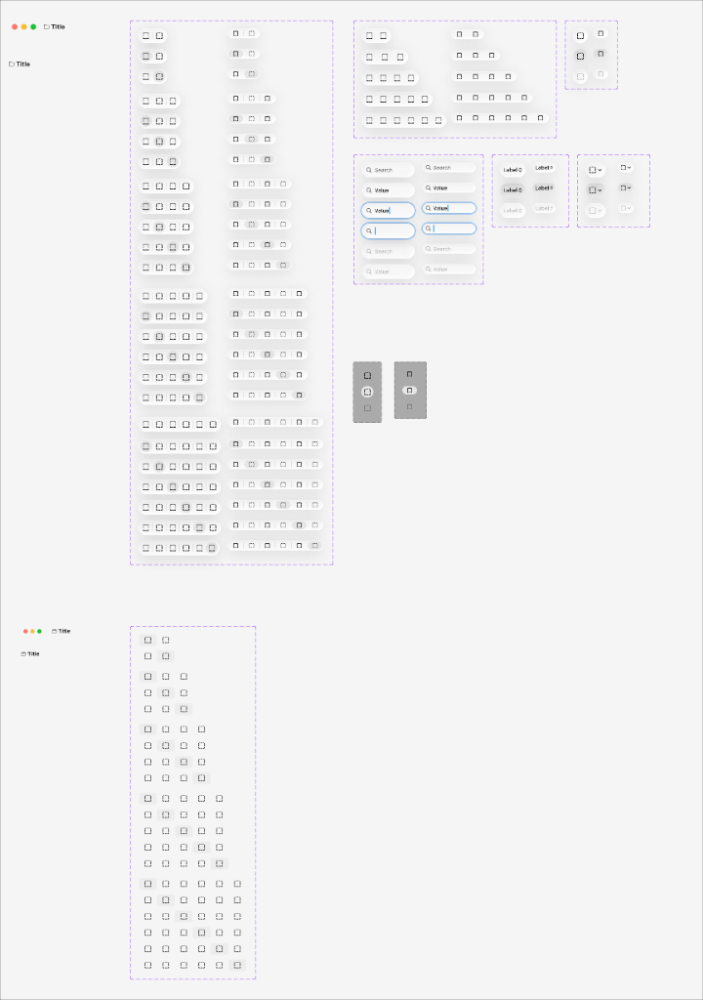

# Apple HIG Toolbars System — macOS Admin Specification

> *"A toolbar provides convenient access to frequently used commands, controls, navigation, and search. A toolbar appears at the top of a window, below or integrated with the title bar, and contains controls that relate to the current view or document."*  
> — **Apple Human Interface Guidelines (Toolbars)** ([developer.apple.com/design/human-interface-guidelines/toolbars](https://developer.apple.com/design/human-interface-guidelines/toolbars))

Dokumen ini mendefinisikan standar resmi implementasi **Toolbars (`NSToolbar`)** pada macOS Tahoe UI Kit, integrasi Titlebar & Traffic Lights, arsitektur **Monobar (Unified Titlebar & Toolbar)**, pengelompokan tombol aksi (*action groups*), kontrol bersegmen (*segmented controls*), integrasi pencarian langsung (*pill search field*), dropdown aksi massal (*pull-down buttons*), spacer fleksibel, serta penerapannya pada seluruh panel navigasi backend/admin MobiCare.

---

## 1. Analisis Aset Referensi Visual Apple Design Resources (Ref 65)



Aset master Apple Design Resources di atas memperlihatkan ekosistem terlengkap komponen toolbar macOS Tahoe:

### A. Anatomi & Struktur Spasial Toolbar macOS
1. **Leading Edge (Sisi Kiri)**:
   - Tombol Traffic Lights (Close `#FF5F56`, Minimize `#FFBD2E`, Zoom `#27C93F`).
   - Tombol Toggle Sidebar `[ |]` (untuk menyembunyikan/menampilkan panel navigasi kiri).
   - Tombol riwayat navigasi `< >` dalam satu pill segmented beradius bulat.
2. **Center Area (Area Tengah)**:
   - **Document Proxy Icon & Judul Jendela**: Ikon dokumen/folder mikro bersanding dengan judul jendela tebal `📁 Title`. Di macOS native, proxy icon dapat diseret atau diklik-kanan untuk melihat path hierarki.
   - **Segmented View Switcher**: Pilihan tampilan data (Tampilan Ikon, Tampilan Tabel List, Tampilan Kolom Hierarkis).
3. **Trailing Edge (Sisi Kanan)**:
   - **Pill Search Field**: Kolom pencarian rounded `28px` dengan ikon kaca pembesar dan tombol hapus cepat `(x)`. Saat aktif, cincin fokus solid Apple Blue memancar `box-shadow: 0 0 0 3px rgba(0, 122, 255, 0.40)`.
   - **Action Item Groups**: Deretan tombol aksi mandiri (Tambah Item `+`, Hapus `🗑`, Bagikan `Share`, Tag Kategori, Filter).
   - **Pull-down Action Button**: Tombol dropdown dengan label dinamis dan panah tunggal `⌄` untuk menu tindakan massal.

---

### B. Varian Arsitektur: Dual-Bar vs Unified Monobar

| Parameter | Dual-Bar Toolbar (Klasik) | Unified Monobar (macOS Modern) |
| :--- | :--- | :--- |
| **Ketinggian Header** | `~52px - 60px` (Titlebar 24px + Toolbar 32px) | **`38px - 44px` (Satu Baris Terpadu)** |
| **Pemisah Garis** | Terdapat garis hairline horizontal antara titlebar & toolbar. | **Tanpa garis pemisah horizontal (*seamless*)**. |
| **Pemanfaatan Ruang** | Mengorbankan ruang vertikal layar. | **Menghemat ruang vertikal secara drastis (*vertical space optimization*)**. |
| **Penerapan di MobiCare** | Modal form besar / Sheet dialog bertingkat. | **Layout utama tabel data admin `/admin/pricelist` & `/admin`**. |

---

## 2. Prinsip & Aturan Emas Desain Apple untuk Toolbars

### 1. Letakkan Perintah Paling Sering Digunakan (*Most-Used Commands*)
> **Aturan Mutlak Apple HIG**: Toolbar bukan tempat untuk menaruh seluruh fitur aplikasi. Hanya sediakan perintah yang relevan dengan konteks tampilan saat ini dan sering dieksekusi admin (seperti tombol Tambah Data, Filter Kategori, Ekspor, dan Pencarian).

### 2. Berikan Ikon SF Symbols yang Jelas & Konsisten
- Gunakan ikon glif simbolik Apple yang sudah dikenal universal: `magnifyingglass` (Cari), `plus` (Tambah), `trash` (Hapus), `square.and.arrow.up` (Ekspor/Share), `arrow.clockwise` (Refresh).
- Berikan tooltip deskriptif yang muncul saat mouse hover pada setiap tombol ikon tanpa teks.

### 3. Gunakan Flexible Spacer untuk Menjaga Keseimbangan
Toolbar macOS memanfaatkan *flexible space* (`flex-grow: 1`) untuk mendorong elemen navigasi dan tombol jendela ke kiri, sementara kolom pencarian dan tombol aksi sekunder berlabuh rapi di tepi kanan.

### 4. Responsif terhadap Lebar Jendela (*Window Resizing & Overflow*)
Saat admin mempersempit jendela browser:
- Kolom pencarian dapat mengecil menjadi tombol lingkaran ikon search (`Ref 46`).
- Tombol-tombol aksi sekunder yang terpotong otomatis masuk ke dalam menu luapan (*overflow chevron* `>>`) di ujung kanan toolbar.

---

## 3. Penerapan Nyata di Backend Admin MobiCare

| Kasus Penggunaan di MobiCare | Komponen / Halaman | Konfigurasi Toolbar | Elemen yang Disematkan |
| :--- | :--- | :--- | :--- |
| **Header Utama Manajemen Suku Cadang** | `/admin/pricelist` | **Unified Monobar 42px** | Traffic Lights + Toggle Sidebar `[ |]` + Judul `Katalog Suku Cadang` + Segmented Switcher (Semua / LCD / Baterai / Mesin) + Search Bar + Tombol `+ Tambah Servis`. |
| **Toolbar Pengelolaan Galeri & Media** | `/admin/gallery` | **Dual-Bar Toolbar** | Tombol navigasi `< >` + View Switcher (Grid / Detail) + Tombol `Upload Foto` + Tombol `Hapus Terpilih`. |
| **Header Modal Ekspor / Cetak Laporan** | `ExportModal.tsx` | **Compact Modal Toolbar** | Tombol Close `x` + Judul `Ekspor Laporan Servis` + Spacer + Tombol `Unduh Excel`. |
| **Toolbar Otorisasi & Riwayat Transaksi** | `/admin` (Dashboard) | **Monobar Toolbar** | Filter Rentang Tanggal (Segmented Control Hari Ini / Minggu Ini / Bulan Ini) + Tombol `Refresh Data` + Avatar Profil Admin. |

---

## 4. Arsitektur Token CSS macOS Toolbars

```css
/* ==========================================================================
   macOS Tahoe Toolbars System Tokens
   ========================================================================== */

:root {
  /* Toolbar Dimensions */
  --mac-toolbar-h-unified: 42px;
  --mac-toolbar-h-dual: 54px;
  --mac-toolbar-pad-x: 14px;

  /* Toolbar Glass Material */
  --mac-toolbar-bg: rgba(255, 255, 255, 0.82);
  --mac-toolbar-blur: blur(30px) saturate(180%);
  --mac-toolbar-border-b: 1px solid rgba(0, 0, 0, 0.10);

  /* Button Items inside Toolbar */
  --mac-toolbar-btn-h: 26px;
  --mac-toolbar-btn-radius: 5px;
  --mac-toolbar-btn-bg: transparent;
  --mac-toolbar-btn-hover: rgba(0, 0, 0, 0.06);
  --mac-toolbar-btn-active: rgba(0, 0, 0, 0.12);
  --mac-toolbar-btn-text: #1D1D1F;

  /* Traffic Lights */
  --mac-traffic-close: #FF5F56;
  --mac-traffic-min: #FFBD2E;
  --mac-traffic-zoom: #27C93F;
}

@media (prefers-color-scheme: dark) {
  :root {
    --mac-toolbar-bg: rgba(30, 30, 32, 0.78);
    --mac-toolbar-border-b: 1px solid rgba(255, 255, 255, 0.12);
    --mac-toolbar-btn-hover: rgba(255, 255, 255, 0.10);
    --mac-toolbar-btn-active: rgba(255, 255, 255, 0.18);
    --mac-toolbar-btn-text: #FFFFFF;
  }
}

/* Base Unified Toolbar */
.mac-toolbar {
  position: relative;
  display: flex;
  align-items: center;
  height: var(--mac-toolbar-h-unified);
  padding: 0 var(--mac-toolbar-pad-x);
  background: var(--mac-toolbar-bg);
  backdrop-filter: var(--mac-toolbar-blur);
  -webkit-backdrop-filter: var(--mac-toolbar-blur);
  border-bottom: var(--mac-toolbar-border-b);
  user-select: none;
  z-index: 40;
}

/* Traffic Lights Container */
.mac-traffic-lights {
  display: flex;
  align-items: center;
  gap: 8px;
  margin-right: 14px;
}

.mac-traffic-dot {
  width: 12px;
  height: 12px;
  border-radius: 50%;
  border: 0.5px solid rgba(0, 0, 0, 0.15);
}

.mac-traffic-close { background: var(--mac-traffic-close); }
.mac-traffic-min { background: var(--mac-traffic-min); }
.mac-traffic-zoom { background: var(--mac-traffic-zoom); }

/* Toolbar Title */
.mac-toolbar-title {
  display: flex;
  align-items: center;
  gap: 6px;
  font-size: 13px;
  font-weight: 600;
  color: var(--mac-toolbar-btn-text);
  white-space: nowrap;
}

/* Flexible Spacer */
.mac-toolbar-spacer {
  flex-grow: 1;
}

/* Toolbar Action Button */
.mac-toolbar-btn {
  display: inline-flex;
  align-items: center;
  justify-content: center;
  gap: 5px;
  height: var(--mac-toolbar-btn-h);
  padding: 0 8px;
  font-size: 12px;
  font-weight: 500;
  color: var(--mac-toolbar-btn-text);
  background: var(--mac-toolbar-btn-bg);
  border-radius: var(--mac-toolbar-btn-radius);
  border: 1px solid transparent;
  outline: none;
  cursor: pointer;
  transition: background-color 0.1s ease, transform 0.08s ease;
}

.mac-toolbar-btn:hover {
  background: var(--mac-toolbar-btn-hover);
}

.mac-toolbar-btn:active {
  background: var(--mac-toolbar-btn-active);
  transform: scale(0.97);
}

.mac-toolbar-btn:focus-visible {
  box-shadow: 0 0 0 2.5px rgba(0, 122, 255, 0.45);
}
```

---

## 5. Komponen React TSX Toolbar Standar macOS

```tsx
// components/admin/ui/MacToolbar.tsx
"use client";

import React from "react";
import { 
  SidebarIcon, 
  MagnifyingGlassIcon, 
  PlusIcon, 
  ArrowPathIcon 
} from "@heroicons/react/20/solid";

export interface MacToolbarProps {
  title?: string;
  icon?: React.ReactNode;
  onToggleSidebar?: () => void;
  searchQuery?: string;
  onSearchChange?: (val: string) => void;
  onRefresh?: () => void;
  onAddItem?: () => void;
  children?: React.ReactNode;
}

export function MacToolbar({
  title = "MobiCare Service Manager",
  icon,
  onToggleSidebar,
  searchQuery,
  onSearchChange,
  onRefresh,
  onAddItem,
  children,
}: MacToolbarProps) {
  return (
    <header className="mac-toolbar">
      {/* 1. Leading: Traffic Lights & Toggle Sidebar */}
      <div className="mac-traffic-lights">
        <span className="mac-traffic-dot mac-traffic-close" title="Close" />
        <span className="mac-traffic-dot mac-traffic-min" title="Minimize" />
        <span className="mac-traffic-dot mac-traffic-zoom" title="Fullscreen" />
      </div>

      {onToggleSidebar && (
        <button
          type="button"
          onClick={onToggleSidebar}
          className="mac-toolbar-btn p-1 mr-2 text-neutral-600 dark:text-neutral-300"
          title="Toggle Sidebar"
        >
          <svg className="w-4 h-4" viewBox="0 0 16 16" fill="currentColor">
            <path d="M2 3a1 1 0 0 1 1-1h10a1 1 0 0 1 1 1v10a1 1 0 0 1-1 1H3a1 1 0 0 1-1-1V3zm4 1v8h7V4H6z" />
          </svg>
        </button>
      )}

      {/* 2. Window Title & Proxy Icon */}
      <div className="mac-toolbar-title">
        {icon && <span className="text-neutral-500">{icon}</span>}
        <span>{title}</span>
      </div>

      {/* 3. Center Children (misal: Segmented View Switcher) */}
      {children && (
        <div className="flex items-center gap-2 ml-4">
          {children}
        </div>
      )}

      {/* 4. Flexible Spacer */}
      <div className="mac-toolbar-spacer" />

      {/* 5. Trailing Controls: Search Bar & Actions */}
      <div className="flex items-center gap-2">
        {onSearchChange !== undefined && (
          <div className="relative flex items-center">
            <MagnifyingGlassIcon className="w-3.5 h-3.5 absolute left-2.5 text-neutral-400 pointer-events-none" />
            <input
              type="text"
              placeholder="Cari suku cadang..."
              value={searchQuery ?? ""}
              onChange={(e) => onSearchChange(e.target.value)}
              className="h-[26px] pl-8 pr-3 text-[12px] rounded-full bg-black/5 dark:bg-white/10 border border-black/10 dark:border-white/15 focus:outline-none focus:ring-2 focus:ring-[#007AFF] focus:bg-white dark:focus:bg-neutral-800 transition-all w-48"
            />
          </div>
        )}

        {onRefresh && (
          <button
            type="button"
            onClick={onRefresh}
            className="mac-toolbar-btn"
            title="Refresh Data"
          >
            <ArrowPathIcon className="w-3.5 h-3.5" />
          </button>
        )}

        {onAddItem && (
          <button
            type="button"
            onClick={onAddItem}
            className="mac-toolbar-btn bg-[#007AFF] text-white hover:bg-[#0062CC] font-semibold px-2.5"
            title="Tambah Data Baru"
          >
            <PlusIcon className="w-3.5 h-3.5 mr-1" />
            <span>Tambah</span>
          </button>
        )}
      </div>
    </header>
  );
}
```

---

## 6. Checklist Verifikasi Implementasi HIG

- [x] Mendukung arsitektur **Unified Monobar 42px** dengan material Liquid Glass translusen (`blur(30px)`).
- [x] Traffic Lights terintegrasi rapi di kiri atas dengan diameter 12px dan jarak 8px.
- [x] Judul jendela menyertakan proxy icon dan teks SF Pro 13px Bold.
- [x] Elemen diposisikan seimbang dengan flexible spacer (`flex-grow: 1`).
- [x] Integrasi kolom pencarian pill-shape dengan ikon `magnifyingglass` dan cincin fokus biru solid.
- [x] Tombol aksi memberikan umpan balik taktil saat ditekan (`transform: scale(0.97)`).
