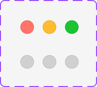
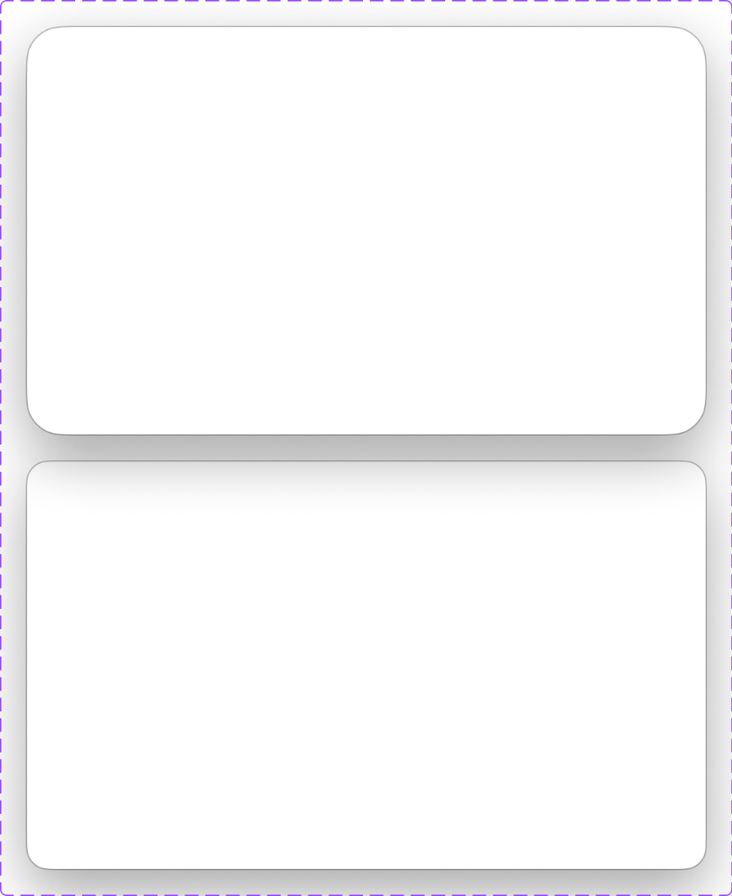
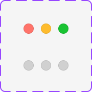
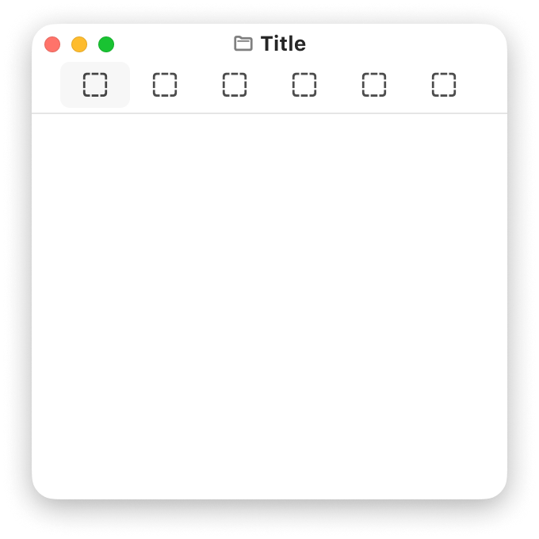

# Apple HIG Windows System — macOS Admin Specification

> *"A window presents UI views and components in your app or game. A window provides an enclosed area within which an app presents its content, controls, and other interface components. Windows can be minimized, resized, moved, and layered to help people organize their workspaces."*  
> — **Apple Human Interface Guidelines (Windows)** ([developer.apple.com/design/human-interface-guidelines/windows](https://developer.apple.com/design/human-interface-guidelines/windows))

Dokumen ini mendefinisikan standar resmi arsitektur dan implementasi **Windows (`NSWindow`)** pada macOS Tahoe UI Kit, geometri kanvas squircle 18px, hierarki bayangan ganda melayang (*multi-layer elevation drop shadow*), perilaku sadar status jendela (*Active Key Window vs Inactive Window*), spesifikasi kontrol Traffic Lights (Merah `#FF5F56`, Kuning `#FFBD2E`, Hijau `#27C93F`), Document Proxy Icon, serta penerapannya sebagai frame utama shell antarmuka backend/admin MobiCare.

---

## 1. Analisis Aset Referensi Visual Apple Design Resources (Ref 66 - 69)






Aset master Apple Design Resources di atas merangkum empat elemen fundamental struktur jendela macOS:

### A. Anatomi Kontrol Traffic Lights (Ref 66 & 68)
1. **Dimensi & Spasi Resmi**:
   - Diameter tiap tombol lingkaran: **`12px`**.
   - Jarak antar pusat tombol (*gap*): **`8px`**.
   - Margin posisi: `top: 13px; left: 14px;` dari sudut kiri atas frame jendela.
2. **Dua Status Sadar Jendela (*Window State Awareness*)**:
   - **Active Window (Baris 1)**:
     - Close (*Tutup*): Merah solid `#FF5F56`
     - Minimize (*Minimalkan*): Kuning solid `#FFBD2E`
     - Zoom (*Fullscreen*): Hijau solid `#27C93F`
   - **Inactive Window (Baris 2)**:
     - Ketika jendela kehilangan fokus (misal admin sedang mengeklik aplikasi lain di desktop), ketiga tombol meredup menjadi bulatan abu-abu monokromatik netral `rgba(0, 0, 0, 0.20)` (Light) atau `rgba(255, 255, 255, 0.20)` (Dark).
3. **Simbol Glif Mikro saat Hover**:
   - Saat kursor mouse melintas di atas area traffic lights, ketiga bulatan secara serempak menampilkan glif simbolik hitam semi-transparan:
     - Merah: Simbol silang mikro `✕`
     - Kuning: Simbol strip minus mikro `—`
     - Hijau: Simbol dua panah diagonal berlawanan `⤢` (atau panah `+` saat menahan `Option ⌥` untuk Zoom).

---

### B. Geometri Kontainer & Sistem Bayangan (Ref 67)
1. **Sudut Squircle Halus**:
   - Sudut luar jendela membulat dengan kurvatur kontinu (*continuous corner smoothing squircle*) beradius **`18px`** (atau `16px` pada panel kompak).
   - Garis tepi (*border outline*): Hairline `1px solid rgba(0, 0, 0, 0.12)` pada Light Mode dan `1px solid rgba(255, 255, 255, 0.15)` pada Dark Mode.
2. **Hierarki Bayangan Ganda Melayang (*Dual-Layer Elevation Shadow*)**:
   - **Layer 1 (Ambient Diffusion)**: `0 30px 90px rgba(0, 0, 0, 0.28)` memberikan ilusi jendela melayang tinggi di atas wallpaper desktop Tahoe.
   - **Layer 2 (Contact Occlusion)**: `0 4px 12px rgba(0, 0, 0, 0.10)` memberikan definisi ketegasan tepi di sekeliling jendela.
   - Pada jendela inaktif, bayangan berkurang densitasnya menjadi `0 15px 45px rgba(0, 0, 0, 0.18)` untuk menandakan kedalaman hierarki z-index.

---

### C. Anatomi Lengkap macOS Window Frame (Ref 69)
1. **Header Bar / Titlebar (`height: ~42px - 50px`)**:
   - Sisi Kiri: Traffic Lights.
   - Tengah: Document Proxy Icon (`📁`) dan Judul Jendela SF Pro 13px Semibold (`Title`).
   - Sisi Kanan: Action Buttons container (slot tombol fungsi terpadu).
2. **Hairline Separator (`0.5px - 1px`)**: Garis batas horizontal sangat halus memisahkan titlebar dari area kerja utama.
3. **Content Canvas (`White / Liquid Glass`)**: Latar belakang konten bersih berbalut kaca buram (*frosted glass*) berteknologi saturasi `saturate(180%)`.

---

## 2. Prinsip & Aturan Emas Desain Apple untuk Windows

### 1. Pertahankan Sensitivitas Fokus Jendela (*Window State Fidelity*)
> **Aturan Mutlak Apple HIG**: Pengguna harus dapat mengetahui secara instan jendela mana yang sedang aktif menerima input. Jendela aktif menampilkan traffic lights berwarna cerah dan bayangan tebal, sedangkan jendela inaktif meredupkan traffic lights menjadi abu-abu dan mengurangi kedalaman bayangan.

### 2. Sediakan Judul yang Jelas & Relevan
- Judul jendela harus mencerminkan entitas data yang sedang dibuka, misalnya `"iPhone 15 Pro Max — Katalog Servis"` atau `"Faktur #INV-2026-1048"`.
- Gunakan Document Proxy Icon di samping judul untuk menegaskan konteks tipe data.

### 3. Responsif & Mendukung Manajemen Ruang
- Jendela harus dapat dimaksimalkan (*zoom*) atau dialihkan ke mode layar penuh (*fullscreen*) secara mulus tanpa distorsi tata letak.
- Jendela harus memiliki batasan ukuran minimum (*minimum window constraint*) yang mencegah kontrol toolbar terpotong secara canggung.

---

## 3. Penerapan Nyata di Backend Admin MobiCare

| Kasus Penggunaan di MobiCare | Komponen / Halaman | Konfigurasi Jendela | Fitur Jendela |
| :--- | :--- | :--- | :--- |
| **Shell Utama Aplikasi Admin** | `app/admin/layout.tsx` | **Main App Window (1440px / Responsive)** | Traffic Lights aktif, Proxy Icon MobiCare , Sidebar kiri terintegrasi, Monobar toolbar terpadu. |
| **Modal Sheet Tambah Servis** | `components/admin/ServiceEditorSheet.tsx` | **Attached Window Sheet** | Melekat di bawah titlebar jendela utama dengan sudut `22px` dan backdrop dimming. |
| **Inspector Rincian Suku Cadang** | `components/admin/ItemInspector.tsx` | **Compact Utility Panel (380px × 480px)** | Window utilitas melayang dengan traffic lights kompak, muncul saat admin menekan `Spacebar` pada baris tabel. |
| **Dialog Konfirmasi Void Nota** | `components/admin/ConfirmModal.tsx` | **Alert Modal Window (320px)** | Dialog terisolasi dengan fokus terkunci (*focus trap*) dan tombol aksi bertumpuk. |

---

## 4. Arsitektur Token CSS macOS Windows

```css
/* ==========================================================================
   macOS Tahoe Windows System Tokens
   ========================================================================== */

:root {
  /* Window Canvas & Geometry */
  --mac-window-radius: 18px;
  --mac-window-border: 1px solid rgba(0, 0, 0, 0.12);
  --mac-window-bg: #FFFFFF;
  --mac-window-bg-translucent: rgba(255, 255, 255, 0.82);

  /* Dual-Layer Window Shadows */
  --mac-window-shadow-active: 0 30px 90px rgba(0, 0, 0, 0.28), 0 4px 12px rgba(0, 0, 0, 0.10);
  --mac-window-shadow-inactive: 0 15px 45px rgba(0, 0, 0, 0.18), 0 2px 6px rgba(0, 0, 0, 0.06);

  /* Traffic Lights Dimensions */
  --mac-traffic-size: 12px;
  --mac-traffic-gap: 8px;

  /* Traffic Lights Colors - Active */
  --mac-traffic-close: #FF5F56;
  --mac-traffic-min: #FFBD2E;
  --mac-traffic-zoom: #27C93F;

  /* Traffic Lights Colors - Inactive */
  --mac-traffic-inactive: rgba(0, 0, 0, 0.20);
}

@media (prefers-color-scheme: dark) {
  :root {
    --mac-window-border: 1px solid rgba(255, 255, 255, 0.15);
    --mac-window-bg: #1E1E20;
    --mac-window-bg-translucent: rgba(30, 30, 32, 0.78);
    --mac-window-shadow-active: 0 30px 90px rgba(0, 0, 0, 0.65), 0 4px 12px rgba(0, 0, 0, 0.35);
    --mac-window-shadow-inactive: 0 15px 45px rgba(0, 0, 0, 0.45), 0 2px 6px rgba(0, 0, 0, 0.20);
    --mac-traffic-inactive: rgba(255, 255, 255, 0.22);
  }
}

/* Base macOS Window Container */
.mac-window-frame {
  position: relative;
  display: flex;
  flex-direction: column;
  border-radius: var(--mac-window-radius);
  border: var(--mac-window-border);
  background: var(--mac-window-bg);
  box-shadow: var(--mac-window-shadow-active);
  overflow: hidden;
  transition: box-shadow 0.2s ease, border-color 0.2s ease;
}

.mac-window-frame.is-inactive {
  box-shadow: var(--mac-window-shadow-inactive);
}

/* Traffic Lights Group */
.mac-traffic-group {
  display: flex;
  align-items: center;
  gap: var(--mac-traffic-gap);
  cursor: pointer;
}

.mac-traffic-btn {
  position: relative;
  width: var(--mac-traffic-size);
  height: var(--mac-traffic-size);
  border-radius: 50%;
  border: 0.5px solid rgba(0, 0, 0, 0.15);
  display: flex;
  align-items: center;
  justify-content: center;
  transition: opacity 0.15s ease, background-color 0.15s ease;
}

.mac-traffic-btn::after {
  content: "";
  opacity: 0;
  font-size: 8px;
  font-weight: 700;
  color: rgba(0, 0, 0, 0.6);
  line-height: 1;
  transition: opacity 0.1s ease;
}

/* Hover Glyphs */
.mac-traffic-group:hover .mac-traffic-btn::after {
  opacity: 1;
}

.mac-traffic-close { background-color: var(--mac-traffic-close); }
.mac-traffic-close::after { content: "✕"; }

.mac-traffic-min { background-color: var(--mac-traffic-min); }
.mac-traffic-min::after { content: "—"; font-size: 7px; }

.mac-traffic-zoom { background-color: var(--mac-traffic-zoom); }
.mac-traffic-zoom::after { content: "⤢"; font-size: 7px; }

/* Inactive State */
.mac-window-frame.is-inactive .mac-traffic-btn {
  background-color: var(--mac-traffic-inactive) !important;
}

.mac-window-frame.is-inactive .mac-traffic-group:hover .mac-traffic-btn::after {
  opacity: 0;
}
```

---

## 5. Komponen React TSX Window Frame Standar macOS

```tsx
// components/admin/ui/AdminWindowFrame.tsx
"use client";

import React, { useState, useEffect } from "react";

export interface AdminWindowFrameProps {
  title?: string;
  proxyIcon?: React.ReactNode;
  toolbarSlot?: React.ReactNode;
  children: React.ReactNode;
  className?: string;
  onClose?: () => void;
  onMinimize?: () => void;
  onFullscreen?: () => void;
}

export function AdminWindowFrame({
  title = "MobiCare Service Hub",
  proxyIcon,
  toolbarSlot,
  children,
  className = "",
  onClose,
  onMinimize,
  onFullscreen,
}: AdminWindowFrameProps) {
  const [isActive, setIsActive] = useState(true);

  // Monitor window focus state
  useEffect(() => {
    const handleFocus = () => setIsActive(true);
    const handleBlur = () => setIsActive(false);

    window.addEventListener("focus", handleFocus);
    window.addEventListener("blur", handleBlur);

    return () => {
      window.removeEventListener("focus", handleFocus);
      window.removeEventListener("blur", handleBlur);
    };
  }, []);

  return (
    <div className={`mac-window-frame ${!isActive ? "is-inactive" : ""} ${className}`}>
      {/* Titlebar Header */}
      <div className="relative flex items-center justify-between h-[42px] px-3.5 bg-neutral-100/80 dark:bg-neutral-800/80 backdrop-blur-md border-b border-black/10 dark:border-white/10 select-none">
        {/* Leading: Traffic Lights */}
        <div className="mac-traffic-group">
          <button
            type="button"
            onClick={onClose}
            className="mac-traffic-btn mac-traffic-close"
            title="Tutup Jendela"
          />
          <button
            type="button"
            onClick={onMinimize}
            className="mac-traffic-btn mac-traffic-min"
            title="Minimalkan Jendela"
          />
          <button
            type="button"
            onClick={onFullscreen}
            className="mac-traffic-btn mac-traffic-zoom"
            title="Layar Penuh"
          />
        </div>

        {/* Center: Title & Proxy Icon */}
        <div className="absolute inset-x-0 flex items-center justify-center pointer-events-none">
          <div className="flex items-center gap-1.5 text-[13px] font-semibold text-neutral-800 dark:text-neutral-200">
            {proxyIcon && <span className="opacity-70">{proxyIcon}</span>}
            <span>{title}</span>
          </div>
        </div>

        {/* Trailing: Custom Toolbar Slot */}
        <div className="relative z-10 flex items-center gap-2">
          {toolbarSlot}
        </div>
      </div>

      {/* Main Content View */}
      <div className="flex-1 overflow-auto bg-white dark:bg-neutral-900">
        {children}
      </div>
    </div>
  );
}
```

---

## 6. Checklist Verifikasi Implementasi HIG

- [x] Kontainer jendela memiliki radius squircle **18px** dengan garis pembatas hairline `1px`.
- [x] Hierarki bayangan ganda melayang (*multi-layer elevation drop shadow*) dengan pembeda tegas antara jendela aktif dan jendela inaktif.
- [x] Traffic Lights 12px dengan jarak 8px mendukung glif hover mikro (`✕`, `—`, `⤢`).
- [x] Traffic lights otomatis meredup menjadi abu-abu saat browser kehilangan fokus (*window blur event*).
- [x] Titlebar menyertakan Document Proxy Icon dan judul tebal SF Pro 13px.
- [x] Area konten bebas dari glitch overflow dan terisolasi rapi di dalam frame.
